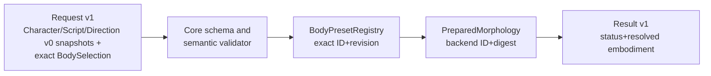

# Performance Contract v1 — exact selectable embodiment (CC-A1)

**Status: DRAFT, not published/adopted; not an audio or physics capability.** Implementation PR and tests are independently gated under [Core #72](https://github.com/ryonakayama234/morphoacoustics/issues/72). Upstream Body Binding v0 and Performance Contract v0 remain unchanged.

## Formal composition and ownership



- **v1 envelope, v0 creative snapshots.** Top-level `schema_version` is `performance-contract/v1`; embedded `CharacterSpec`, `Script` and `Direction` remain *exact, independent, unchanged* `performance-contract/v0` snapshots referenced via JSON Schema. This avoids duplicating or silently redefining creator-facing semantics. A future version may separately upgrade creative snapshots.
- Request `embodiment = {preset_id, preset_revision}`, exact revision integer `>=1`; never `latest`, no physical geometry or pressure in creator fields.
- Resolution `embodiment.status` is `BOUND`, `MISSING_PRESET`, `REVISION_MISMATCH` or `UNSUPPORTED_BACKEND`. When and only when `BOUND`, result stores exact `preset_id`, `preset_revision`, `backend_id`, `preparation_digest` (actual Core body binding). Status is *not* job lifecycle or physical realization; `job_status=SUCCEEDED` and `realization_outcome=INFEASIBLE` remain valid for a body that **was** successfully bound.
- v1 request+result JSON Schemas are under `contracts/performance/v1`, Draft 2020-12; v0 files are untouched. The source helper `integration/performance_v1.py` only resolves exact prevalidated Core presets, never synthesizes a body, waveform, or approximate fallback.
- The v1 fixture uses illustrative `sha256` values and `UNSUPPORTED` with no audio: **not** a claim that a validated live two-body adapter exists or was executed.

## Digest and historical Takes

`input_digest_algorithm=sha256-canonical-json-v1`: SHA-256 over `json.dumps({request: <full validated v1 request>, backend_id: <exact backend>, backend_version: <exact version>}, sort_keys=True, ensure_ascii=False, separators=(',', ':'), allow_nan=False)`, UTF-8 encoding. All input snapshots, seed, exact body revision and adapter identity are included. Canonicalization handles JSON types as encoded (it does not normalize 1 vs 1.0); request serialization is included in the contract. This digest describes request+adapter input, **not** prepared physical state.

`preparation_digest` is separately created by the authoritative `BodyPresetRegistry` / Core `PreparedMorphology` binding, not calculated from user free-form character text. Saved Takes retain both request and result snapshots. Replacing/upgrading the catalog later must not mutate a historical Take or retarget it to a newer preset revision. Missing/mismatched preset returns a typed status; no implicit substitute.

## Rejection/status taxonomy

Malformed v1 request is **INVALID**, validated request with missing ID is **MISSING_PRESET**, known ID at a missing revision is **REVISION_MISMATCH**, compatible ID/revision at wrong backend is **UNSUPPORTED_BACKEND**. A bound body may still receive realization **UNSUPPORTED**, **INFEASIBLE**, or **FEASIBLE**; task execution can separately be **FAILED**. These states must not be conflated. No unrestricted morphology editing or geometry interpolation exists.

## Acceptance and limits

- Validate v1 request and result fixtures, structural negative controls, missing/latest/bool/zero revision rejection and correct schema registry references.
- Verify unchanged v0 request/result fixtures; input digest varies by selected body exact revision and backend version, while stable repeats match.
- Resolve two extant validated Core `BodyPreset` fixtures; preserve immutable earlier binding and digests across later catalog revision; typed missing, mismatch, incompatible status without fallback.
- For `SUCCEEDED, FEASIBLE/INFEASIBLE`, require `BOUND` with all four physical identity values; prevent false resolved physical digest on unsuccessful binding.
- Run both JSON Schema and runtime semantic tests, mypy and generic CI across supported Python versions and pin results to exact commit SHA.
- This **contract-level pass cannot authorize a Studio two-body physical audio demo**. Studio #14 must show actual backend capability and can use supported trace-only evidence without inventing WAV.

## Files

```text
contracts/performance/v1/
  common.schema.json
  performance-request.schema.json
  performance-result.schema.json
  examples/request.json
  examples/result.fixture.json
  examples/result.revision-mismatch.json
src/morphoacoustics/integration/performance_v1.py
tests/test_performance_contract_v1.py
docs/performance-contract-v1.md
```

Existing [architecture/data proposal](./research/organ-graph-program.md) and [execution plan](./research/organ-graph-execution-plan.md) track the cross-work-package status; research physics remains independent of this contract.
