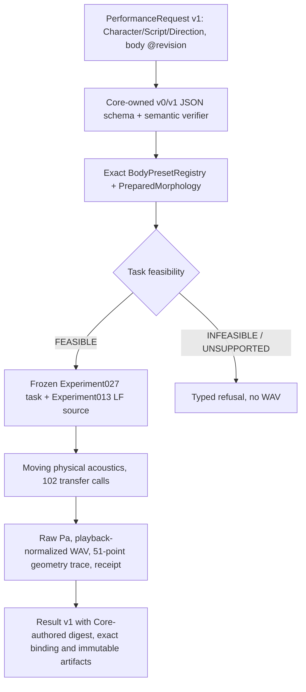

# CC-A2 — bounded two-body live integration (review candidate)

**Status: IN DEVELOPMENT / NOT ADOPTED / Core physics and Studio product gates pending.**

Parent: [Studio #14](https://github.com/ryonakayama234/morphoacoustics-studio/issues/14). Reuse adopted Core [Experiment 027](../../experiments/027_task_field_vowel_transition/RESULTS.md), [Experiment 028](../../experiments/028_task_field_morphology_transfer/RESULTS.md), [Experiment 029](../../experiments/029_task_field_embodied_infeasibility/RESULTS.md). Core [PR #101](https://github.com/ryonakayama234/morphoacoustics/pull/101) / Issue #72 was **LIMITED contract adopted and merged** on 2026-10-19 (main commit 5ee26470). Existing README and contract v1 documentation's historical DRAFT text must not be read as the current git release state.

## Hypothesis / physical intervention

Apply the **same frozen 3-task /a/-like→/i/-like motor program**, the same LF source F0=100Hz, and the same 0.5-second moving-acoustic calculation to exactly two body conditions:

| Exact preset | Section length | Total length | Same source/tasks? |
| --- | ---: | ---: | --- |
| v3b-axial-M0@1 | 0.010m ×16 | 0.160m | Yes |
| v3b-axial-M1@1 | 0.011m ×16 | 0.176m | Yes |

The 16 section cross-sectional areas remain equal. Both include the fixed permissive Experiment029 articulator envelope with reach_end=0.75. Their new PreparedMorphology provenance correctly identifies the combination of a validated Experiment028 axial geometry and the Experiment029 capability wrapper. They are **not claimed to be byte-identical to the old Experiment028 prepared objects**.

Frozen independent Wolfram Experiment028 reference endpoint peaks are M0 (275.00, 2101.75) Hz and M1 (249.75, 1910.75) Hz. The bounded runner must compare against that frozen oracle without updating numerical values. The baseline M0 raw pressure is also checked against Experiment029's quantized 1e-9Pa waveform SHA256. M1 produces a new physical waveform; there is no independently pre-adopted M1 pressure SHA, so test its numerical shape, physical origin and distinct output without claiming it is a separately validated biological voice.

Expected scientific statements: body length changes resonances; normalized task program and source are unchanged. Human perceptual discrimination and phonetic correctness remain untested.

## Data flow

Core source: `tools/cc_a2_live.py`. This is an **uninstalled checkout-local candidate** to avoid editing the frozen X2a `src/morphoacoustics` inventory. Reuses `limited_live._load_audited_experiment()` and its Git-blob/NumPy/Wolfram preflight. Does not replace or change X2a.

Request and result must pass the upstream v1 JSON Schemas. The Python Core-side `semantic_validation.py` issues `sha256-canonical-json-v1`; Studio must not assert JavaScript JSON canonical byte equivalence. Result includes exact chosen preset revision, backend and preparation digest. Core emits WAV (normalized for listening) separate from raw NPY pressure (Pa); only raw Pa can support physics measurement. Completion marker `result.json` is installed last in a new output directory, never overwritten.

A malformed v1 request is INVALID and produces no Take. Schema-valid unknown/revision-mismatched preset is an explicit binding refusal and UNSUPPORTED realization. Unsupported script/Direction/seed is UNSUPPORTED, not INFEASIBLE. Realization INFEASIBLE is reserved for a **bound** body failing capability. Process failure remains FAILED. No silent replacement body, pre-rendered audio or neural voice conversion.

## Current validation and adoption prerequisites

- [ ] Dedicated `.github/workflows/cc-a2-two-body.yml` on exact PR HEAD: NumPy==2.4.6, both fresh real 24,000-sample voices, 102 acoustic calls each, Wolfram endpoint peak gate, frozen M0 pressure SHA, distinct M1 pressure, exact v1 binding, no-fallback and repeatable Take hashes.
- [ ] Source inventory compatibility: existing X2a regression and full Core test suite.
- [ ] Independent physical/numerical and data-contract review; record auditor independence, negative controls and exact SHA.
- [ ] Studio #14 separately integrates pinned Core and independently verifies artifacts, selection/persistence, browser playback, and status taxonomy.
- [ ] Windows/WSL2 creator audible A/B pilot; report subjectivity separately from physics.
- [ ] Explicit GO_LIMITED/HOLD/REJECT after all gates. No merge without review.

This integration uses already studied physical laws; it does not establish new FSI, real tissue dynamics, natural Japanese, or generalized body editing.

## 2026-10-19 critical Codex review finding disposition — pending re-review

Initial Draft PR #122 reviewed HEAD `588c52c` returned P1 (inherited `limited_live.py` module itself was outside its own frozen transitive inventory), P2 (malformed CLI failures pretended to be incomplete `PerformanceResult v1`), and P2 (a requested `gesture_trace` falsely advertised as satisfied). The following corrections are **code candidate, not approved**:

- CC-A2 verifies the exact adopted Git blob of `src/morphoacoustics/integration/limited_live.py` **before importing** it; rejects checksum drift without synthesizing. Existing Experiment028/029 pinned source and oracle preflight remains intact.
- Unhandled execution failures return nonzero process exit and an explicitly separate `cc-a2-transport-error/v1` JSON envelope `{schema_version,error:{code,message}}`; **not** a valid PerformanceResult v1. Studio treats failed CLI execution as an error, with no Take. Valid schema requests with binding/feasibility refusals still produce valid v1 outcomes with no audio.
- `gesture_trace` is rejected `UNSUPPORTED` because this slice only emits physical geometry trace and source/task receipt, not a separately contracted gesture-trace artifact.
- New reproducible tests cover borrowed/changed inherited source pin, unsupported `gesture_trace`, and malformed request transport error without audio.

**No Gate C signoff before exact repaired HEAD CI and independent re-review.**
