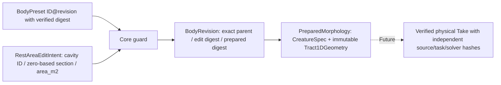

# DATA — experimental single-rest-area BodyRevision candidate

**NOT a public performance contract.** All area and lengths are in SI; editor pixels/decoration cannot enter prepared-geometry identity.

## Candidate typed fields
`RestAreaEditIntent`: `base_preset_id`, `base_revision` (strict positive integer), `base_preparation_digest`, `cavity_id`, `section_index` (strict 0..15), `area_m2` (finite >0).

`BodyRevision`: `revision_id` (content-derived, not user choice), exact parent ID/revision/digest, edit section/before/after areas, `edit_digest`, `preparation_digest`, and prepared object. `receipt()` serializes only a *proposal receipt*; it is not yet an authenticated persisted artifact or external contract.

`RevisionResult`: `ACCEPTED`, `INVALID`, `UNSUPPORTED`, `REVISION_MISMATCH`; `NUMERICALLY_UNRESOLVED` reserved for a future physical numerical gate and is not emitted without evidence. Physical `INFEASIBLE` applies only after task execution, not during this rest-geometry preparation. Runtime `FAILED` belongs to a later service boundary.

## Safety/capability proposal, NOT certified limits
- Exactly 16 × 0.01m serial sections; one isolated cavity, no cavity branching.
- One exact section's *rest* `area_m2`, prototype trial window 0.90–1.10 × corresponding **parent** section area. Bounds are provisional exploration constraints, **not certified biomechanical safety**.
- Parent is independently content-hashed before derivation. Null edits, malformed, NaN/Inf, nonpositive, wrong section/base/digest, out-of-range and unsupported graph never create new bodies.
- Every acceptance returns a fresh immutable prepared state; original `BodyPreset` and existing audio/creative Character remain unmodified.
- Digests use SHA-256 over sorted compact JSON (edit input domain and existing Core prepared-payload domain). They provide reproducibility and accidental-change detection, not signed/authenticated origin. Trust requires controlled storage/service.
- Exact source, GestureScore, seed, solver SHA, raw-Pa SHA, Studio adapter SHA, playback gain and evaluation data must live in **Take provenance** later, not be hidden inside body identity.

## Schema adoption hold
Before external release, freeze canonical numeric precision/rounding, accepted baseline whitelist, detailed failure transport, collision/reload registry semantics, bounded source capability, and cross-repo version negotiation; never retrofit arbitrary area fields into v0/v1 request or bypass the Core authority.
