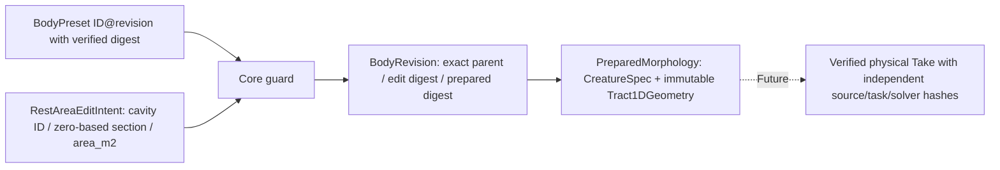

# DATA — experimental single-rest-area BodyRevision candidate

**NOT a public performance contract.** All area and lengths are in SI; editor pixels/decoration cannot enter prepared-geometry identity.

## Candidate typed fields
`RestAreaEditIntent`: `base_preset_id`, `base_revision` (strict positive integer), `base_preparation_digest`, `cavity_id`, `section_index` (strict 0..15), `area_m2` (finite >0).

`BodyRevision`: `revision_id` (content-derived, not user choice), exact parent ID/revision/digest, edit section/before/after areas, `edit_digest`, `preparation_digest`, and prepared object. `receipt()` serializes only a *proposal receipt*; it is not yet an authenticated persisted artifact or external contract.

`RevisionResult`: `ACCEPTED`, `INVALID`, `UNSUPPORTED`, `REVISION_MISMATCH`; `NUMERICALLY_UNRESOLVED` reserved for a future physical numerical gate and is not emitted without evidence. Physical `INFEASIBLE` applies only after task execution, not during this rest-geometry preparation. Runtime `FAILED` belongs to a later service boundary.

## Safety/capability proposal, NOT certified limits
- Exactly 16 × 0.01m serial sections; one isolated cavity, no cavity branching.
- One exact section's *rest* `area_m2`, prototype trial window 0.90–1.10 × corresponding **parent** section area. Bounds are provisional exploration constraints, **not certified biomechanical safety**.
- Parent is independently content-hashed before derivation. Null edits, malformed, NaN/Inf, nonpositive, wrong section/base/digest, out-of-range and unsupported graph never create new bodies.
- Every acceptance returns a fresh immutable prepared state; original `BodyPreset` and existing audio/creative Character remain unmodified.
- Digests use SHA-256 over sorted compact JSON (edit input domain and existing Core prepared-payload domain). They provide reproducibility and accidental-change detection, not signed/authenticated origin. Trust requires controlled storage/service.
- Exact source, GestureScore, seed, solver SHA, raw-Pa SHA, Studio adapter SHA, playback gain and evaluation data must live in **Take provenance** later, not be hidden inside body identity.

## Schema adoption hold
Before external release, freeze canonical numeric precision/rounding, accepted baseline whitelist, detailed failure transport, collision/reload registry semantics, bounded source capability, and cross-repo version negotiation; never retrofit arbitrary area fields into v0/v1 request or bypass the Core authority.

## Authority of prototype implementation
The prototype is held under `tools/cc_b1_revision.py` to avoid the frozen production source inventory; its `RestAreaEditIntent` and `BodyRevision` are experimental Python records, **not** a published cross-repo JSON schema. No Studio request may assume these classes are already part of an accepted contract.

## CC-B1 performer request candidate (2026-10-22)
Version `cc-b1-core-limited-performer/v1` is a standalone opt-in JSON boundary; request has exactly `schema_version`, `parent`, `edit`. Parent = `{preset_id:v3b-axial-M0, revision:1, preparation_digest:sha256:<64 hex>}`. Edit = `{cavity_id:oral-vowel-a-16x10mm, section_index:8, rest_area_ratio:"0.90"|"1.10"}`. Ratios are canonical **strings** at external interface, and are converted into SI `area_m2` by Core, with no client-supplied arbitrary audio gain/task/source. JSON schema is published as **candidate** `contracts/cc-b1/v1/core-limited-performer-request.schema.json`.
Output is a success `result.json` written last only after new two-body physics, archived `baseline_pa.npy`, `edited_pa.npy`, pair-shared-gain `baseline.wav`, `edited.wav`, two physical geometry traces, per-file SHA256, exact parent+revision+prepared hashes, source/task digest, Core checkout SHA and frozen Gate A/B science pins. Error statuses `INVALID/UNSUPPORTED/REVISION_MISMATCH/INFEASIBLE/NUMERICALLY_UNRESOLVED/FAILED` **never produce a completed Take**. A checksum is not a digital signature or authorization to trust unknown upstream data.

## Gate C v1 extended receipt and readback
Successful manifest now has `edit_intent` as a strictly accepted canonical profile and `body_revision` with exact immutable edit, so stored data can be compared against the verified CC-A2 M0/r1 baseline after restart. `verify_output_archive` rejects missing marker, unexpected file, linked/missing artifact, bytes/length mismatch, nonfinite pressure, wrong quantized oracle, wrong body digest/profile, and mismatched common playback audio. This is read-only checked evidence, NOT cryptographic origin authentication or app persistence.

## Gate C trust-audit amendment — 2026-10-22 (CANDIDATE)

A `BodyRevision` receipt is not authoritative merely because its fields look like 64-character SHA-256 strings. During archive reloading the Core reader now re-resolves **the frozen M0/r1 baseline** and reconstructs exactly the allowed zero-based site08 ratio 0.90 or 1.10 edit through Core's prototype binder. The *whole re-derived receipt* (`revision_id`, parent, edit, `edit_digest`, `preparation_digest`, backend) must equal the archived receipt. The fixed LF source hash, fixed task-plan hash, pinned Gate A/B references, rate/count/calls, expected artifact `kind/path/media_type`, and reconstructed baseline/edited geometry trace bytes must also match. JSON duplicate keys and nonstandard NaN/Infinity are rejected at the reader/CLI parser boundary. Symbolic filename aliases and symlinked parent paths are refused.

This is **content-consistency/authenticated-local-baseline verification**, *not* signer/producer authentication. The trusted process supplies the frozen source checkout and baseline registry; an untrusted filesystem writer may still cause race or denial of service. SHA-256 does not distinguish two actors who can rewrite both data and manifest; independently authenticated CI artifact provenance/attestation remains a separate requirement. No new `performance/v0` or `performance/v1` contract fields; no creator-written geometry can bypass the exact-body restriction.
