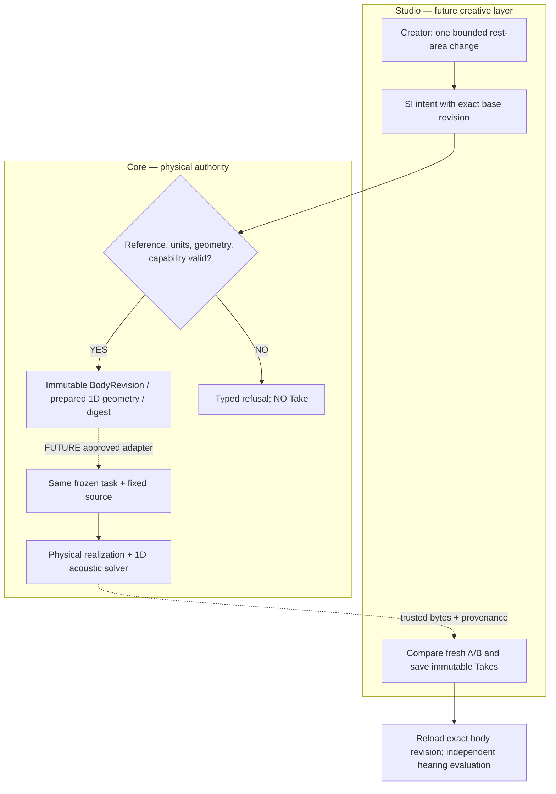
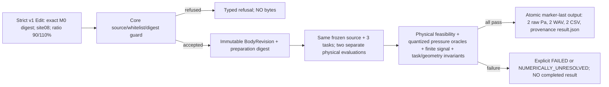
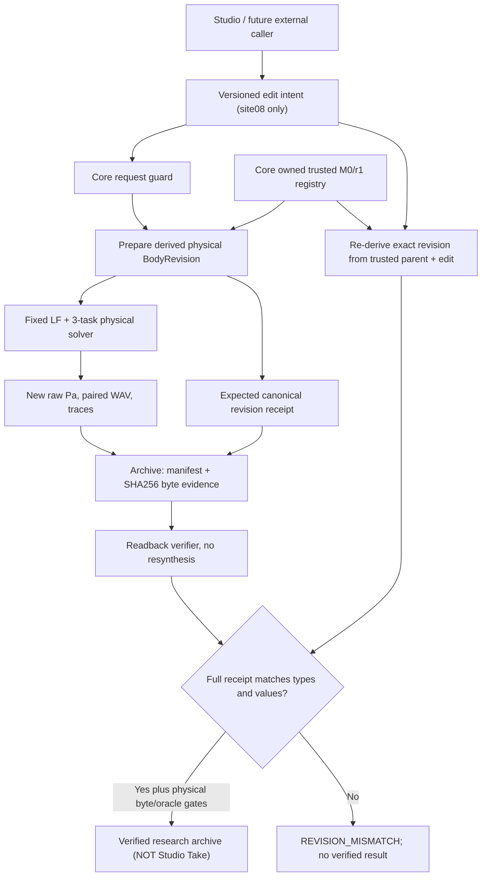

# SYSTEM — physical authority and creative loop

**Architecture under test; not a shipped editor.**

Implemented only: `RestAreaEditIntent → validate → BodyRevision + PreparedMorphology`, or explicit refusal. **Dashed arrows are future work; no sound is rendered by this prototype.**

## Causality and stable boundaries
- The **rest geometry** of one serial tract is edited; not a time-dependent constriction target, vocal effort, F0, equalizer, speech content or gain.
- Core uses existing `Tract1DGeometry`, `TubeSection`, `prepare_tract1d` and `preparation_digest`. Solver and CC-A2/X2a/performance contracts remain unmodified.
- Supports *only* one isolated `oral`-like cavity already identified in the prepared state, 16 rigid sections of 10mm; `cavity_id` is a semantic future organ-node anchor.
- **Future typed organ graph**: organ nodes must have physical boundary conditions; connector edges must specify physically validated pressure/flow/coupling laws. An organ ID alone does not implement cavity branching, 3D tissue/FSI or an acoustic port solver.
- SMC-1 accepts task/GestureScore at a separate interface later; ASMR contact/noise source is a separate validated organ and observer model later.
- Read model fidelity explicitly: current bounded backend is 1D serial; its sound may be buzzer-like; do not infer human anatomy or voice-naturalness.

## Integration hold
First ratify independent prospective Gate A and physics Gate B. Then introduce a versioned, additive Core registration/performer adapter; Studio must verify exact digest/bytes and preserve older Takes. The prototype alone cannot be used as a live v1 preset or as a truthful Studio Take.

## Frozen package regression discovered during implementation
Initial placement under `src/morphoacoustics/preparation/` correctly triggered the adopted limited-live *package source inventory* guard. We moved the candidate to `tools/cc_b1_revision.py` rather than weakening or rewriting the frozen-source policy. This is a Core-owned research tool, **not a callable stable module in the released package**. Public integration is postponed until independently audited versioned adoption.

## Gate C minimal versioned adapter — candidate, no Studio yet

The implementation is a separate `tools/` entrypoint due to legacy frozen source inventory; it deliberately does NOT change the original published package or v0/v1 contracts. It is not yet a stable `pip install` import API. No arbitrary motor/script selection and no fake Studio Take. Final Gate C adoption additionally needs reviewed trust boundary and persistence/version negotiation with Studio.

## Gate C readback validation boundary
Core's additive candidate now exposes `verify_output_archive(path)`: before allowing future Studio import it independently checks a **complete marker-last manifest**, exact artifact set, SHA256/length, raw finite float64 Pa content, quantized Gate B baseline/edit oracles, same-pair gain WAV reconstruction, exact base/edit reference, and a nonzero numerical pressure difference. It never treats a partial directory as a successful physical output. Digest/hash checking is NOT a digital signature of origin; an adversarial storage and full persisted revision registry remain Gate C product-adoption conditions.

## Gate C revision replay: archive authority repair (2026-10-22, Draft)

An archived audio payload hash validates stored bytes, **not** its asserted physical parent or derived body. Gate C readback must reconstruct the revision from a trusted Core baseline and canonical edit, then compare the *entire* serialized receipt.

The verification is a *replay of deterministic preparation* (not a replay of all 102 acoustic calls). The baseline registry still must be trusted by a controlled Core installation. Hashes alone cannot establish who authored a file or authorize an upstream package. Future stable CLI/service ABI, persisted revision store, O_NOFOLLOW/race hardening, end-to-end Studio Take handling and role-scoped authority remain separate Gate C work, not completed by this patch.
