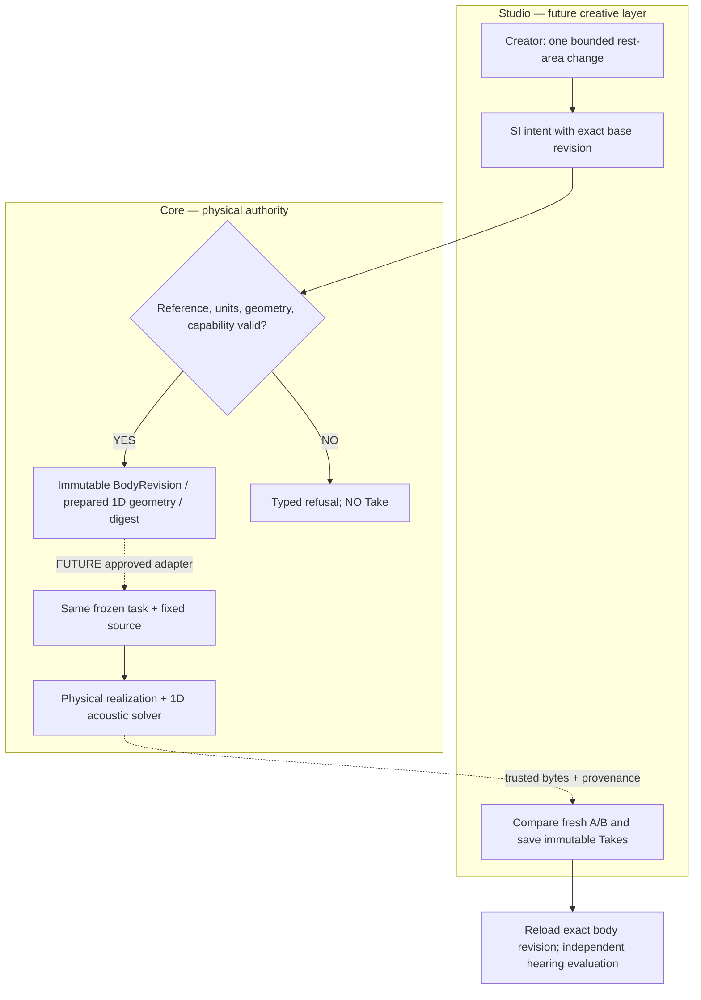

# SYSTEM — physical authority and creative loop

**Architecture under test; not a shipped editor.**

Implemented only: `RestAreaEditIntent → validate → BodyRevision + PreparedMorphology`, or explicit refusal. **Dashed arrows are future work; no sound is rendered by this prototype.**

## Causality and stable boundaries
- The **rest geometry** of one serial tract is edited; not a time-dependent constriction target, vocal effort, F0, equalizer, speech content or gain.
- Core uses existing `Tract1DGeometry`, `TubeSection`, `prepare_tract1d` and `preparation_digest`. Solver and CC-A2/X2a/performance contracts remain unmodified.
- Supports *only* one isolated `oral`-like cavity already identified in the prepared state, 16 rigid sections of 10mm; `cavity_id` is a semantic future organ-node anchor.
- **Future typed organ graph**: organ nodes must have physical boundary conditions; connector edges must specify physically validated pressure/flow/coupling laws. An organ ID alone does not implement cavity branching, 3D tissue/FSI or an acoustic port solver.
- SMC-1 accepts task/GestureScore at a separate interface later; ASMR contact/noise source is a separate validated organ and observer model later.
- Read model fidelity explicitly: current bounded backend is 1D serial; its sound may be buzzer-like; do not infer human anatomy or voice-naturalness.

## Integration hold
First ratify independent prospective Gate A and physics Gate B. Then introduce a versioned, additive Core registration/performer adapter; Studio must verify exact digest/bytes and preserve older Takes. The prototype alone cannot be used as a live v1 preset or as a truthful Studio Take.
