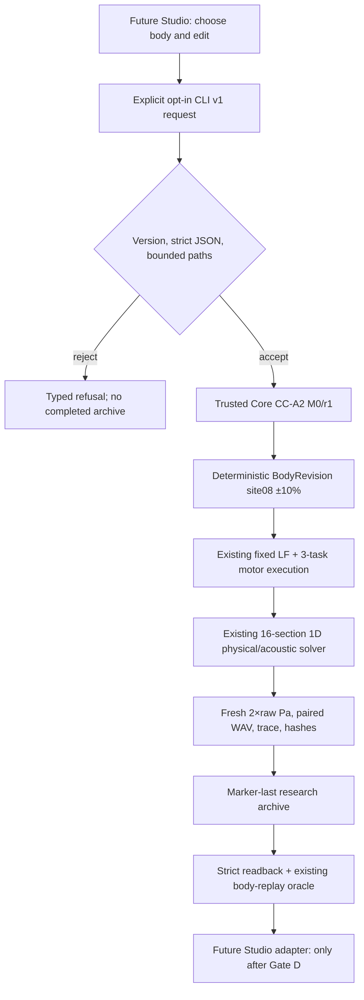

# SYSTEM — strict candidate CLI above trusted physical Core

The CLI owns **parsing, version negotiation, operation selection and a narrow filesystem preflight** only. It does not own physical law or change the solver. Baseline is resolved afresh from the Core-owned preparation registry. Inherited research performer `tools/cc_b1_limited_performer.py` remains the sole physical execution authority. A verified archive is **not** a Studio Take, authenticated signature, durable registry, natural voice, emitted SPL or human audibility.

Unsupported body/site/ratio/source/gesture and mismatched parent refuse. Only fixed baseline `v3b-axial-M0` revision 1, section 8, ratios `0.90`/`1.10` are scientifically bounded here. The CLI must not claim robust atomic writes under adversarial concurrent filesystem mutation. Rejecting existing symlinked ancestors is conservative preflight, **not** race-free openat/O_NOFOLLOW protection. Do not expose this CLI to untrusted network traffic.
