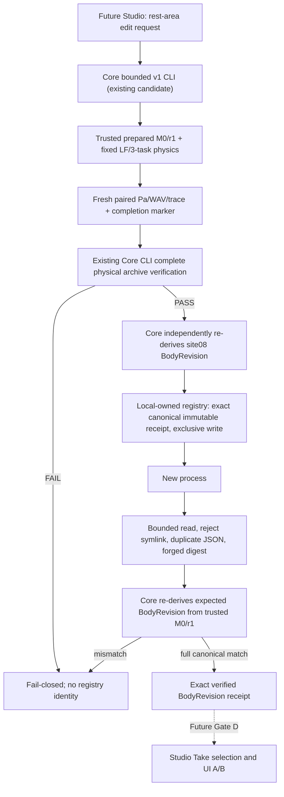

# SYSTEM — Creator to Core immutable identity path

**Physical authority never moves from Core.** Registry stores a deterministic identity receipt only, not audio, not solver state and not a new source. The existing immutable physical archive and Studio Take repository are separate stores. A user can reproduce a BodyRevision and select it by exact ID after a restart; a physical Take can reference its identity, but a registry entry does not itself prove any arbitrary Take was rendered.

Storage trust model is a trusted local single-user Core-managed directory with restricted filesystem permissions, no untrusted process capable of rewriting its contents. The implementation must create new records with exclusive creation and no replacement. Repeated identical revision under a different Take is *idempotent*, not a collision. The same revision ID with mismatched bytes fails closed. **Not a hostile concurrent-filesystem or networked service certification**: O_NOFOLLOW/dir-fd checks reduce exposure but cannot defend against an attacker already controlling the owner directory or same-UID process. Unexpected disk failures are non-success.

### A2 repair — no partially published canonical revision path

New registration writes a random owner-only `.stage-*` regular inode inside the trusted private `revisions` directory, flushes/fsyncs its complete bytes, then creates the final `<revision_id>.json` name using same-directory atomic no-overwrite hard-link and removes the staging name; fsyncs directory and re-reads canonical content before returning `REGISTERED`. `os.open(... O_NOFOLLOW)` and dir-fds restrict end-component redirection. Concurrent competing registration may return non-success during transient hard-link count 2; it must never publish two distinct identities. A failed stage/link/fsync cannot be reported as success. **This is fail-closed publication under tested fault injection, not a full crash-transactional or adversarial filesystem proof.** Crash/power loss can leave orphan `.stage-*` files that cannot be mistaken for a valid revision ID; cleanup/lock/recovery design is a future Gate. Multiuser and malicious ancestor symlinks/owner-level path swapping remain unsupported.
