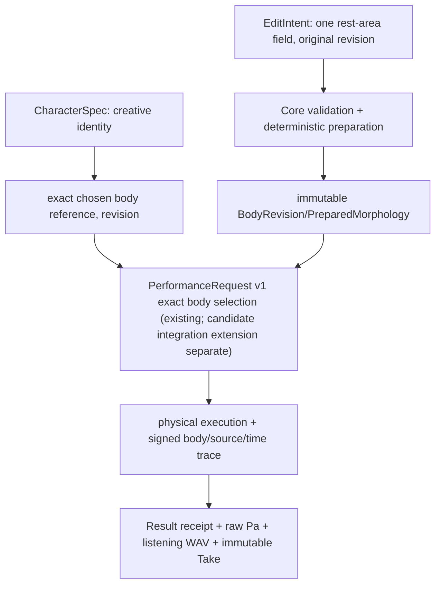

# CC-B1 — DATA / schema candidates (NOT A PUBLIC API)
**Status: proposed concepts; exact schema, canonical byte representation, units-range and digest domain require prospective Gate A review.**

## Ownership and versioning


**Candidate intent**, *not* endorsed concrete v1 JSON:
```yaml
proposal_schema: research.cc_b1.rest_area_edit.v0.candidate
base:
  id: exact_existing_body_id
  revision: 1
target:
  organ_id: vocal_tract
  rest_section: exact_index_to_freeze_at_gate_a
edit:
  kind: rest_cross_section_area
  area_m2: positive_finite_value_in_frozen_capability_envelope
provenance:
  user_edit_id: immutable_editor_draft_ref
```

A derived BodyRevision should contain exactly one changed **rest-area** value, inherited baseline geometry/section length/source-independent material definitions, solver-relevant semantic IDs, capability bounds and Core-calculated preparation digest. Store exact original recipe and numerical realized geometry separately. Canonical wave/time states, pressure and playback-normalized PCM do **not** enter immutable anatomy identity. UI node x/y positions and mere color/style are not morphology.

Current [Performance Contract v1](../../performance-contract-v1.md) resolves **prevalidated exact preset ID/revision**; arbitrary editor parameters are NOT in that request. Research must decide, as a separate additive contract, how a prepared *new immutable exact revision* becomes eligible for existing request/refusal semantics. Studio may neither manufacture Core preparation digests nor silently rebind old Takes. Frozen v0/X2a and CC-A2 need regression tests.

## Refusal taxonomy
- **INVALID:** syntactically malformed, non-finite/negative area, invalid structure/unit/index.
- **UNSUPPORTED:** structurally valid edit outside frozen backend capability or unsupported revision/source/program.
- **INFEASIBLE:** bound body cannot physically realize the requested task (only after valid binding).
- **NUMERICALLY_UNRESOLVED:** valid/nominally supported but conditioning/stability prevents defensible physical output.
- **FAILED:** runtime/infrastructure error (not a physical impossibility).
No invented WAV, substituted body, or partial apparently-successful immutable Take on refusal. Preserve source commit, Core/Studio adapter commit, exact body/shape/gesture/source/solver and artifact digests independently. Frozen spatial/timing/numerical domains are to be specified before confirmation.

## Bounded standalone run evidence (not public schema)
Experiment-local reference includes `area_ratio∈{0.90,1.00,1.10}` in **zero-based section 0 only**; data provenance records exact CC-A2/Experiment029 pinned source and independent reference peaks. Files when executed: `pressure_0.90.npy`, `pressure_1.00.npy`, `pressure_1.10.npy` (float64 Pa), `decision.json` (written last, hashes, plan/source, peak residuals, raw difference and model limitation). These are **not** `PerformanceResult` or immutable Studio Takes. Requested body edits remain unrepresentable in released v1 schema; no ABI changed.
