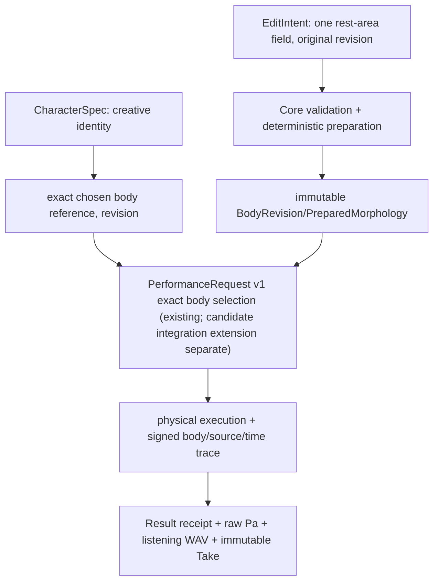

# CC-B1 — DATA / schema candidates (NOT A PUBLIC API)
**Status: proposed concepts; exact schema, canonical byte representation, units-range and digest domain require prospective Gate A review.**

## Ownership and versioning


**Candidate intent**, *not* endorsed concrete v1 JSON:
```yaml
proposal_schema: research.cc_b1.rest_area_edit.v0.candidate
base:
  id: exact_existing_body_id
  revision: 1
target:
  organ_id: vocal_tract
  rest_section: exact_index_to_freeze_at_gate_a
edit:
  kind: rest_cross_section_area
  area_m2: positive_finite_value_in_frozen_capability_envelope
provenance:
  user_edit_id: immutable_editor_draft_ref
```

A derived BodyRevision should contain exactly one changed **rest-area** value, inherited baseline geometry/section length/source-independent material definitions, solver-relevant semantic IDs, capability bounds and Core-calculated preparation digest. Store exact original recipe and numerical realized geometry separately. Canonical wave/time states, pressure and playback-normalized PCM do **not** enter immutable anatomy identity. UI node x/y positions and mere color/style are not morphology.

Current [Performance Contract v1](../../performance-contract-v1.md) resolves **prevalidated exact preset ID/revision**; arbitrary editor parameters are NOT in that request. Research must decide, as a separate additive contract, how a prepared *new immutable exact revision* becomes eligible for existing request/refusal semantics. Studio may neither manufacture Core preparation digests nor silently rebind old Takes. Frozen v0/X2a and CC-A2 need regression tests.

## Refusal taxonomy
- **INVALID:** syntactically malformed, non-finite/negative area, invalid structure/unit/index.
- **UNSUPPORTED:** structurally valid edit outside frozen backend capability or unsupported revision/source/program.
- **INFEASIBLE:** bound body cannot physically realize the requested task (only after valid binding).
- **NUMERICALLY_UNRESOLVED:** valid/nominally supported but conditioning/stability prevents defensible physical output.
- **FAILED:** runtime/infrastructure error (not a physical impossibility).
No invented WAV, substituted body, or partial apparently-successful immutable Take on refusal. Preserve source commit, Core/Studio adapter commit, exact body/shape/gesture/source/solver and artifact digests independently. Frozen spatial/timing/numerical domains are to be specified before confirmation.

## Frozen Gate A numeric and provenance contract (2026-10-22)
Site index is **zero-based 8**; absolute SI section rest area is derived from legacy diameter 30mm in rest geometry (π×0.015² m²), multiplier **0.90/1.00/1.10**. Source and task digests must be identical across every run. Output is 48kHz/24000 float64 SI Pa with quantized SHA, 102 acoustic snapshots/case, exact one-section change and rejection codes. The independent ideal frequency peak oracle and thresholds are immutable in [gate_a_site08_oracle.json](gate_a_site08_oracle.json). No registered BodyRevision public schema is changed. Protocol state: pending independent ratification.

## Gate B physical research output (NEW run)
Typed research-only envelope: `{status, exact_checkout_sha, prespecified_freeze_commit, source_sha256_le_f64, task_plan_sha256, 3 conditions [{ratio, section, geometry, rest_peaks_hz, final_peaks_hz, raw_pressure_sha256_le_f64, raw_pressure_quantized_sha256, raw_pressure_file, preview_wav_sha256, acoustic_calls}], baseline_repeat, preview_audio, limitations}`. Conditions are the fixed site8 rest geometry intervention, **not** persistent Core BodyRevision IDs or Studio Takes. `baseline_repeat` comes from a *second* actual physical solver execution. Frozen oracle lives in parent Gate A commit.

## 2026-10-22 actual receipt digests
First evidence physical run: `1be4433038fa0347f3d0bde9a5f8a97f5a765693`; freeze `ca8bf64c8525a9cf59cb1332c4819763a0f9197e`, immutable oracle blob `046a26a7baf31003244e05088a2b5d19bc7af416`. 90%/100%/110% quantized pressure SHAs: `a5f34b795b886f67f88716be53ebf50dd68731e5b4bd03f2c189a1a17a752aa1`, `dc14c78bcc6d4a19c11fe2a01ba84b1394802b66626f4dfa27cc582c741e714e`, `9f359add71f68ce66a2306d7b5dd66a658b3676d54f66369269eadc71c2c8db6`. Independently reevaluated null SHA matched original exactly on CI environment. 4×NPY, 3×WAV, decision JSON [artifact](https://github.com/ryonakayama234/morphoacoustics/actions/runs/39692576705/artifacts/12388864048).
