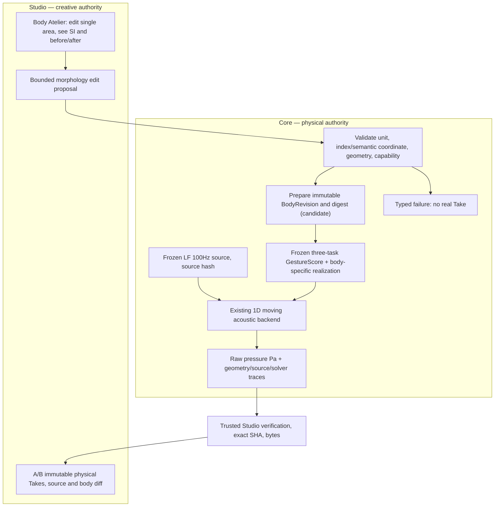
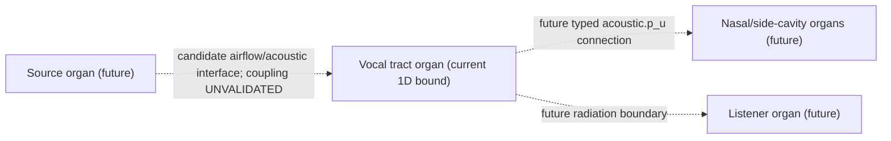
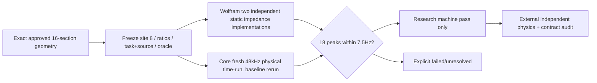
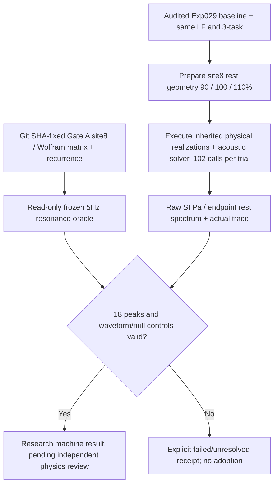

# CC-B1 — SYSTEM / physical architecture
**DESIGN CANDIDATE; NOT ADOPTED.** Defines one creator-editable **rest morphology** axis, not gesture-time control or acoustic postprocessing.

## Existing live implementation and bounded extension

- Grounded current baseline: [CC-A2](../cc-a2-two-body-live.md) only two 16-section prepared axial bodies, 0.5s 48kHz LF 100Hz / three tasks. New rest-section area is **NOT** currently accepted by the CC-A2 runner.
- First experiment changes only **a single rest-area cell**. All other source, task, timing, base geometry, listener policy and backend inputs must be held fixed. Choose an area section not actively targeted by a frozen exact-area gesture, then independently verify what the realizer does to this morphology perturbation.
- Identity separation: Character is the creative entity; BodyRevision is immutable morphology; GestureScore is the performance intent; physical state and waveform are time-varying derived observations.
- The Core renderer is presently an independently integrated segmented **serial 1D tract**. Do not falsely model it as the separately validated OG-4 branch3 graph, self-oscillating vocal folds or real listener pressure.

## Future typed organ and port mapping (DESIGN ONLY)

A semantic **organ node** owns stable ID, version, geometry/material capability and typed ports. An **edge** connects validated compatible ports via explicitly chosen physical junction/boundary law. Visual lines do not create legal physical edges. UI node layout never enters physical body hashes. The physical two-port/junction conditions of [OG-4](../og4-branch3-api-v1.md) cannot be retrofitted into the existing live source-filter by UI mapping alone.

## Non-goals
No automatic voice-sex/age identity, no anatomy 3D, no arbitrary graph editing, no moving-wall FSI, no source-filter feedback proof, no source spectrum retuning, no neural voice conversion or post-hoc EQ. Unsupported asks must fail rather than inventing a more human-like sound.

## Gate A freeze dependency and validation boundary (2026-10-22)

Full acceptance freeze in [GATE_A_FREEZE_20261022.md](GATE_A_FREEZE_20261022.md). No Studio UI, no adopted API or time-varying passivity proof.

## Gate B live path (new standalone run, not API)

The B script directly uses previously audited physical research functions; there is no BodyRevision stable API, Studio Take, or new time-dependent solver.

## Post-run causal observation (2026-10-22)
Unlike an edited audio effect, original and changed pressure traces were separately generated with the same frozen source and task through the inherited realizer/acoustic solver. Three conditions + independent second null were observed. Pre-frozen static 16-tube oracle matched 18 peak coordinates to at most 4.75Hz, but neither full driven passivity, anatomical dynamics nor subjective audibility were checked. The new B runner asserts the Git blob of the PRE-RUN oracle is unchanged and its freeze SHA is an ancestor of the physical CI checkout.
