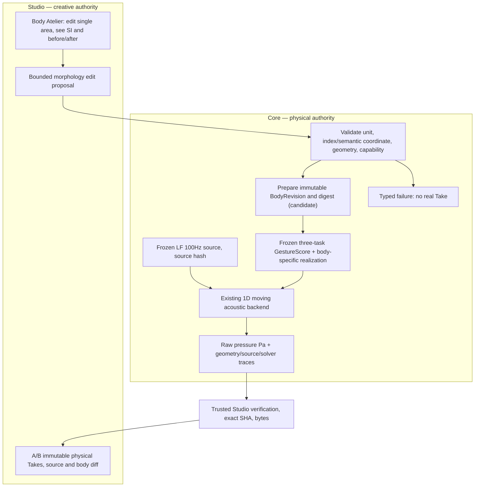
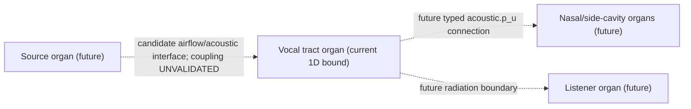
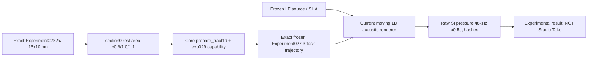
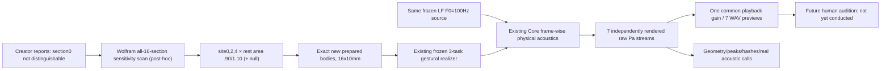

# CC-B1 — SYSTEM / physical architecture
**DESIGN CANDIDATE; NOT ADOPTED.** Defines one creator-editable **rest morphology** axis, not gesture-time control or acoustic postprocessing.

## Existing live implementation and bounded extension

- Grounded current baseline: [CC-A2](../cc-a2-two-body-live.md) only two 16-section prepared axial bodies, 0.5s 48kHz LF 100Hz / three tasks. New rest-section area is **NOT** currently accepted by the CC-A2 runner.
- First experiment changes only **a single rest-area cell**. All other source, task, timing, base geometry, listener policy and backend inputs must be held fixed. Choose an area section not actively targeted by a frozen exact-area gesture, then independently verify what the realizer does to this morphology perturbation.
- Identity separation: Character is the creative entity; BodyRevision is immutable morphology; GestureScore is the performance intent; physical state and waveform are time-varying derived observations.
- The Core renderer is presently an independently integrated segmented **serial 1D tract**. Do not falsely model it as the separately validated OG-4 branch3 graph, self-oscillating vocal folds or real listener pressure.

## Future typed organ and port mapping (DESIGN ONLY)

A semantic **organ node** owns stable ID, version, geometry/material capability and typed ports. An **edge** connects validated compatible ports via explicitly chosen physical junction/boundary law. Visual lines do not create legal physical edges. UI node layout never enters physical body hashes. The physical two-port/junction conditions of [OG-4](../og4-branch3-api-v1.md) cannot be retrofitted into the existing live source-filter by UI mapping alone.

## Non-goals
No automatic voice-sex/age identity, no anatomy 3D, no arbitrary graph editing, no moving-wall FSI, no source-filter feedback proof, no source spectrum retuning, no neural voice conversion or post-hoc EQ. Unsupported asks must fail rather than inventing a more human-like sound.

## Implemented research-only physical path (NOT a new public feature)

The conditional output signal is generated through existing physical source/tract path, **not** edited audio amplitude. The measured sound may remain buzzer-like. This code neither implements immutable first-class BodyRevision registry nor character editor; neither permits arbitrary source coupling or branched Port physics.

## Preview renderer is downstream observation only
The subsequent research build optionally exposes `raw Pa -> common fixed listening gain -> PCM16 WAV` for *three* conditions. This stage does not overwrite raw physical pressure, add EQ, generate phantom phonemes, or claim calibrated acoustic SPL. Same gain matters for causal A/B. It is a research listening artifact only; Studio immutable Take and listener/eardrum physics remain separate future boundaries.

## Listening signal path and sensitivity (diagnostic only)

Section0 is a 10mm segment at the inlet, and its ±10% area equates to diameter changes roughly −5.13%/+4.88% (circular area equivalence); a single site changes only 1/16 of the axial tract. End-state spectral F2 mode span 15Hz (~0.71% of 2100Hz), F1 nearly invariant. A common-gain WAV should be thought of as a *listening observation* of physical raw pressure, not a human-validated character difference.

## Semantically complete vs incomplete
**Current physical causal loop demonstrator** is implemented for exact 16-section research fixtures: one rest cross-section only; *all* sites are already subject to the same existing task-field motion. The site4 area at terminal state is ~4.640627× its own rest-area under existing Gesture alone, so this is **not activation of a previously static organ**. Numerically distinct waveform is obtained from the same source/filter law, not per-condition EQ or spoofed voice. This satisfies the *bounded causal proof of principle*.

**Not yet implemented:** a creator directly editing the permanent shape through Studio; Core-authoritative immutable saved/versioned BodyRevision; typed refusal, new bound Performance Contract bridge, independently validated physical oracle for output waveform and untrusted inputs, immutable Studio historical Takes and reload. Current physics is frame-wise prescribed area-dependent lossy 1D transfer with explicit resistive outlet and surrogate monopole radiation, **not** validated 3D moving boundary FSI, natural phonation source coupling or organ junction acoustics. Preserve those limits as separate research backlog, never aesthetic voice-quality guarantees.
