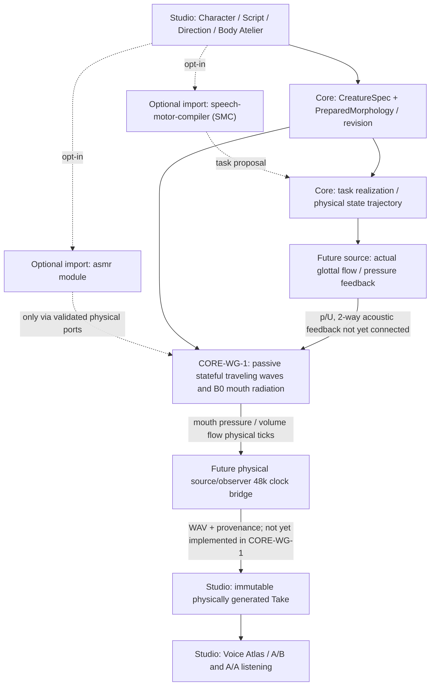

# CORE-WG-1 — System and dependency map

## Physical causality and app boundary



The arrow from Source is prospective: CORE-WG-1 currently takes a **prescribed inlet volume flow** in each physics tick, NOT VF-1 self-oscillation, and produces signed outlet pressure/flow. The receiver/Studio arrow is also future. There must never be a script→audio shortcut outside physical realization.

## Algorithm

```text
Tract1DGeometry (actual section lengths and areas) + air rho,c
   → PassiveWaveguideConfig (clock c*cells/section_length; Zj=rho*c/Aj)
   → PassiveWaveguideSession (forward/backward FIFOs, optional B0 q)
   → step(signed inlet U) : WaveguideStep
      p_source, p_mouth, U_mouth, E_wave, E_B0, W_source, loss, ΔE, residual
   → PHYSICAL observations / independent energy audit
```

At every tick, incident waves advance exactly one finite spatial cell; local pressure/flow junction scattering couples neighboring sections and the physically derived B0 termination reflects energy. There is no post-WAV timbral operator and no source frequency/amplitude conditioning.

## Core integration policy
- Module: `src/morphoacoustics/acoustics/passive_waveguide.py`, deliberately **not** the existing Fidelity-0 `simulate_snapshot` protocol: this is a persistent time-domain state, not a static impedance observation.
- Current Fidelity-0, existing real-performance paths, `src/morphoacoustics_graph`, SMC, ASMR, Studio v0/v1 contracts and CC-A2 remain unchanged.
- Do not expose UI controls for material properties without measured/derived effects on physical state. Material richness alone does not guarantee perceptual acoustic richness.
- Future B2-B can introduce section area/time derivatives and external wall work only with a discrete power identity and static-limit equivalence, using this same Core candidate or a justified conservation-preserving evolution.

## Dependency order
1. CORE-WG-1 focused CI + independent B2-A regression (static verified signal path; no waveform-quality claim).
2. CORE-WG-2 trusted M0/M1 prepared-body binding and physical clock/source/observer integration.
3. B2-B prescribed moving wall: accounting for wall work and acoustic feedback; static limit preserves CORE-WG-1.
4. VF-1 source/tract coupling plus physiologically constrained losses/noise and physical observer; then Studio audible Take, Voice Atlas and character exploration.
