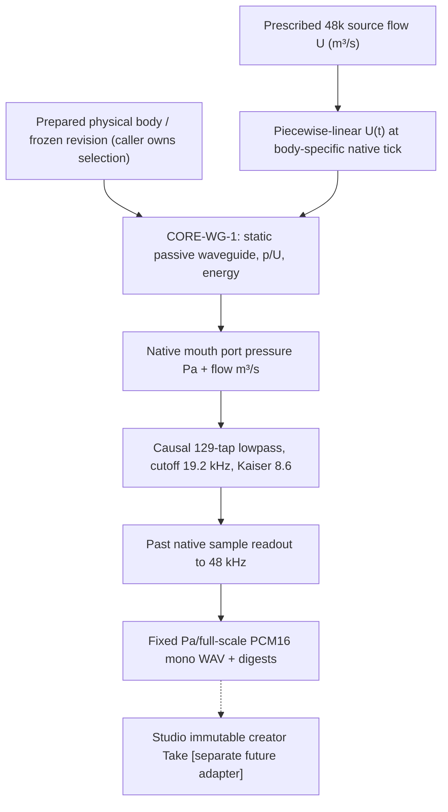

# WG2 — Causal path and limits

**No physical bypass:** neither source nor WAV is copied from a pre-rendered Take. Every run advances a new `PassiveWaveguideSession` at actual native clock `c*cells/section_length`. Only a prescribed source-flow program, not self-oscillating glottis, is modeled; input interpolation is a declared actuator approximation. The source/duct/termination acoustic work identity is tested at physics ticks before 48k observation.

**Observer honesty:** returned mouth-port pressure (Pa) is an actual B0 termination-side waveguide boundary variable; its fixed-scale WAV is a **listener preview of this port**, not a calibrated free-field radiated pressure or acoustic receiver. Lowpass and ZOH are sample-rate conversion, not stylistic EQ. The causal FIR incurs `64/f_physics` seconds group latency, plus at most a physical sample of ZOH timing. No zero-phase filter or pre-echo.

**Ownership:** Core physics/monitor package has no Character/Script/UI concept; caller must validate prepared-body revision and source provenance. Studio later takes a versioned adapter for new per-request WAV and immutable Take. B2-B wall work, source/tract feedback, nonlinear flow, speaker identity, true microphone and SMC/ASMR integration are outside this increment.
