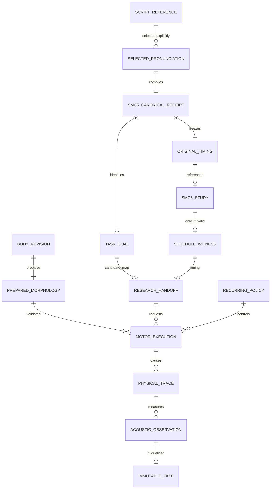

# CVI-1 — DATA / ownership and provenance proposal (Gate A)

2026-10-27 JST · Core #223 · **not a published API, not a Studio panel contract modification**.

## Existing sources of truth to reuse, not copy

- Character/Body: existing frozen `CreatureSpec`, prepared morphology and exact body fixtures; the *creative* CharacterDefinition and BodyRevision remain Studio/application ownership until separately versioned and approved.
- Task: a canonical `GestureScore` / three-task sequence where already supported. The motor strategy is a candidate **controller choice**, not a task rewrite, prescribed waveform, or identity embedding.
- `src/morphoacoustics_graph/`: currently constrained `acoustic.p_u` passive ports. Fixed serial/branching acoustics are **not** the articulating body or a source model. Do not promote suggested OrganGraph extensions to production.
- UI: only selected references and mode/selection state; no canonical physical arrays or pressure signals in UI document.
- Voice observation/Take: immutable downstream evidence only after a real physical run and qualified provenance. Naturalness and speaker identity assessments are annotations, never authoritative morphology.

## Experiment-local candidate record (field names are not a schema adoption)

```json
{
  "schema": "cvi1.experiment.proposal.v0",
  "status": "NOT_RUN",
  "case_id": "M0_H0_T0",
  "body": {
    "fixture_ref": "existing pinned prepared M0",
    "revision": null,
    "preparation_digest": null
  },
  "task": {
    "task_plan_sha256": null,
    "context_id": "T0",
    "direction_ref": null
  },
  "habit": {
    "candidate_id": "H0",
    "controller_ref": null,
    "law": "declared in prospective protocol, not a free style embedding"
  },
  "engine": {
    "backend_id": null,
    "source_commit": null,
    "physics_mode": null,
    "source_state": null,
    "receiver_ref": null,
    "simulation_clock_hz": null
  },
  "outcome": {
    "feasibility": "NOT_RUN",
    "physical_trace_ref": null,
    "acoustic_port_trace_ref": null,
    "numeric_floor_ref": null,
    "measures": {},
    "limitations": ["NO_VOICE_QUALITY_CLAIM"]
  }
}
```

The `null` placeholders are intentional. This is not a result, a permission to accept missing provenance, or an instance of the adopted `Performance Contract v0/v1`.

## Dimensions / direct observables

| Name | SI unit | Provenance/owner | Meaning |
| --- | --- | --- | --- |
| morphology length L | m | prepared physical body | body fixed per row |
| section area A | m² | prepared physical body | rest/deformed geometry, with state distinction |
| gesture time / activation | s / dimensionless | performance and realizer | continuous task execution, not WAV concatenation |
| effort or actuator command u | **declare physical dimension per control** | controller/physical realization | candidate only; no generic 0–1 loudness-to-Pa mapping |
| physical state x and velocity | specific SI units per DOF | physical backend | motor outcome, not audio observation |
| acoustic port p | Pa | solver/observer | location, clock and sign fixed |
| volume flow U | m³/s | solver/observer | signed physical port flow |
| acoustic impedance p/U | Pa·s/m³ | derived observer | include regularity/singularity masks |
| resonance / peak locations | Hz | independent identified estimator | label finite bandwidth/observer floor |
| WAV pressure/calibration | Pa only if calibrated, else declared digital units | Take/observer | never equate PCM gain with vocal effort |
| source and energy/work | W / J per modeled port | source/physics | no invented fluid/tissue energy closure |

Every derived value must record its exact causal signal path and model scope. Full absolute SPL claims require calibrated receiver; no such claim follows from a raw mouth-port pressure array.

## Analysis datasets (factorial but conditional on feasibility)

Initial candidates: M0/M1 × H0/H1 × T0/T1 (held-out compatible task contexts) = 8 records **only after the backend preflight passes**. Repeats and null controls are additional run records, not invented missing combinations. Freeze exact body, task and controller refs before observing results.

A factorial contrast `I_Q` is defined only for a scalar Q that is comparable in all four valid rows of a given task and has specified units, measurement extraction and uncertainty. If one row is infeasible or unsupported, report **NOT_ESTIMABLE**, never substitute silence/zero. Numerical differences alone must not be named perceptual speaker identity.

## Identity and integrity

- Separate hashes: input/body revision, task semantics, controller candidate, runtime/solver, raw trace, rendered waveform when actually present. No shared digest that hides which factor changed.
- Body digest MUST NOT depend on Studio canvas coordinates, label, playback state or theme.
- Task semantic hash must be identical within a task context across body/habit interventions; controller hash changes only for H0/H1.
- Source and receiver hashes must be invariant across physical comparisons.
- Any future UI binding uses stable immutable references and the currently approved Studio panel owners; no copied model state.

## Explicit status vocabulary

`PROPOSED`, `NOT_TESTABLE_BACKEND_CAPABILITY`, `INVALID_INPUT`, `UNSUPPORTED`, `INFEASIBLE`, `NUMERICALLY_UNRESOLVED`, `EXECUTED_NOT_VALIDATED`, `G0_PASS`, `G1_PASS`, `G2_ACOUSTIC_ONLY`, `G3_CREATOR_NO_GO`, `ADOPTION_HOLD`.

These are **experiment log labels**, not new Core public exception codes. Translate only documented native backend failure statuses; do not conflate `INFEASIBLE` body/task with `UNSUPPORTED` implementation.

Reference: [CVI-1 #223](https://github.com/ryonakayama234/morphoacoustics/issues/223).


## Gate 0 evidence/data inventory — 2026-10-27

**Static source review only; no CVI-1 numerical rows, sound files or new observations were produced.** Core main baseline `e05e3274ad69bfb9202816049f6661a18ba39ec0`.

| Existing reference | Actually represented | Missing for CVI-1 |
| --- | --- | --- |
| `experiments/022_shared_body_multigesture/run.py` | 10-section shared KKT / modal state dynamics | validated same 16-section M0/M1 realization path |
| `experiments/027_task_field_vowel_transition/run.py` | 3 fixed timed tasks, an activation-vector geometry helper | independently versioned recurring H0/H1 controller and invariant goal identity |
| `experiments/028_task_field_morphology_transfer/run.py` | 16-section prepared M0=0.160m/M1=0.176m, physical shape and research acoustic transfer | a tested motor-habit axis |
| `experiments/029_task_field_embodied_infeasibility/run.py` | narrow capability refusal with no synthetic fallback | H-specific physiological feasibility |
| Studio `docs/product/STUDIO_WORKSPACE_V2_DECISION.md` | frozen Character/Motion/Scene canvas ownership and Take dock | new UI-binding approval, which is absent |

**Result status:** the originally proposed M0/M1 × H0/H1 × T0/T1 dataset remains **absent**. `NOT_TESTABLE_BACKEND_CAPABILITY` describes the currently demonstrated interface, *not* the native body/task status `INFEASIBLE`. G1–G4 remain `NOT_RUN`.

If a future new experiment is separately approved, its record must distinguish:
- `upstream_task_plan_hash` (the original Exp027 task+timing hash, unchanged);
- `research_goal_set_hash` (new, separately frozen task/location/degree semantics, if timing separated);
- `context_hash` (per-performance direction, not habit);
- `controller_law_hash` (H0/H1 equations, SI quantities, bounds, exact version);
- `body_preparation_hash` and `capability_policy_hash` (M0/M1 binding);
- `solver_hash`, `source_boundary_hash`, `observation_port_hash`, `clock_hash`;
- `physical_trace_hash` / `acoustic_trace_hash` / `take_ref` **only after genuinely executing and qualifying them**.

Keep unknown values null; never fabricate reference IDs. An edited gain/EQ/recorded-WAV selector cannot be stored as a valid habitual motor strategy. Existing UI mode/viewport/label state never enters the physical body hash.


## 2026-10-27 — SMC × CVI data ownership and candidate handoff (design only)

No stable Runtime JSON Schema, public MotorScore, production serialization, source-code change, or executable cross-package mapping is authorized. These are **research traceability fields**, not adopted model types.

### Existing proven research interfaces — do not change in place

- SMC-5 `CompileResult(plan, goals, timing, receipt)`: `TaskGoal(task_id, definition_id, semantic_revision, goal_kind, capabilities, lower, upper, ...)` with **exact rational dimensionless research scalar intervals**; `CompileReceipt` includes distinct `canonical_request_sha256`, `plan_digest`, `candidate_digest`. A validated symbolic TaskGoal **does not imply a physically typed Core goal**.
- SMC-6 `TemporalAnalysis(status, code, events, overlaps, receipt)` produces actual hard-bound earliest/latest windows, exact rational witness and overlap extrema. `TemporalReceipt` retains `canonical_request_sha256`, `source_plan_digest`, `source_candidate_digest`, `source_timing_digest`, `study_digest`, optional `witness_digest`.
- SMC-6 `COMPATIBILITY`: inherited exact SMC5 events; `RESEARCH_OVERRIDE`: distinct synthetic study with required replacement policy/reason; do not silently rewrite selected pronunciation, Goal or prior timing digest.
- Existing Core `Gesture` / `GestureScore`, `CreatureSpec`, `PreparedMorphology`, `FeasibilityReport` have **different scope and semantics**. Current research lacks an accepted adapter turning arbitrary SMC TaskGoal into them.

### Proposed bounded record relationships



**Minimal typed handoff *proposal*, none of these values may be implicitly defaulted:**

| Field/identity | Owner and physical meaning | Unit / failure |
| --- | --- | --- |
| `source_ref`, `selected_pronunciation_id` | Studio Script selection and SMC canonical request | exact Unicode source/codepoint span; reject missing/ambiguous reading |
| `smc_source_commit`, `smc_candidate_digest` | SMC-5 exact code/goal identity | exact SHA, reject unmapped/unreviewed version |
| `smc_timing_digest`, `temporal_lane`, `scenario_digest`, `witness_digest` | SMC-6 formal plan and schedule identity | exact rational s; compatibility is faithful; override is **not** |
| `task_mapping_revision`, `mapped_task_id[]`, `goal_semantics[]` | future research adapter with explicit functional variable and inverse mapping | explicit SI or declared dimensionless quantity; reject `UNMAPPED_SEMANTICS` |
| `body_preparation_digest`, `capability_policy_hash` | Core-owned immutable body and capability | physical SI geometry; reject unsupported body/capability |
| `controller_revision`, `habit_candidate_id` | Core research control policy, distinct from per-take Direction | declared physically meaningful parameter units; no arbitrary style code |
| `requested_task_trace_ref`, `actual_motor_trace_ref`, `task_residual_ref` | Core intended vs performed trajectory | clocked, named task variable, units, causal path; null until executed |
| `source_boundary_ref`, `acoustic_port_ref`, `receiver_ref` | Core source/tract/radiation and separately validated scene | Pa, m³/s, m, s, Hz as appropriate; no assumed SPL from mouth port |
| `take_ref` | Studio immutable observation record | absent if no qualified physical WAV; preserving historical Takes |

**Absolute rule:** SMC planning intervals `Task ONSET/OFFSET` are symbolic markers and not muscle activation, time of constriction, time of sound onset or measured tissue coordinates. A full SMC-5 candidate digest can **change when timing changes**, even if a new extracted task-meaning digest is stable. Such a new goal identity needs separately versioned research semantics, not a false equivalence assertion.

**Recurring policy H vs Direction D:** H is stable across at least two tasks/contexts on one body; D is a per-performance instruction. If an intervention changes SMC chosen schedule, label it `H_PLAN_TIMING`; if it changes only Core physical control at fixed schedule, label it `H_PHYSICAL_POLICY`. The first CVI factorial must not mix these. A tempo or one-off stage Direction is not a persistent MotorPersona.

**Data status for this proposal:** SMC6 formal synthetic results exist *on its separate Draft branch*, but CVI handoff, Core physical controller, actor-specific habit and creator Takes are all **NOT_RUN / NOT_IMPLEMENTED**. No SMC code is present on current Core main. Record missing references as null, do not inject mock payloads into Takes.

## D2 refinement — semantic binding proof and factor identities (2026-10-27)

**Research-only candidate handoff, not a published serializer.** Every SMC-to-Core binding needs a complete, version-pinned proof row, not a best-effort guess.

| Binding evidence | Must prove | Failure |
| --- | --- | --- |
| exact SMC5 compiler/source SHA, canonical request SHA, selected pronunciation, Task IDs, candidate digest | authenticated immutable symbolic origin, shared Task counted once | invalid/untrusted |
| TaskGoal definition_id + semantic_revision + goal_kind and the referenced full canonical TaskDefinition | `variable`, `value_domain`, `applicability_domain`, constraints and capabilities from authenticated source; these are **not** all exposed on TaskGoal | `UNMAPPED_SEMANTICS` |
| mapped Core functional variable and goal interval | physical units, coordinate frame, location interpretation, direction, target conversion evidence, body applicability | `UNMAPPED_SEMANTICS` |
| SMC6 source timing digest, COMPATIBILITY lane, witness digest | strict original planned ONSET/OFFSET equality, exactly same between H_EXEC cases | timing/provenance mismatch |
| Core body-preparation/capability/controller hashes | unchanged H0/H1 defining physical equations across M0/M1; distinguish unsupported from infeasible | no Core execution |
| Direction/context, source-boundary, acoustic port, receiver, solver/clock hashes | controlled nuisance factors and unambiguous signal sign/units | `NOT_ESTIMABLE` |

Within each task-context T, **SMC source, selected reading, goal identity, exact timing, semantic mapping, Direction, source, receiver and solver are invariant** for all M/H comparisons. Only body identity varies with M and only a physically meaningful H_EXEC-law identity varies with H. The same H law cannot silently be fitted differently for each body. Achieved geometry and physical attainment times may differ as causal outcomes.

Executed rows must contain complete identity evidence and native status; null placeholders are permitted **only in design/proposal rows**. Invalid, unsupported or infeasible runs produce no substituted silence/zero acoustic metric; omit invalid contrasts as `NOT_ESTIMABLE`. `KINEMATIC_ONLY` is an experiment qualification when an imposed shape curve differs but no independent actuator/state law is demonstrated—not a native Core status.

**Do not confuse coverage populations:** manually selected SMC synthetic pronunciation fixtures establish bounded compiler/adapter compatibility only. Arbitrary free-script coverage requires a separately sampled input population, pronunciation-selection/ambiguity policy, complete failure denominator and linguistic validity evidence. A successful TaskGoal-to-Core mapping cannot be used to claim automatic Japanese reading or natural speech.

Required raw audit distinction: `requested_event_trace` (SMC exact events), `requested_physical_goal_trace` (explicit Core conversion), `achieved_state_trace` and `task_residual` (measured physical output), followed only conditionally by `acoustic_port_trace` and `qualified_take_ref`. Hash each independently.

## 2026-10-27 — candidate G_area metrology record, not an accepted task schema

Follow-up [Gate B Issue #227](https://github.com/ryonakayama234/morphoacoustics/issues/227). The evidence below is a **prospective design over already published in-repo experiment fixtures**, not a new observation or SMC vocabulary acceptance.

| Layer | Field / quantity | Owner / unit / identity | Unknown or forbidden assumption |
| --- | --- | --- | --- |
| Upstream | original Script, selected pronunciation, canonical SHA, TaskGoal and SMC6 exact event table | SMC5/6 identity, exact Fraction seconds | no inferred Japanese pronunciation; no TaskGoal scalar-as-meters |
| Research new meaning | `model_goal_id=G_area`, semantic revision, model applicability `tract1d.section_area` | independent research TaskDefinition + binding proof | not existing SMC `tract/open_closed/synthetic` |
| Body | prepared body digest, rest `A_rest,j`, cavity, n, section lengths, coordinate convention | Core; `A` m², `s` m, `ξ` dimensionless, `j` section index | do not equate ξ and a metric distance or import Exp022's 10-section equations into Exp028's 16 sections |
| Target | `A_target,j` or bounds `[A_low,A_high]` with positivity/reference | independently frozen SI m² | `degree` or activation ∈ [0,1] is not an SI area |
| Observation | actual model state area `A_j(x(t))` and declared residual | SI m², time s, separate requested vs achieved events | not measured anatomical tongue–palate gap in mm |
| Execution | realizer/constitutive-law digest, native feasibility, physical state and any supported velocity | Core R0 hard projector vs experiment-local R1/R2, separately labeled | no force, biological mass or acoustic pressure if not modeled |
| Evidence | observer digest, independent oracle and numerical floor, negative controls and full backend ancestry | raw state/receipt SHA, exact code/CI | no fake pass for unknown units, nonpositive area or missing mapping |

**Frozen candidate fixture from Exp019** (not a new result): 10 sections, rest area `3e-4 m²`, target `5e-5 m²` at ξ=0.65, section index 6. The *existing* experiment also uses dimensionless relative stiffness; that coefficient is not newtons/meters or a validated tissue material parameter. A ratio `ρ=A_target/A_rest` may be derived **after** checking a prepared body; its physical area conversion and whether the intended goal is *absolute area* or *body-relative ratio* must be prespecified, never changed between M bodies to rescue a comparison.

**Audit scope:** First Stage B tests one prepared-body/target record and its null/infeasible cases. The eventual M0/M1 factorial is **NOT_YET_ELIGIBLE** until topology/representation and transferable physical state law are separately verified. For Stage C, store a separate recurring controller revision H_EXEC; H is not a redefined TaskDefinition, target adjustment or playback gain.

**Provenance quarantine:** Physically interpretable `G_area` is still a *reduced 1D geometric model goal*. Papers using constriction gap distance from anatomical contours show that anatomy-calibrated distance is a distinct measurand. Do not promote this provisional binding to measured physiology or natural-voice semantics.
