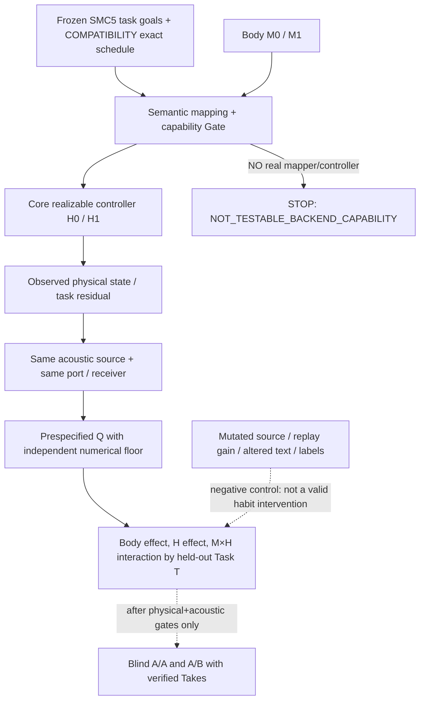

# CVI-1 — EXPERIMENT / prospective Gate A and falsification

2026-10-27 JST · Issue #223 · Status **RESEARCH DESIGN ONLY / NO RESULT / NO ADOPTION**.

## The single question

Does a lawful recurring controller habit have a repeatable, acoustically observable effect whose size or direction may depend on the Character's prepared morphology, while preserving the intended task? Distinguish this from a one-off direction change, pitch preset, EQ change, source injection, label-only variation or waveform-level splice.

This does **not** ask whether a synthesized voice is already natural. The answer may be NO; null, unmodelable and source-quality failures are first-class outcomes.

## Gate 0 — feasibility BEFORE coding a 2 × 2 result

Inspect the **actual existing source code and pinned contract** for the candidate full path:
1. Can the same task meaning be executed with H0 and H1 (e.g., two nonidentical valid gesture-overlap/coordination controllers) through **one backend and one body representation** without changing the task targets, controller capability policy or solver?
2. Can that backend realize both vetted M0 and M1 body revisions with actual physical traces and acoustic observation under the same sampling clock?
3. Is the source acoustic boundary and receiver observation explicitly declared? Does no-body/no-controller fallback remain disabled?
4. Is the distinction between transient Direction (per-performance) and H (repeated motor strategy) operationally observable?

**STOP** on first incompatibility with `NOT_TESTABLE_BACKEND_CAPABILITY`. In particular, Exp022 (10-section shared-body) and Exp028 (16-section live vowel transfer) are different fixtures, NOT interchangeable modules. There is no accepted production MotorPersona or general OrganGraph source backend.

Document exactly which functions/data already exist; if an adapter is necessary, make a **separate scientific proposal**, do not silently blend experiment sources. No Core public ABI or Studio edits.

## Hypotheses (falsifiable, not frozen numeric acceptance thresholds)

- **H-representation:** within one T, canonical task semantics are bitwise invariant across M/H cases and physically impossible cases do not generate audio.
- **H-habit:** H0 and H1 yield repeatable differences in an already declared feasible physical control/trajectory quantity after independent solver noise is excluded. Null H0/H0 shows no change.
- **H-acoustic:** for at least two task contexts T0/T1, the downstream acoustic port quantity Q changes under a lawful H manipulation and/or differs between M0/M1, beyond an independently estimated numerical/measurement floor.
- **H-interaction:** the prespecified `I_Q = Q(M1,H1)-Q(M1,H0)-Q(M0,H1)+Q(M0,H0)` is potentially nonzero; **zero is accepted without retuning**. It is a test, not a requirement that identity interactions always occur.
- **H-retention (later):** an unseen task or held-out performance shows recognizable Character identity to blinded listeners; this is NOT equivalent to H-acoustic.

## Conditions / controls for a later frozen Gate B

Proposed 8 primary model runs: 2 prepared body revisions M0/M1 × 2 verified motor strategies H0/H1 × 2 legal gesture contexts T0/T1. Exact revisions, controller equations, durations/clock, task targets, baseline source and receiver and physics backend must be written into a frozen future Gate-B protocol **before** executing confirmatory model results.

Required controls:
- Repeat same request and source at unchanged inputs (run-to-run numerical floor, not an arbitrary acoustic significance threshold).
- H0 versus exactly H0 (null), and task only changes if the context T changes.
- Negative infeasible task using documented existing failure law: no waveform, no acoustic invocation.
- Body or habit tamper that changes only a label/Studio viewport/selection: zero physical effect.
- Source/preset tone, playback gain or neural renderer changed: must be classified as wrong manipulation and rejected from H comparison.
- Corrupted unit, NaN, altered body digest, mismatched task version: invalid input, no automatic replacement.
- Negative comparison with an old independently combined gesture overlay only if the current backend actually exposes a comparable lawful null; else mark `NOT_AVAILABLE`, not a made-up control.

## Signals / measurements

1. **Task and motion:** task residual; physical coordinate and velocity time histories (dimensioned); feasible/infeasible counts; if applicable, controller work / force / damping with explicit signed conventions.
2. **Acoustic ports:** physical pressure/volume velocity (Pa / m³/s), transfer/response, peaks or trajectories, with location and clock. Check energy passivity only for a backend whose energy ledger is actually modeled and validated.
3. **Factor effects:** preselected Q (unit, extraction, bandwidth, reference), body effect, H effect, body × H interaction and held-out T consistency. Do not use a tolerance chosen after seeing results.
4. **Evidence:** exact commit, source/body/task/controller/backend hashes, RAW arrays, standalone independent oracle/perturbation floor, negative tests and CI/third-party review outcome.
5. **Product later:** equal-level unedited A/A and blind A/B from actual new physical Takes; creator separately rates identity, distinctness, naturalness and creative usefulness. Do not demand preferences if no intelligible voice exists.

## Evidence and decision gates

| Gate | Possible decision | Excludes |
| --- | --- | --- |
| G0 actual compatibility / provenance | READY_FOR_PREREGISTRATION or NOT_TESTABLE_BACKEND_CAPABILITY | no fictional merged dynamics |
| G1 native physical execution & controls | NUMERICALLY_SUPPORTED / REVISE / NUMERICALLY_UNRESOLVED | no biology or loudness claim |
| G2 acoustic discriminability beyond observer floor | ACOUSTIC_SIGNATURE_SUPPORTED / NO_EFFECT / INDETERMINATE | no speaker identity |
| G3 human-held-out perceptual identity and actual voice quality | CREATOR_GO / CREATOR_NO_GO / NOT_RUN | CI cannot approve |
| G4 product/ABI adoption | pending separate creator approval and contract review | no default Studio UI change |

**Current decision (2026-10-27): G0 NOT EXECUTED; G1–G4 NOT RUN.** The existence of Exp022, Exp028, Exp029 and a motor-persona hypothesis document is *evidence of components*, not proof the full proposed 2×2 experiment is executable.

## Integration dependencies & parallel work

- Physics/quality: VF-1A/B2 moving source work is draft, measured M5 scalar benchmark #222 does not supply spatial pressure. A genuinely voice-like source–filter–radiation path remains a separate critical dependency for eventual G3.
- Core bounded organ graph: OG-3 current adopted-limited; OG-4 and OG-5 scope must not be confused with moving anatomy.
- Studio contract: three fixed modes, only exact slots from accepted ADR; UI edit STOP-AND-PROPOSE before any code. Existing Takes immutable.
- SMC / ASMR: optional separately gated imports at Motion / Scene boundaries; neither is a dependency to determine body × habit causal observability.

## Follow-up artifacts

If creator accepts research framing and G0 identifies a real compatible implementation:
- prospective **frozen** Gate B amendment with numerical floor and independent reference chosen before outcome,
- isolated executable pilot under a numbered `experiments/` directory, no published public schema,
- source/tests + raw result receipt + append-only decision,
- matching edits to SYSTEM / DATA / EXPERIMENT in same PR,
- CI on exact HEAD and independent `@codex` science/code review,
- explicit decision; only then consider a separate Core API and Studio creator proposal.

Reference: [Issue #223](https://github.com/ryonakayama234/morphoacoustics/issues/223), [Exp022](https://github.com/ryonakayama234/morphoacoustics/blob/main/experiments/022_shared_body_multigesture/RESULTS.md), [Exp028](https://github.com/ryonakayama234/morphoacoustics/blob/main/experiments/028_task_field_morphology_transfer/RESULTS.md), [Exp025](https://github.com/ryonakayama234/morphoacoustics/blob/main/experiments/025_smooth_source_spectrum_vowel_cue/RESULTS.md).

## 2026-10-27 Gate 0 source-level compatibility audit receipt

**Decision:** `NOT_TESTABLE_BACKEND_CAPABILITY` for the *currently demonstrated* CVI-1 factorial pipeline; full `G0_READY_FOR_PREREGISTRATION = false`. This updates the earlier “G0 NOT EXECUTED” statement by distinguishing a newly completed **static source preflight** from a **not executed** same-backend experimental run. There are **no new numerical/CI, G1–G4, sound-quality or creator-listening results**.

| Preflight condition | Exact code evidence | Outcome |
| --- | --- | --- |
| Two H policies with invariant goal semantics | Exp027 `CandidateTask` contains onset/offset; `task_activations_at_time` uses fixed `TASKS`; helper takes explicit activations but not validated H | NOT ESTABLISHED |
| M0/M1 on same backend | Exp028 frozen 16-section, 0.160/0.176m task-field transfer | YES for original fixed task, NOT for H0/H1 |
| Shared state interaction reusable on that backend | Exp022 custom 10-section KKT and modal dynamics, not Exp028 16-section realizer | NO VERIFIED BRIDGE |
| Refuse infeasible/no-fallback | Exp029 `LOCATION_UNREACHABLE` with no acoustic call | LIMITED PRECEDENT only |
| Genuine voice and calibrated receiver | Exp028 frame-rendered frequency-domain transfer; sound/perception not qualified | NOT ESTABLISHED |

Audited source links: [Exp022](https://github.com/ryonakayama234/morphoacoustics/blob/main/experiments/022_shared_body_multigesture/run.py), [Exp027](https://github.com/ryonakayama234/morphoacoustics/blob/main/experiments/027_task_field_vowel_transition/run.py), [Exp028](https://github.com/ryonakayama234/morphoacoustics/blob/main/experiments/028_task_field_morphology_transfer/run.py), [Exp029](https://github.com/ryonakayama234/morphoacoustics/blob/main/experiments/029_task_field_embodied_infeasibility/RESULTS.md).

**Falsifiable next hypothesis, not an approval:** a separately reviewed experiment-local split of goals and lawful activation/controller schedules may permit genuinely nonidentical H0/H1 on both frozen M0/M1 bodies, with goal targets and physical state checks intact. It must not modify the old frozen V3 identity, relabel transient Direction as persistent H, or claim shared-body dynamics merely by adding independent log-area fields.

**Gate B prerequisite proposal — no code yet:**
1. Freeze a new goal-semantic identity and retained historical task+timing hash. Test that tampering with either fails.
2. Register two explicit lawful recurring controller equations H0/H1 with bounds; freeze one independent trial Direction; null H0/H0 must match.
3. Validate *actual* 16-section state, task residual and feasibility on both exact bodies, and a no-fallback impossible-task negative case. Reject any undocumented 10-to-16 conversion.
4. Freeze source, port, units, timebase and independent numeric/observer floor before comparing acoustic metrics; reject gain-only/label-only interventions.
5. If no common physically meaningful realization exists, **STOP** rather than simulate plausible voice.
6. Only then run preregistered acoustic and held-out-context trials. Studio interface changes and creator audition require separate explicit approval for the already frozen V2 slots; preserve immutable Takes.

This audit removes a deceptive shortcut: a selectable “voice personality” that only changes source signal, mixing or labels. It makes the actual missing causal-control seam explicit while leaving VF/VM sound-quality investigations independent.

## 2026-10-27 — SMC-first metrology / hypotheses / ordered integration study (prospective, not preregistration)

**No actual integration execution, numeric result, experimental test source, Core ABI, Studio UI or PR merge in this revision.** The SMC-6 formal-math GO from Draft #225 is a prerequisite **software evidence class**, not evidence that Japanese speech movements, anatomical execution or auditory character identity work.

### Four distinct measurement layers (no false cross-layer promotion)

| Layer / measurand | Measurement definition / instrument | Reference, unit and uncertainty | Can establish / cannot establish |
| --- | --- | --- | --- |
| **L0 SMC syntax and timing** | authenticated SMC5 selected pronunciation coverage; TaskGoal occurrence count; SMC6 SAT/UNSAT, exact `t_i`, per-event min/max, witness, jointly feasible `O_ij=max(0,min(e_i,e_j)-max(s_i,s_j))`, hard residual | canonical source/goal/timing digests, exact Fraction s, independent small-grid oracle; arithmetic is **exact under assumptions**, not biological measurement | formal soundness; **NOT** feasible muscles, best timing or natural speech |
| **L1 semantic mapping** | required functional TaskGoal count `N_req`, explicitly mapped `N_mapped`, named typed target variables and capability sets; structural coverage `N_mapped/N_req` only when denominator>0, otherwise refuse | separate frozen TaskLexicon and Core mapping reference, explicit dimension and evidence revision; mapping uncertainty/conflict recorded as `UNMAPPED_SEMANTICS` not hidden in scores | a stated map for a bounded task subset; **NOT** real-world articulation |
| **L2 Core motor execution** | requested vs achieved functional goal `g_i(x_M(t))`, physical coordinates/velocity, onset-to-achievement latency, final/hold task residual, repeatability, divergence of H0/H1, explicit `INFEASIBLE/UNSUPPORTED/INVALID` | pinned same realizer/body versions, actual clock and SI units, independent timestep convergence / oracle, feasibility controls; no energy claim unless full physical ledger exists | lawful model response and body dependence, **NOT** voice |
| **L3 Acoustic / later reception** | same-source same-port `p(t)` Pa, `U(t)` m³/s, spectra/transfer phase, predeclared comparable `Q` and body×H interaction; later radiated/receiver pressure with source/geometry identifiers | fixed source, radiation/receiver models, calibration where claimed, numerical floor, common listening gain; no arbitrary Eq/timbre editing | model-acoustic contrast only; **NOT** an identifiable pleasant character voice |
| **L4 Perceptual creator outcome** | held-out matched A/A and A/B, distinctness, same-identity retention, voice-likeness, intelligibility and usability independently | actual verified physical Takes, blinded order, equal-level replay, report listener count/uncertainty and task coverage | only qualified audition may justify creator-facing GO; CI is not a listening test |

Where a proposed Core physical target `g_i` has valid lower/upper bounds `[l_i,u_i]`, preregister residual `r_i(t)=max(l_i-g_i(x(t)),0,g_i(x(t))-u_i)` in its declared units. This is **prospective** and does not presume SMC5's synthetic scalar interval has those physical units. Fix the achievement/hold window and any threshold using independent evidence *before* looking at H0/H1 outcomes. If the physical meaning is uncalibrated, mark `NOT_MEASURABLE`, never define a cosmetic normalized error afterward.

### Separable falsifiable research hypotheses (all untested for CVI)

- **H-S0 provenance:** authenticated identical SMC request + COMPATIBILITY timing reproduces identical plan/goal/exact events irrespective of input ordering that is semantically unordered; a forged receipt, unresolved timing or wrong SHA generates no physical request.
- **H-S1 mapping:** a predeclared subset of SMC TaskGoals can be mapped to dimensioned and physically supported Core task variables without reading invention or body-specific target substitution. Competing/ambiguous or missing mappings **refuse**. Counterexample proves the bridge is unsupported, not that SMC's symbolic graph is invalid.
- **H-P0 same-plan habit:** with same *faithful* SMC exact schedule, same body M0, fixed Direction/source/initial state/solver, two genuinely lawful **physical policies** H0/H1 satisfy the same task goals but yield reproducibly distinguishable physical trajectories above predeclared numerical floor. H0/H0 null must not differ. Reparameterized interpolation of a prescribed waveform does **not** count.
- **H-P1 cross-body transfer:** the *same* H0/H1 definitions and SMC task identity can be tested on both prepared M0/M1 and >=2 independently chosen feasible contexts. Any `UNSUPPORTED` or `INFEASIBLE` case stops the associated contrast; do not impute silence as Q=0. A change in results need not imply a nonzero interaction.
- **H-A0 acoustic mediation:** if physical H contrast exists, it changes a prespecified acoustic observation *because* of executed physical state under identical source/receiver conditions; null gains/labels, source-only or postfilter manipulations must fail. If source is fixed/prescribed, claim only tract-mediated effects, **not different vocal-fold phonation**.
- **H-T0 independent planner timing study (later):** under a **new authorized non-exact timing contract** a documented policy may select different schedules from a feasible SMC timing region, while source identities and hard constraints remain intact. **SMC6 RESEARCH_OVERRIDE is only synthetic sidecar evidence** and cannot fulfill a faithful performance claim.
- **H-L0 voice identity (later):** any listener-recognized individuality must persist on held-out tasks and under controlled level/source conditions, separate from acoustic-only differences and creator preferences. No assertion until L4.

### Decision sequence / dependency and hard stops

**D0 — source/ABI audit (this design, partially complete):** exact SMC5/SMC6 function/signatures, digest and lane semantics versus actual Core body/task APIs documented; **no supported general SMC->Core mapper or H controller found**. Existing verdict `NOT_TESTABLE_BACKEND_CAPABILITY` for the full CVI 2×2 stands.

**D1 — future mapping feasibility design, before code:** choose one concrete, fully named SMC TaskDefinition and one *independently supported* Core functional variable. Prove semantic compatibility and units with an auditable mapping table; explicitly distinguish vocabulary/task hypotheses from measured anatomy. If no mapping, `UNMAPPED_SEMANTICS / STOP`, not automatic 'CONSTRICT' guess.

**D2 — future body/habit execution design:** show one same-backend physically meaningful controller with two lawful policies and two compatible pinned prepared bodies. Distinguish symbolic schedule, continuous motor command and actual motion; no 10-section Exp022 graft into 16-section Exp028. If no meaningful physical controller, `NOT_TESTABLE_BACKEND_CAPABILITY / STOP`. A mere kinematic curve difference is not automatically a habitual skill.

**D3 — separately preregistered experiment and code after approval:** freeze all inputs, task labels, body/SMC/core/adapter SHA, target/clock, reference oracle, predeclared numerical/observer floor, negative controls and exact Gate thresholds **before** implementation. Only then perform H0/H1 and two-body tests, with raw traces and append-only result ledger. SMC6 compatibility candidate must remain exact. If testing override, use a different synthetic-study evidence stream.

**D4 — bounded acoustic/creator adoption:** only after D3 physical support, test real source/tract/acoustic observations and perhaps qualified physical Takes. Creator's blind A/B and actual voice GO/NO-GO are independently required. Product ABI/Studio V2 motion/character parameter bindings need a fresh STOP->present->agree gate. No new panel, no sound EQ, no automatic merge.

### Preregisterable negative-control suite (not executed)

N1 same SMC5 exact bytes/semantic permutation -> unchanged original candidate/timing digest; N2 COMPATIBILITY attempt to move an exact event -> UNSAT/refusal; N3 untrusted `RESEARCH_OVERRIDE` displayed as original SMC5 performance -> reject; N4 SMC shared Task appears once even with two pronunciation owners; N5 absent/ambiguous unit / unknown Task mapping -> no Core execution; N6 wrong physical units/capability / unreachable task -> no acoustic fallback; N7 same H0/H0 and label-only/canvas-only -> zero physical contrast; N8 waveform gain/EQ/source-only change -> forbidden as H; N9 distorted source/receiver clocks -> no acoustic contrast; N10 same-step solver refinement or independently measured floor fails -> `NUMERICALLY_UNRESOLVED`; N11 inconsistent 10-vs-16 shared-state shapes -> refuse before computation; N12 invalid schedule/constraint digest or changed Code SHA -> fail-closed.

**Owner/process interface:** SMC #219 remains its independent temporal-formal project and may continue without CVI implementation. CVI #223 / Draft #224 owns this *integration* research plan. Core #199 owns physical law and measured feasibility. Studio V2 ADR remains frozen; Studio #32 acoustic creator-quality HOLD remains authoritative. New technical work requires a specifically reviewed integration task, not stacking unmerged SMC research onto Core main by implication.

### Causal contrast and non-identifiable shortcuts (design diagram)

Keep SMC schedule and requested task fixed in the **first** H0/H1 contrast. A later SMC flexible-schedule policy study uses distinct source identities and a different experiment. This diagram defines what a causal contrast would need to isolate; it is not a record of observed correlations or generated audio.

## D2 refinement — preregisterable estimands and ordered start gates (2026-10-27)

**Current status: source-level design only, no newly executed integrated CVI run.** The first hypothesis is **H_EXEC**: on M0 and M1, authenticated identical SMC5 TaskGoals + SMC6 COMPATIBILITY exact times and a fixed per-context Direction, two independent lawful physical-controller policies can satisfy the same real Core functional goal while producing repeatably different **achieved** physical motion. This is neither a test of SMC H_PLAN, free-text Japanese reading, phonation nor speaker identity.

**Prerequisite sequence, STOP at each missing proof:** (A) pin SMC5/6 stacked branches and exact authentic source, selected pronunciation, share IDs and COMPATIBILITY timing; (B) choose **one named** TaskDefinition and an independently physically interpretable Core target, with dimensioned value-domain/location/capability mapping (otherwise `UNMAPPED_SEMANTICS`); (C) demonstrate one genuinely physical state/actuator/feedback backend that executes two distinct H laws on both pinned bodies (otherwise `NOT_TESTABLE_BACKEND_CAPABILITY`; merely prescribing two 16-section geometry curves = `KINEMATIC_ONLY`); (D) freeze numeric metrology, negative controls, contexts and reference oracles *before* any comparison code; (E) execute matched M×H×T and only later acoustics and blind creator listening.

**Physical outcome:** for actual achieved variable `z_i(t)=g_i(x(t))` with physically grounded target bounds `[l_i,u_i]`, task violation `r_i(t)=max(l_i-z_i(t),0,z_i(t)-u_i)` is measured in the variable's specified units over a preregistered attainment/hold window. A body without a validated `g_i` is `NOT_MEASURABLE`, never supplied with a cosmetic unitless residual. Requested SMC onset/offset timestamps remain *exactly equal* across H; separately derived actual attainment times need an independently validated threshold and solver/clock error bar.

**Distinct controller effect:** define and freeze an actual state/velocity/actuation trajectory metric `D_X` with units, time window, identical initial-condition policy and solver settings. Compare `D_X(x[M,H1,T],x[M,H0,T])` against independently measured identical-law H0/H0 baseline and temporal/spatial resolution sensitivity. A hash change or a prescribed interpolation difference without physical controller evidence is not success. Feasibility and goal satisfaction are required simultaneously; failed cells must not be silently imputed.

**Acoustic estimand (only if underlying backend supports it):** choose *before H outcome inspection* one fixed acoustic port transfer measure `Q(M,H,T)` with defined source, band, estimator and units. One possible candidate is first unambiguously resolved transfer-response peak frequency (Hz) within an independently selected fixed band. If no peak exists, report `Q_UNDEFINED` rather than moving the band. For each valid T compute `Delta_H(M,T)=Q(M,H1,T)-Q(M,H0,T)` and `I_Q(T)=Delta_H(M1,T)-Delta_H(M0,T)`. A null interaction is permitted. Require all four valid cells per context; numerical differences do not confer perceptual individuality.

**Critical confound controls:** H0/H0; duplicate shared SMC Task; changed text/TaskGoal; SMC6 RESEARCH_OVERRIDE mislabelled as faithful performance; forged digest; unknown physical unit; body-incompatible goal; 10-to-16 fixture graft; label/viewport; source-only tone, receiver, gain/EQ; independent mesh/time-step/clock perturbation. No Core audio fallback for invalid/unsupported/infeasible task. Hold source/receiver and prescribed source boundary fixed for causal H comparisons; if phonation is prescribed, claim tract-mediated acoustics only.

**Evidence classes are separate:** L0 exact mathematics, L1 bounded semantic mapping, L2 actual lawful physical motor response, L3 conditional port acoustics, L4 blinded same-identity retention, naturalness, intelligibility and creator usefulness. Eight valid factorial cells are not independent listener measurements or a human-speech validation. Acceptance thresholds, numeric floor, two frozen feasible held-out contexts and complete artifact manifests are **not currently preregistered**; a future Gate-B document must freeze them before code. SMC #219 independent research and Studio #32 listening HOLD stay authoritative; no Core production ABI, Studio V2 UI or main merge is approved here.

## 2026-10-27 — decision/preregistration boundary for Stage B (post-040)

**Outcome of decision review:** the next *research target* is B1/B2 `G_area` observable-area semantics plus a minimally matched R0/R1 capability check; **not** a new H0/H1 controller implementation. Follow-up issue [#227](https://github.com/ryonakayama234/morphoacoustics/issues/227). The preceding SMC [#226](https://github.com/ryonakayama234/morphoacoustics/pull/226) produced Stage-A `FORMAL_AUTHENTICATED`, Stage-B `UNMAPPED_SEMANTICS` (3 goals, 6 exact events, 0/3 supported mappings); do not relabel that result a physiological failure or a success.

### Prospective ordered decision gates (none newly executed)

1. **B0 review/verification hygiene:** fix the PR #226 independent Codex P2 complaint: preregistered A09 promised an import scanner and actual execution/output guard, but tests checked only receipt attributes. Add source and runtime side-effect negative tests, re-run exact-head CI and independent review; preserve prior RED and green receipts.
2. **B1 target definition/observation:** choose exactly one source-pinned prepared 1D section and `g(x)=A_j(x) m²`. Freeze positional mapping ξ→j/s, rest `A_rest,j`, positive target bounds, observation from *actual returned state* (not a prescribed target curve), and an independently computed/reference area. Negative tests: wrong SI unit, `A_target <= 0`, `A_target > A_rest` for constrictive request, location/body mismatch, unknown reference. STOP `UNMAPPED_SEMANTICS/INVALID` if no coherent task meaning.
3. **B2 local actuation and model limitations:** compare existing Fidelity-0 direct projector R0 to the experiment-local R1 minimum-energy solution from Exp019 **on the same pinned 10-section fixture**; verify target residual [m²], positivity, neighboring state and an independent oracle. R0 equality is only **KINEMATIC_ONLY**; R1 supported minimum-energy equilibrium is only **REDUCED_QUASISTATIC_MODEL**, not muscle dynamics. Use existing R2 (Exp020) only as a *separately labeled* finite-time follow-on, not an automatically attached new controller. If R1 cannot be called lawfully on the desired fixture, STOP `NOT_TESTABLE_BACKEND_CAPABILITY`.
4. **B3 SMC research binding:** after B1/B2 evidence and preregistration, add a **new versioned model-only TaskDefinition and mapping**, preserve original synthetic TaskGoal/SMC5 SHA as historical comparison, authentic canonical request and COMPATIBILITY timing unchanged within the test, refuse ambiguous/unmapped/changed semantic revisions. Because SMC5 requires `SYNTHETIC_ONLY` candidate evidence, model-bound success cannot be advertised as empirical phonetic correctness; if semantic promotion requires unsupported SMC changes, STOP.
5. **C (not this gate):** once one target is legitimately bound and feasible, preregister H_EXEC contrasting actual state/controller policies while keeping identical task/SMC times. Only later plan 2 M × 2 H × ≥2 feasible T, independent numerical floors, acoustic mediation and listener study.

### Claims and measurements

- **First primary measurand:** `r_A(t)=A_j(x(t))-A_target,j` [m²] (signed). Also report absolute residual `|r_A|` and normalized diagnostic `r_A/A_rest,j` only when `A_rest,j>0`; do not silently replace the SI metric with the ratio. For bounded target use `max(A_low-A_j,0,A_j-A_high)` m². Measure from returned state, with observer coordinate and clock.
- **Secondary controls:** `A_k` in neighboring sections (m²), positivity and all-valid-section count, volume/length consistency as actually modeled; native `FEASIBLE/INVALID/UNSUPPORTED/INFEASIBLE` and counts; oracle difference and mesh/solver sensitivity with prechosen bounds.
- **Counterfactual:** change only Task target while holding body + realizer fixed to check response; then change material-profile relative stiffness with *same* target to check whether neighboring area changes while target is maintained (Exp019 precedent). The latter is a reduced constitutive-model intervention, not a recurring habit.
- **Negative cases:** selection label only, scrambled original TaskGoal definition/units, impossible target or unreachable cavity, contradictory goal, 10-section vs 16-section backend mismatch, unauthorized SMC6 RESEARCH_OVERRIDE, reuse of source playback/phonation as a target substitute.
- **Decision:** `MODEL_PHYSICAL_TASK_BOUND` (limited to the audited 1D model) or `UNMAPPED_SEMANTICS` / `KINEMATIC_ONLY` / native failure / `NUMERICALLY_UNRESOLVED` / `NOT_TESTABLE_BACKEND_CAPABILITY`. A model-level PASS is not biological articulatory validation, H_EXEC, voice identity or creator quality GO.

**Do not treat these metrics as preregistered thresholds yet.** B1/B2 requires a separately frozen exact-SHA Gate-B protocol and independent reference *before* code/new simulation. This is a source-grounded choice of what to measure, not fabricated experiment results.

## D4 precision — prospective Gate B1/B2 falsifiers and numerical oracle (2026-10-28)

**DESIGN ONLY; no new simulation executed, thresholds and exact-source fixtures not yet frozen for implementation.** Existing Issue #227 governs this follow-on.

### Explicit hypotheses and outcome tiers

- **B1-H1 geometry is observable:** prepared-body SHA and ξ=0.65 uniquely resolve a *model section* j=6, s=0.1105 m and actual returned-state `A_j` [m²]. Fail if observer echoes target rather than reading returned state, or if body/coordinate changes silently.
- **B1-H2 input is dimensional and valid:** one 10-section 0.17-m uniform-rest fixture with `A_rest=3.0e-4 m²` accepts candidate target `A*=5.0e-5 m²` (ratio 1/6); reject zero/negative area, wrong `m2` unit, unknown cavity, out-of-reach location, non-constrictive target and changed body index. An invalid request cannot generate a state or audio.
- **B2-H1 R0 null:** hard-projector R0 produces the same full 10-vector when *only* reduced stiffness metadata changes. Goal satisfaction via R0 is `KINEMATIC_ONLY`, not physical control.
- **B2-H2 R1 reduced response:** on the same fixture and goal, experiment-local R1 has a positive 10-section constrained optimum, preserves requested area at j, and exhibits neighboring response to left-neighbor *relative stiffness* 1→4 beyond an independently estimated solver/observer floor. Independent Wolfram or analytic model oracle must agree. This is `REDUCED_QUASISTATIC_MODEL_RESPONSE`, **not** tissue force, muscle work or controller H_EXEC.
- **B2-H3 negative inference:** neither R0 nor R1 can be promoted to valid H_EXEC from a target residual alone; altered static stiffness is a *body/model-parameter* intervention. Exp020 scalar `omega_per_s` dynamics and Exp022 10-section modal dynamics are separate bounded mathematical precedents, **not already measured biological actuators**.
- **B3 semantic gap (future):** old SMC5 `tract/open_closed/synthetic` TaskGoal (capability labels `flow/contact`) still has no evidenced Core location/target. B3 would need a distinct versioned model-only TaskDefinition and explicitly versioned *location + cavity + target conversion* binding outside SMC5 TaskGoal; current SMC TaskGoal has no physical location field. Reauthenticate entire new canonical candidate and its own COMPATIBILITY times; refuse any implicit relabel of the original candidate.

### Independent mathematical reference, not biological oracle

Exp019's reduced 10-section model represents `q=A/A_rest` as dimensionless area ratios. Let `K=diag(k_i)>0` be relative stiffness, `D` first differences, `λ≥0` dimensionless smoothing, `H=K+λDᵀD`, `c=e_j`, `ρ=A*/A_rest`. Existing R1 solves
`min J(q)=1/2 (q−1)ᵀK(q−1)+λ/2||Dq||²  subject to cᵀq=ρ`.
The independent analytic rank-one reference is
`q*=1 + H⁻¹c(ρ−1)/(cᵀH⁻¹c)`;
the R1 KKT implementation must match both this formula and existing Wolfram reference while meeting primal equality `|cᵀq−ρ|`, stationarity residual, positive `q_i`, eigenvalue/condition diagnostics, and returning all 10 actual section areas. This is a **mathematical model cross-check**, not a physical measurement independent of the model. R1's quadratic is uncalibrated and cannot be labeled Joules; its multiplier is not force. If any ratio becomes nonpositive, report model UNSUPPORTED, never clip to a plausible area.

### Prespecified prospective cells

| Cell | Model and intervention | Check |
| --- | --- | --- |
| V0 | validation / observer only | body+geometry identity, exact ξ→s→j, units and invalid cases |
| R0-A / R0-B | Core hard projector, same goal; base vs changed stiffness metadata | full-state exact null, projection-only classification |
| R1-A / R1-B | Exp019 10-section reduced equilibrium, same goal; left-relative stiffness 1 vs 4 | original independent Wolfram reference, analytic rank-one solution, task residual, positivity, neighbor contrast |
| R1-X | unsupported positive-area or impossible-goal case | preserve native failure and null state, no fallback |
| B3 future | new model-only SMC lexicon, exact timing and sidecar location rule | separately versioned semantics; not executed at B1/B2 |

Controls before coding: A/A at same SHA; reordered or label-only changes have no model effect; section boundary ξ=0/1 and internal downstream half-open convention; ξ perturbation remaining inside same cell; changed target at same state solver; wrong SI unit/NaN/zero/oversized goal; unreachable/connected cavity; changed body SHA; forbidden 10-vs-16 transfer; SMC5 forged provenance or SMC6 override misrepresented as original. A physical failure must yield no acoustic port measurement.

### Calibration and STOP rules

The earlier Exp019 work recorded target residual acceptance `1e-18 m²`, normalized-state independent-oracle tolerance `1e-10`, and left-neighbor ratio 0.6816881258941345 → 0.8516666666666667. **These are historical benchmark priors**, not newly earned Gate-B thresholds. Before implementation the exact-source Gate-B protocol must freeze the numerical error budget from reference+solver condition, oracle residuals, observer section/discretization sensitivity, effect statistic and null floor. Do not choose a threshold after seeing a new run. Do not treat mesh-count mismatch as discretization convergence.

**B0 mandatory debt:** Draft #226 independent Codex review P2 observed preregistered A09 had no no-physics source/import scanner or side-effect/output guard, despite 12 tests passing. The scanner, execution/output negative test, exact-head CI and independent re-review must be completed *before asserting that the previous software boundary was exhaustively proven*; its already observed 0/3 semantic STOP remains valid.

**Decision staircase:** B1 `MODEL_GEOMETRIC_MEASURAND_DEFINED` or `NOT_MEASURABLE/INVALID`; B2 `REDUCED_QUASISTATIC_MODEL_RESPONSE` (R0-only `KINEMATIC_ONLY`) or `UNSUPPORTED/NUMERICALLY_UNRESOLVED`; B3 distinct `SMC_MODEL_SEMANTIC_BOUND` or `UNMAPPED_SEMANTICS`; C later requires a *demonstrated actuation and state-feedback law* with named physical input units, actual response/perturbation, null H0/H0, two valid distinct H_EXEC policies and body feasibility. If absent, `NOT_TESTABLE_BACKEND_CAPABILITY`. No sound identity, naturalness or Studio UI claim from B gates.

**External theoretical context, not validation of Core:** [Nam et al. 2012](https://pmc.ncbi.nlm.nih.gov/articles/PMC3528686), [FACTS](https://pmc.ncbi.nlm.nih.gov/articles/PMC6743785), and [tract area-function modeling](https://pmc.ncbi.nlm.nih.gov/articles/PMC5234468) distinguish task variables, articulatory state and simplified 1D acoustic area representations. The 1D `A_j` sensor is not a tongue–palate clearance measure.
