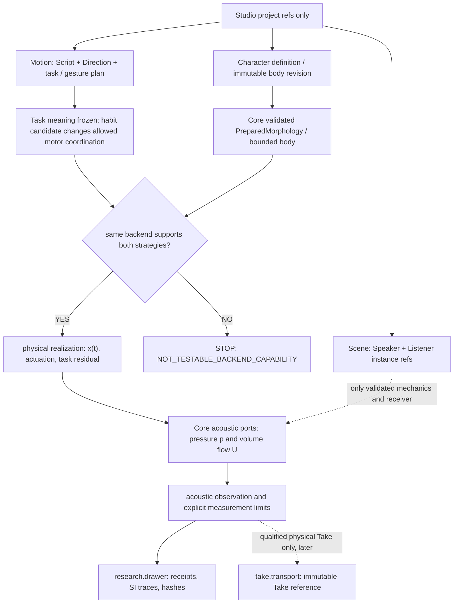
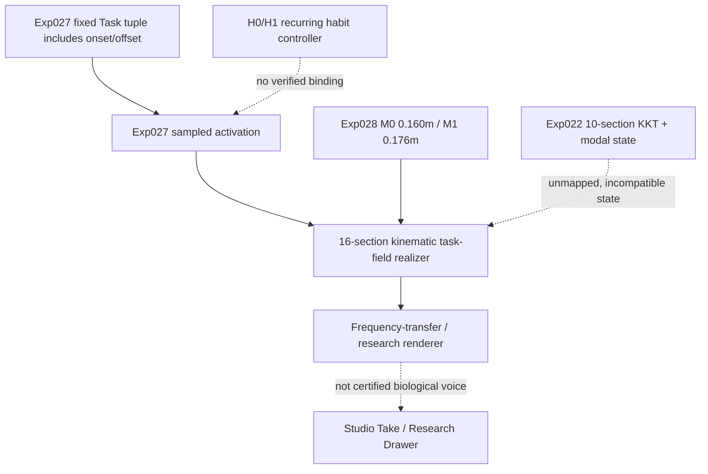
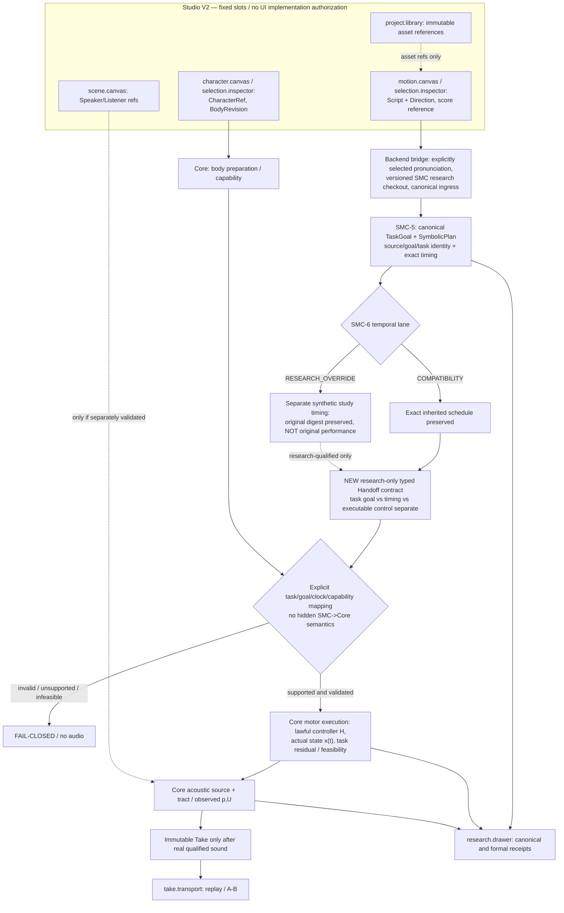
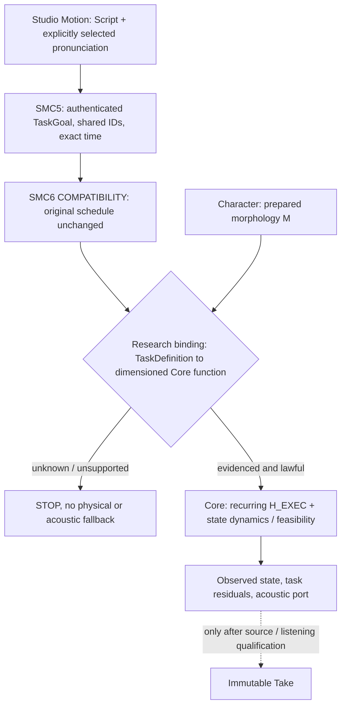
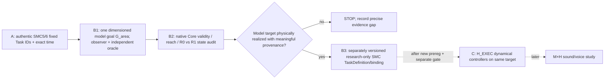

# CVI-1 — SYSTEM (Gate A proposal, not an adopted architecture)

2026-10-27 JST · Issue #223 · Core main baseline `e05e3274ad69bfb9202816049f6661a18ba39ec0`.

**Primary responsibility:** research-local experiment in Core embodied motion realization and acoustic observation. This file is not a runtime API and does not authorize a Studio UI edit or a merged MotorPersona type.

## Creator-facing promise, if experimentally established

The creator chooses an exact body revision and a habitual physically executable motor strategy. The **same task meaning** is physically realized in that body. Changing anatomy and changing habitual performance are distinguishable authoring actions. The generated sound is a consequence, not a selected timbre preset.

## Causal model (ownership, no shortcuts)



No generated waveform, speech target, phoneme label, listener quality, or neural embedding may directly override `Realize`. An infeasible task has no acoustic fallback. A waveform from a *prescribed diagnostic source* must be labeled accordingly, not biological speech.

## Current implementation boundaries requiring an explicit preflight

- `experiments/022_shared_body_multigesture`: compatible shared-state interaction in a **10-section** reduced physical fixture, NOT a 16-section live phonator.
- `experiments/028_task_field_morphology_transfer`: a **16-section** three-task two-body physical/acoustic transfer; same frozen task, 0.160m/0.176m. No established habit control.
- `experiments/029_task_field_embodied_infeasibility`: explicit unsupported/infeasible distinction and no acoustic fallback.
- `src/morphoacoustics_graph`: bounded fixed passive typed acoustic graphs. Their edge laws are not a generic time-varying source, actuating tongue, or organic voice.
- VF-1A/1B and M5 pressure work have not qualified self-oscillating, physiologically credible acoustic voice; do not import them into this design.

**Preflight is the first experimental decision**: demonstrate using source references whether both H0/H1 are executable on the *same* verified M0/M1 physical backend, without copying Exp022 arrays into Exp028. If not, stop and return a research-backend capability gap, rather than write an adapter by fiat.

## Fixed Studio contract mapping (reference only, NO UI changes)

Normative Studio ADR: `morphoacoustics-studio/docs/product/STUDIO_WORKSPACE_V2_DECISION.md` (2026-10-26 ACCEPTED/FROZEN).

| Studio slot | Authoritative data | CVI-1 future use | Explicit ban |
| --- | --- | --- | --- |
| `character.canvas` | Character/OrganGraph references | choose BodyRevision; future physically legal edit | no voice rendering / invented organ solver |
| `motion.canvas` | performance task / Direction / gesture refs | select/coordinate a lawful habit | no physical topology rewrite |
| `scene.canvas` | SceneDocument instances | choose Speaker / Listener refs | no fictitious 3D contact |
| `selection.inspector` | selected domain entity | inspect eligible parameters/status | no duplicate physics model |
| `project.library` | asset references | navigate characters, scripts, Takes | no solver state |
| `take.transport` | immutable Take ref/playback state | later source/receiver-qualified A/B | no backend control |
| `research.drawer` | ValidationReceipt/provenance | show tests, numeric signal provenance | no visual panel proliferation |

SMC lives independently in `packages/speech-motor-compiler/`, and ASMR in `asmr/`. They are optional future imports at existing Motion/Scene boundaries. No code dependency or fourth tab in CVI-1.

## Acceptance split

1. Representation and backend applicability, **not audio**.
2. Physical intervention isolatability and independent numerical floor.
3. Auditable acoustic changes across task contexts, **not human voice identity**.
4. Later blind creator A/A and A/B Takes with qualified source, radiation and receiver, **not automatically approved by physics**.
5. Separate creator-approved public Core/Studio contract gate before any UI implementation.

Reference: [Core #223](https://github.com/ryonakayama234/morphoacoustics/issues/223), [Studio ADR](https://github.com/ryonakayama234/morphoacoustics-studio/blob/main/docs/product/STUDIO_WORKSPACE_V2_DECISION.md), [CVI conceptual hypothesis](https://github.com/ryonakayama234/morphoacoustics/blob/main/docs/research/motor-skill-persona-hypotheses-v0.md).


## Gate 0 source audit — 2026-10-27 (static inspection only)

This is **not** a solver implementation, experiment execution, or adoption. Core main baseline: `e05e3274ad69bfb9202816049f6661a18ba39ec0`.



**Observed method boundaries:**
- Exp027 `TASKS` fixes all three onset/offset values at 0.150/0.350 s. `task_activations_at_time(time_s, control_step_s)` derives activation from these frozen tasks, not from a controller argument.
- Exp027 `realize_task_geometry_from_activations(start, activations, cavity_id)` does accept three finite [0,1] activation values and returns positive area sections by additive log-diameter fields. This is a kinematic surface, **not** an established H0/H1 habitual strategy or a force-based biomechanical response.
- Exp028 audits and binds 16-section M0/M1 on the *same frozen* task/transfer path, but has no independently controlled H factor. Exp029 provides a narrow no-fallback `INFEASIBLE` precedent only.
- Exp022's 10-section custom KKT/modal physical state, velocity and constraint equations cannot be silently grafted onto Exp028's 16-section task-field geometry.

**Candidate narrow future interface (research-local; NOT an API):**

```text
Frozen research GoalSet (task/location/degree; own digest)
        + ControllerStrategy H (lawful motor schedule, own digest)
        + PerformanceContext T (independent transient direction)
        + PreparedMorphology M (exact source revision)
                    |
       One explicitly verified 16-section realizer
       -> task residual / feasibility / geometry trace
       -> declared acoustic source and observation port
```

The existing Exp027 task plan includes timing in its identity. Separating goal semantics from timing **must create a new research-local identifier**, not rewrite the audited historical hash or pretend those hashes mean the same thing. H0/H1 need declared independent motor laws and legal feasible domains; a different interpolation curve alone does not certify a persistent biological motor habit.

**G0 disposition:** no demonstrated same-backend M0/M1 × H0/H1 path on current interfaces: `NOT_TESTABLE_BACKEND_CAPABILITY` for the full proposed factorial, **not** a claim that such motor habits are impossible in nature. No Core public contract or Studio panel modified.


## 2026-10-27 — SMC-first integration architecture / pre-implementation decision D1

**Status: DESIGN REFINEMENT ONLY.** Core main baseline `e05e3274`; independently reviewed SMC-6 Gate B research [PR #225](https://github.com/ryonakayama234/morphoacoustics/pull/225) (software-accepted bounded formal math only, **unmerged stacked branch**). SMC-5 [PR #211](https://github.com/ryonakayama234/morphoacoustics/pull/211) is **GO_LIMITED_SYMBOLIC** only. This CVI Draft remains based on Core main, **does not cherry-pick/import/merge any SMC source**, and changes neither SMC nor Core's public APIs.

### Architectural decision: SMC is the planned motor *planning* entrypoint, not an optional decoration

The previous diagram's "SMC optional" meant only *not a prerequisite for source-only science at that time*. For the **planned Studio Script -> Motion -> Perform workflow**, adopt the following *research architecture direction* without pretending it exists:



**Authority boundaries:**

1. **SMC (independent Python package)** owns canonical selected pronunciation, Task identity/many-to-many sharing, symbolic goal interval, temporal constraints, feasible set and explicitly identified schedule. It does **not** generate a physical actuator, speaker identity, acoustic waveform, or body `INFEASIBLE`.
2. **CVI-1** is a *testable hypothesis about stable motor-policy variation*, not an alternate Script compiler, new tone-renderer or public `MotorPersona` API. A proposed recurring habit can influence **(a)** the choice among permitted symbolic schedules (future SMC policy gate, *not yet supported*), and **(b)** Core's physical-control strategy for an **unchanged selected schedule** (preferred first CVI causal test). These two interventions must be tested separately; never attribute planner timing selection to physical motor skill.
3. **A narrow research-only integration adapter** must authenticate SMC identities, declare exact symbolic-to-Core task/capability mapping, map seconds/units/coordinates with an independent witness, and return fail-closed statuses. It must not silently reinterpret SMC5 scalar intervals as Exp027 constriction degrees, physical actuator force or target area.
4. **Core** owns `PreparedMorphology`, realizability, constraints, actual motor state/dynamics, source-tract/organ-graph physics and acoustic observation. Existing Exp027/028 provide a bounded *kinematic* surface, not proven motor-habit dynamics. Exp022's 10-section modal state is not the same backend as Exp028's 16 sections.
5. **Studio** owns only creator actions and references in the **already frozen** V2 slots. For Python SMC, Studio would call a versioned **local backend service**, never import Python into TypeScript or add a fourth mode. No Studio UI change is authorized in this Draft.
6. **ASMR** remains an independently gated physical/scene capability at the Scene boundary. It is not a compiler dependency or a fourth tab.

### The critical timing-integrity problem

SMC-5's event equalities/anchors and `CouplingConstraint.lag_s` are hard exact timing. SMC-6 `COMPATIBILITY` faithfully retains them, and so has **no H0/H1 timing degrees of freedom** to choose from. SMC-6 `RESEARCH_OVERRIDE` deliberately *replaces* those exact source timing constraints for a labeled synthetic study; its witness **cannot** be sold as faithful reading/performance of the original SMC-5 candidate. A later SMC goal-vs-temporal-contract revision requires its *own* decision, proof and ABI gate.

**Chosen narrow starting semantics:** hold the SMC-authenticated task/goal/timing identical while contrasting two lawful *body-level* motor policies; only when this is physically expressible and supported should an H test run. This preserves SMC as the motion planning origin without requiring an unapproved SMC scheduler optimization. A future timing-habit study is separate and may study selectable schedules only under a *new properly authorized flexible timing contract*, not a silent override.

**Branch and dependency policy:** keep CVI #224 docs on main-derived branch. SMC-4 B-R -> SMC-5 -> SMC-6 remain an unmerged stacked research family. A future disposable integration research branch must explicitly pin/check all required parent source SHAs and its change manifest, with no production import or Studio bridge until independent compatibility, semantic and creator gates. Do not call the presence of the `packages/` path on SMC's Draft branch a feature on Core main.

**Open decision before code:** Can any currently supported Core realizer accept SMC TaskGoal semantics with independent physical meaning and a second *feasible* recurring control policy? If no, STOP at `NOT_TESTABLE_BACKEND_CAPABILITY`; the first later task is a separately proposed and measured realizer/bridge, **not** a fake custom H slider.

## D2 refinement — SMC-first motor ownership and typed Core handoff (2026-10-27)

**Research architecture, not implemented integration or UI authorization.** Interpret the earlier "SMC optional" only as "not imported by the then-unexecuted Core experiment". For the intended Script-to-Motion workflow, SMC is the authoritative **motor-planning lineage**. Core remains responsible for actual moving material, feasibility, physical state and sound, not a rival text compiler.

There are two distinct *future* habit locations. **H_EXEC** is a recurring, physically defined Core execution/control law, changing the achieved movement under the *same* SMC5 TaskGoal and SMC6 COMPATIBILITY exact event table; it is the **first CVI comparison**. **H_PLAN** is a later SMC-owned coordination preference selecting among legitimately flexible temporal solutions, and needs a separately authorized new timing contract. SMC6 RESEARCH_OVERRIDE does not count as faithful H_PLAN because it explicitly replaces original SMC5 exact timing for synthetic research. Per-take Direction is neither persistent habit. A future combined style reference may name separate H_PLAN and H_EXEC revisions, but **no public MotorPersona type is adopted**.



**Semantic trap confirmed by source:** SMC5 `TaskGoal` itself has `definition_id`, `semantic_revision`, `goal_kind`, `capabilities` and scalar `lower/upper`; it does **not** expose the TaskDefinition's `variable`, `value_domain` or `applicability_domain` fields directly. An adapter must re-authenticate the exact canonical request/lexicon, join through immutable definition identities and explicitly document physical target, coordinate frame, dimensional conversion and capability predicates. Matching string `CONSTRICT` to a Core `Gesture` or mapping a unitless SMC bound to a length is **not** a scientific binding.

Symbolic `ONSET/OFFSET` events are *planned* times. Actual onset/attainment of a tissue/tract state must be observed and may differ, without mutating that SMC receipt. The planned coordination is SMC-owned; Core actuation response is Core-owned; Studio V2 fixed Character/Motion/Scene slots only reference both. UI must remain unchanged until separate creator approval.

SMC source currently belongs to an **unmerged stacked Draft lineage**, not Core main. Any future disposable integration checkout must pin explicit SMC ancestry, exact source/TaskLexicon SHAs, Core base and adapter hash; no product import, cherry-pick or main merge is implied. Source: SMC `symbolic_bridge.py`, `temporal_stn.py`, Draft #211/#225; Core `src/morphoacoustics/domain/gesture.py`; CVI Draft #224.

## 2026-10-27 — Gate B decision: measured task first, minimum controller audit in parallel

**Decision:** choose **physical-task-definition-first, not controller-first**, but build one short **observable-goal → capability → actual-state** vertical slice; avoid an unbounded task ontology. Follow-up [Issue #227](https://github.com/ryonakayama234/morphoacoustics/issues/227). This amendment is design-only, does not change frozen Exp019–022 or Exp027–029 sources, and is not a new public Core/SMC contract.

Repository evidence: the SMC preflight [Draft #226](https://github.com/ryonakayama234/morphoacoustics/pull/226) authenticated 3 synthetic goals / 6 exact symbolic events, but independently supported **0/3** Core physical task bindings. SMC's synthetic `tract/open_closed` is not automatically Core `CONSTRICT`. Core Fidelity-0 `Tract1DRealizer` already accepts a dimensioned `target_area` parameter (`m2`) and a normalized location; Exp019/022 provide a *separate 10-section* reduced minimum-energy/shared-state realization, and Exp020 reports finite-time state without muscle claims. Exp027–029 use a distinct *16-section* calibrated task-field / morphology path; no implicit 10→16 mechanical bridge.

**Chosen Stage-B research candidate:** `G_area`: the measured cross-sectional area `A_j(x)` (m²) of a named prepared 1D tract section (located via dimensionless ξ, resolved to metric s and integer j **on that body**), constrained by explicitly dimensioned positive target bounds. Audit the existing Exp019 single-target fixture `A_rest=3.0e-4 m²`, `A_target=5.0e-5 m²`, `ξ=0.65`, `j=6` / 10-section model **as candidate existing evidence**, not a silently adopted universal task. `G_area` describes the **model's geometric goal**; it does **not** specify a tongue, lip, gap distance, biological constriction degree, muscle activation, contact or phoneme. Geometry is measurable from existing state; physical *actuation* is a separate proof.

Proposed ordering:



SMC remains the sole motor *planning* lineage; this stage may not backfill a physical result onto its original synthetic lexicon or alter its SMC6 COMPATIBILITY events. Test the target and existing model capabilities first, then describe a **new, explicitly qualified research mapping**. Core remains the authority for bodily motion. Stage-C H_EXEC controllers cannot be selected until Stage-B demonstrates an actual usable task measure. Studio V2 and production ABI remain frozen.

**Immediate integrity debt before B outcome:** Codex's independent review on Draft #226 final source head `ef151632` found a P2 gap: the A09 no-physics/no-output claim had no source-import scanner or execution/side-effect negative test. Closing and rerunning that guard is a separate prerequisite, not a reinterpretation of the 0/3 semantic STOP. No completed fix is claimed by this design.


## D4 precision — Stage B measurand, inference boundary and next research architecture (2026-10-28)

**Decision sharpened after source review, design only:** order is **B0 review-hygiene → B1 geometric *measurand* → B2 native Core R0/R1 *reduced-state response* → B3 a separately authenticated model-only SMC lexicon/binding → C (later) actual H_EXEC motor-control dynamics**. The first scientific question is *not* “can SMC generate a CONSTRICT label?” but “what named functional quantity does that request constrain, and what law makes a body respond?” None of B1–C was newly executed by this amendment.

`MODEL OBSERVATION`: one audited 10-section Fidelity-0 prepared tract, body-local normalized axial coordinate ξ (inlet/source 0 → outlet/radiation 1), with observed actual returned-state section area `g_B(x)=A_{j_B(ξ)}(x)` in m². The section index `j_B(ξ)` is **a prepared-body mapping**, not a universal articulator or lexical property. A named model section/segment is not a tongue surface, 3D airway area measurement or human constriction degree. Body changes can alter `j_B` and centerline length: do not compare by the same integer index across morphologies without a second landmark/coordinate proof.

`SOLVER AND INTERVENTION`: Core Fidelity-0 R0 is direct projection; Exp019 R1 is a *dimensionless reduced quadratic area-ratio equilibrium* with a positive-area rejection, not tissue force/work. Exp020 R2 and Exp022 modal histories are mathematical state dynamics without validated muscle actuators, and must not be described as physics-grade H_EXEC just by varying `omega`. A later physically claimed controller must add declared actuation port and units, state x/v, coupling/work law or explicitly bounded surrogate law, actual task feedback/residual and perturbation test, plus honest capability receipts. No physiology from the word “minimum energy”.

`CAUSE/OWNERSHIP`:
```text
Studio Motion/Script (frozen UI, not written)
    -> SMC5 authentic task occurrence/definition + SMC6 exact COMPATIBILITY times
    -> future research binding [new, model-only semantic revision; no legacy relabel]
    -> Core immutable prepared body -> ξ/j/axial-s position and legal capability
    -> Core model-specific R0 / R1 state x (B1/B2; NO physical H yet)
    -> returned-state observer A_j(x) [m²] + oracle + failure receipt
    -> STOP B if unmeasurable/invalid/unsupported/infeasible/unresolved
    -> (later separate Gate C) actual actuator, controller H_EXEC, response and acoustic law
```

**Crucial two distinct references**: the *original* SMC5 canonical and timing receipt stays historically unchanged (synthetic TaskGoal); any proposed `G_area` model-meaning input must be separately versioned and freshly compiled. Changing its lexicon changes candidate identity; never assert SMC digest equality between legacy and new semantics. Hold exact event timing within **each** authentic candidate and forbid SMC6 RESEARCH_OVERRIDE masquerading as the same utterance.

**Claim tiers:** `B1_MODEL_MEASURAND_DEFINED` (state observer+units and location), `B2_REDUCED_MODEL_RESPONSE_SUPPORTED` (R0/R1 reachability, constrained model and independent algebraic oracle, no actuator), `B3_SMC_MODEL_BINDING_ONLY` (new synthetic-evidence-only compiler linkage); **none is full physical control, phonetic validity, H_EXEC habit or voice identity**. `C_ACTUATED_MOTOR_RESPONSE_SUPPORTED` is a future distinct proof. Existing Issue #227 and Foundation #199 continue to own work; no new public schema, numerical output or UI.
