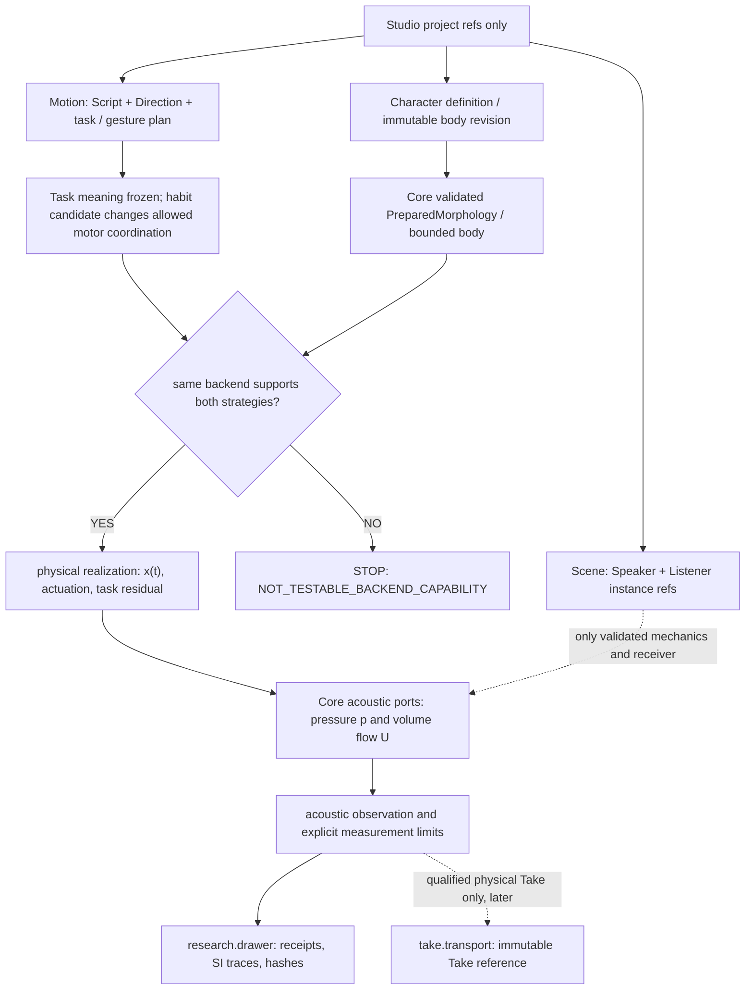
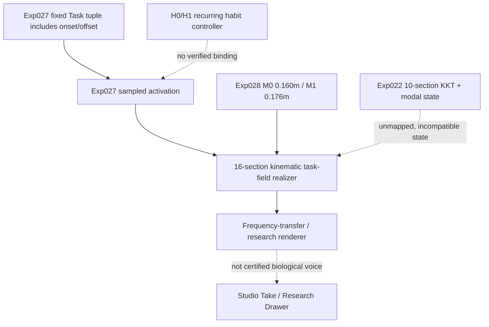

# CVI-1 — SYSTEM (Gate A proposal, not an adopted architecture)

2026-10-27 JST · Issue #223 · Core main baseline `e05e3274ad69bfb9202816049f6661a18ba39ec0`.

**Primary responsibility:** research-local experiment in Core embodied motion realization and acoustic observation. This file is not a runtime API and does not authorize a Studio UI edit or a merged MotorPersona type.

## Creator-facing promise, if experimentally established

The creator chooses an exact body revision and a habitual physically executable motor strategy. The **same task meaning** is physically realized in that body. Changing anatomy and changing habitual performance are distinguishable authoring actions. The generated sound is a consequence, not a selected timbre preset.

## Causal model (ownership, no shortcuts)



No generated waveform, speech target, phoneme label, listener quality, or neural embedding may directly override `Realize`. An infeasible task has no acoustic fallback. A waveform from a *prescribed diagnostic source* must be labeled accordingly, not biological speech.

## Current implementation boundaries requiring an explicit preflight

- `experiments/022_shared_body_multigesture`: compatible shared-state interaction in a **10-section** reduced physical fixture, NOT a 16-section live phonator.
- `experiments/028_task_field_morphology_transfer`: a **16-section** three-task two-body physical/acoustic transfer; same frozen task, 0.160m/0.176m. No established habit control.
- `experiments/029_task_field_embodied_infeasibility`: explicit unsupported/infeasible distinction and no acoustic fallback.
- `src/morphoacoustics_graph`: bounded fixed passive typed acoustic graphs. Their edge laws are not a generic time-varying source, actuating tongue, or organic voice.
- VF-1A/1B and M5 pressure work have not qualified self-oscillating, physiologically credible acoustic voice; do not import them into this design.

**Preflight is the first experimental decision**: demonstrate using source references whether both H0/H1 are executable on the *same* verified M0/M1 physical backend, without copying Exp022 arrays into Exp028. If not, stop and return a research-backend capability gap, rather than write an adapter by fiat.

## Fixed Studio contract mapping (reference only, NO UI changes)

Normative Studio ADR: `morphoacoustics-studio/docs/product/STUDIO_WORKSPACE_V2_DECISION.md` (2026-10-26 ACCEPTED/FROZEN).

| Studio slot | Authoritative data | CVI-1 future use | Explicit ban |
| --- | --- | --- | --- |
| `character.canvas` | Character/OrganGraph references | choose BodyRevision; future physically legal edit | no voice rendering / invented organ solver |
| `motion.canvas` | performance task / Direction / gesture refs | select/coordinate a lawful habit | no physical topology rewrite |
| `scene.canvas` | SceneDocument instances | choose Speaker / Listener refs | no fictitious 3D contact |
| `selection.inspector` | selected domain entity | inspect eligible parameters/status | no duplicate physics model |
| `project.library` | asset references | navigate characters, scripts, Takes | no solver state |
| `take.transport` | immutable Take ref/playback state | later source/receiver-qualified A/B | no backend control |
| `research.drawer` | ValidationReceipt/provenance | show tests, numeric signal provenance | no visual panel proliferation |

SMC lives independently in `packages/speech-motor-compiler/`, and ASMR in `asmr/`. They are optional future imports at existing Motion/Scene boundaries. No code dependency or fourth tab in CVI-1.

## Acceptance split

1. Representation and backend applicability, **not audio**.
2. Physical intervention isolatability and independent numerical floor.
3. Auditable acoustic changes across task contexts, **not human voice identity**.
4. Later blind creator A/A and A/B Takes with qualified source, radiation and receiver, **not automatically approved by physics**.
5. Separate creator-approved public Core/Studio contract gate before any UI implementation.

Reference: [Core #223](https://github.com/ryonakayama234/morphoacoustics/issues/223), [Studio ADR](https://github.com/ryonakayama234/morphoacoustics-studio/blob/main/docs/product/STUDIO_WORKSPACE_V2_DECISION.md), [CVI conceptual hypothesis](https://github.com/ryonakayama234/morphoacoustics/blob/main/docs/research/motor-skill-persona-hypotheses-v0.md).


## Gate 0 source audit — 2026-10-27 (static inspection only)

This is **not** a solver implementation, experiment execution, or adoption. Core main baseline: `e05e3274ad69bfb9202816049f6661a18ba39ec0`.



**Observed method boundaries:**
- Exp027 `TASKS` fixes all three onset/offset values at 0.150/0.350 s. `task_activations_at_time(time_s, control_step_s)` derives activation from these frozen tasks, not from a controller argument.
- Exp027 `realize_task_geometry_from_activations(start, activations, cavity_id)` does accept three finite [0,1] activation values and returns positive area sections by additive log-diameter fields. This is a kinematic surface, **not** an established H0/H1 habitual strategy or a force-based biomechanical response.
- Exp028 audits and binds 16-section M0/M1 on the *same frozen* task/transfer path, but has no independently controlled H factor. Exp029 provides a narrow no-fallback `INFEASIBLE` precedent only.
- Exp022's 10-section custom KKT/modal physical state, velocity and constraint equations cannot be silently grafted onto Exp028's 16-section task-field geometry.

**Candidate narrow future interface (research-local; NOT an API):**

```text
Frozen research GoalSet (task/location/degree; own digest)
        + ControllerStrategy H (lawful motor schedule, own digest)
        + PerformanceContext T (independent transient direction)
        + PreparedMorphology M (exact source revision)
                    |
       One explicitly verified 16-section realizer
       -> task residual / feasibility / geometry trace
       -> declared acoustic source and observation port
```

The existing Exp027 task plan includes timing in its identity. Separating goal semantics from timing **must create a new research-local identifier**, not rewrite the audited historical hash or pretend those hashes mean the same thing. H0/H1 need declared independent motor laws and legal feasible domains; a different interpolation curve alone does not certify a persistent biological motor habit.

**G0 disposition:** no demonstrated same-backend M0/M1 × H0/H1 path on current interfaces: `NOT_TESTABLE_BACKEND_CAPABILITY` for the full proposed factorial, **not** a claim that such motor habits are impossible in nature. No Core public contract or Studio panel modified.
