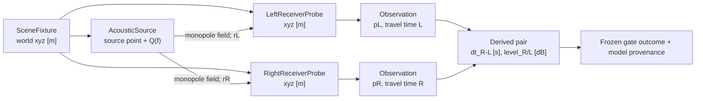

# EL-G0 — Data structures, flow and provenance

## The meaning of nodes / edges

The edges are **propagation/observation relations**, *not* tissue contact, organ attachment, mechanical F·v coupling or acoustic two-port p·Q coupling. The two receiver points are not anatomical organ nodes.

## Executable input fixture (SI)
| Field | Type | Meaning |
| --- | --- | --- |
| sources.center/offset/mirror | xyz, m | world-frame monopole location |
| left / right probe | xyz, m | mathematical measurement point |
| frequency_hz | positive scalar, Hz | monochromatic test frequency |
| sound_speed_m_s | positive scalar, m/s | propagation |
| air_density_kg_m3 | positive scalar, kg/m³ | monopole scaling |
| volume_velocity_m3_s | scalar, m³/s | source complex volume-velocity amplitude |
| time convention | literal | exp(-i ω t) with exp(-ikr) spatial phase |

## Result (schema el-g0-result-v0)
| Key | Shape / units | Interpretation |
| --- | --- | --- |
| schema_version, hypothesis_id, model_id, preregistration_id | strings | stable search identifiers |
| source_sha256 | hex SHA-256 | runner content provenance, not git commit |
| physics | object | c, rho, f, Q, time convention, environment |
| receiver_type | literal | point-probe limitation |
| observations.center/offset/mirror | objects | frozen scene instances |
| ...source_position_m | 3-vector, m | actual source |
| ...left_probe / right_probe | objects | named observation point |
| ...probe.distance_m, travel_time_s | scalar SI | r, r/c |
| ...probe.complex_pressure_pa | real/imag scalars, Pa | p(r,f) phasor; do not coerce to scalar level |
| ...probe.pressure_magnitude_pa | scalar, Pa | abs complex pressure |
| ...right_minus_left_delay_s | scalar, s | tR-tL; sign preserved |
| ...right_over_left_level_db | scalar, dB | 20log10(abs pR / abs pL); **not calibrated SPL** |
| gates | map Boolean | results of preregistered checks |
| decision, claim_limit | literals | provisional evidence only |

## Flow and change management
1. `PREREGISTRATION.md` locks the fixture, hypothesis and gates **before numerical results**.
2. `run.py` computes point pressures and pairwise contrasts; rejects nonfinite/singular inputs.
3. Automated `test_experiment_040_listener_g0.py` checks symmetry, sign, formula and invalid inputs.
4. Run command serializes JSON to a **new path only**, with runner SHA-256 and precise SI coordinates. Commit or attach output with the source revision recorded.
5. `RESULTS.md` links the evidence, reports discrepancies and stays separate from the interpretation/adoption vote.
6. Schema changes require version bump and a preserved migration note; speaker Core types must not be changed for the experiment.

## Measurement boundary
The present probe samples ideal free-field pressure at a coordinate only. In future, an **ear-canal entrance, blocked canal and tympanic membrane plane must be separately named**; do not append an ear-canal response to data that already includes it. Spectrogram, subjective ASMR and touch are downstream, separate observations, not physical states or motor goals.
