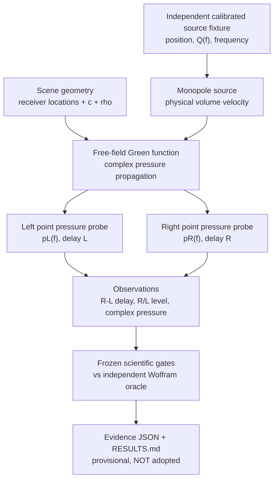
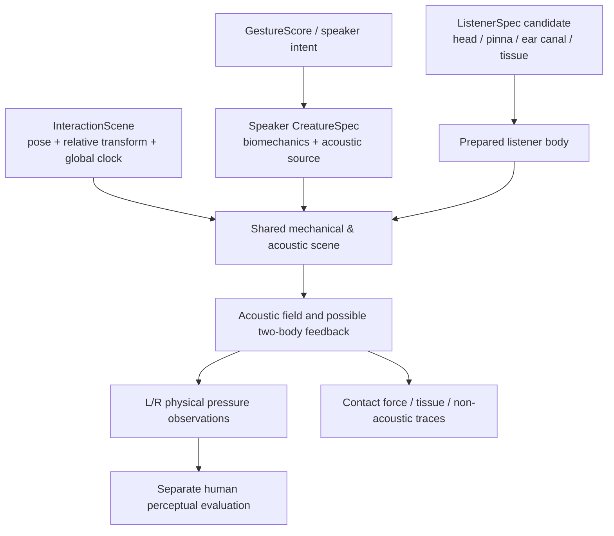

# EL-G0 — System architecture (research only)

## Present executable causal graph

## Future architecture target — NOT implemented

The dashed conceptual distinction is architectural: *the second graph is a research destination, not the solver currently present*. EL-G0 only exercises the upper diagram.

## What was actually included
- Speaker: **synthetic, independent point monopole**. No CreatureSpec, articulation, vocal fold, breath, lick, wet sources, or source-side feedback.
- Listener: two **ideal point pressure probes**. Locations only; no head diffraction, tissue properties, canal impedance or pinna.
- Scene: 3D Euclidean coordinates, fixed point positions. No motion, collision or two-body coupling.
- Outputs: frequency-domain pressure phasors, analytic propagation delay and level ratio; no waveform/ASMR perceptual output.

## Fidelity and failure semantics
The mathematics is an **ideal monopole null**, not measured HRTF. Anatomical model claims need separately calibrated evidence. Invalid coordinates / singular coincidence are rejected as INVALID rather than physical INFEASIBLE. Unknown anatomical performance is UNSUPPORTED BY THIS EXPERIMENT, not silently rendered by point probes.

## Research next steps
G1: fixed source and pose, change **pinna/head geometry**, compare no-pinna and rigid models with measured references at appropriate distances. G2: near-field distance-dependent HRIR/field against measured evidence **within its range**. G3: ear-canal termination and optional cartilage pathway. Only then isolate contact and counterfactual source-vs-transfer effects (EL-H04/H05). Perception stays a separate blinded human gate.

Reference: [PR #83](https://github.com/ryonakayama234/morphoacoustics/pull/83), [EL research gate 70](https://github.com/ryonakayama234/morphoacoustics/blob/docs/embodied-listener-research-20261011/docs/research/embodied-listener/70-research-gates.md).
