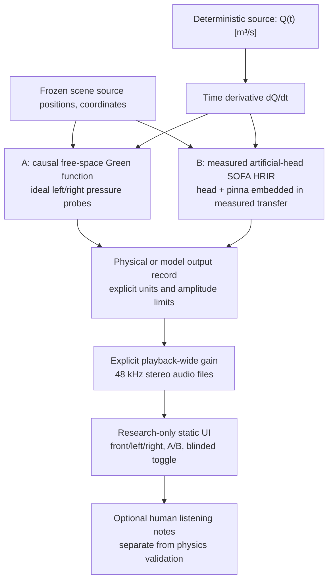

# System / ownership

- **Core/research:** volume-velocity source, free-field pressure solver, measured SOFA adapter, validation, SI/provenance outputs.
- **Studio:** unchanged. The HTML is a standalone experimental presentation only, not a new physics engine or feature promotion.
- **Source:** deterministic research fixture; no actual `CreatureSpec` or gesture simulation in this task.
- **Receiver B:** real measured head/pinna *transfer*, no geometry/material solver, user-specific hearing, ear mechanical vibration or contact.
- **Physical limits:** no listener movement, rooms, binaural head tracking, contact, cartilage conduction, wet sounds or psychophysical guarantee.
- **Comparison validity:** model-B amplitude/reference calibration unknown; matching loudness across A/B is a playback intervention. A/B directional/tonal comparisons are exploratory, not fully calibrated absolute-pressure testing.

The future speaker body -> spatial field -> anatomically grounded receiver pipeline remains PR #83's *research target*, not implemented here.
