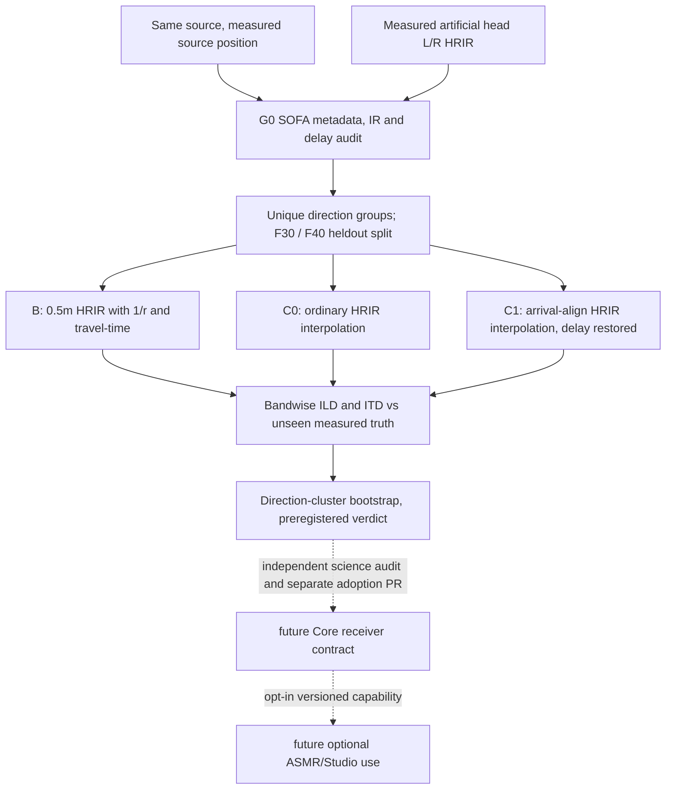

# EL-NF1 — scientific architecture

Only measurement-specific left/right **relative transfer** is investigated; SOFA HRIR is not calibrated Pa-per-source-Q. The ear canal/blocked-open reference plane and absolute scale are unresolved. `Data.Delay` is applied **once** as additional sample delay. B is 0.5m near-field fixed-reference, **not** a genuine far-field HRTF. C1 per-ear maximum-arrival alignment is an algorithmic hypothesis and can fail versus C0; it is not a biological ear model. No output loudness normalization, source impedance, room, head motion, contact or neural residual.
