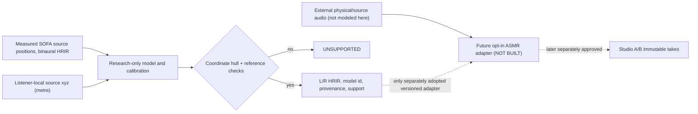

# EL-NF3 — SYSTEM / physical and computational architecture



## Invariants
Core owns physical body/source and acoustic observation meaning; Core MUST NEVER import ASMR. ASMR may eventually implement optional *audited* receiver adapters and must refuse unadopted studies. Studio owns composition, location controls, comparisons, immutable Takes, and must not import experiment scripts. This branch edits no `src/morphoacoustics`, `asmr/` package runtime, Performance Contracts or Studio.

Measurand: dataset-relative two-ear static receive response `h_e(q,t)`, e in {L,R}. An external source signal `s(t)` would, after legitimate transfer/routing checks, yield `y_e(t)=h_e(q,t)*s(t)`. Never claim absolute ear-drum Pa without a verified reference-pressure plane or mix an HRTF with a signal already containing receiver filtering.

Geometry is listener-coordinate Cartesian metres. SOFA spherical convention: azimuth around +z with +x front/+y left, elevation above xy; check dataset ListenerView/Up rather than assuming. Source position references must not become a shortest surface-to-surface gap. For Cartesian input `(x,y,z)`, r=sqrt(x²+y²+z²), az=atan2(y,x), el=atan2(z,hypot(x,y)). Do not conflate source distance with microphone distance.

## Models
B0 Cartesian nearest. B1 Cartesian nearest-k inverse-distance-weighted direct FIR. B2 3D Cartesian Delaunay barycentric, research-only with bounded point count, no 3D hull extrapolation. C1 B1 + per-ear largest-magnitude peak arrival proxy, integer/fractional FIR zero-padded shift. C2 radial-shell/angular Delaunay triangles using seam-safe duplicate azimuth nodes, 2 shell barycentric blend, guarded local simplex geometry, onset-constrained arrival separation, bilateral reconstruct. Onset proxy is NOT proven direct sound. The same angular weights are applied to both ears; ear-specific arrival times may differ. Invalid simplex or topology -> explicit refusal, not silent B0 substitution.

Calibration, when actually fitted on disjoint spatial blocks, may **abstain** based on training-neighbor geometry and calibrated residual error. Never use unseen truth in a prediction/refusal. No numerical claim before measured Gate G3. Do not portray 20-50 cm as direct ear contact or continuous head-tracked acoustic simulation.

## Future research-only interface sketch
```text
predict(query_xyz_m, trained_SOFA, algorithm_id, geometry_policy)
  -> supported {left_hrir,right_hrir,fs,provenance,geometry_diagnostics}
  | unsupported {reason,provenance}

calibrate(model, disjoint_calibration_blocks) -> frozen_selection_policy
validate(frozen_model, final_heldout_blocks) -> audit receipt
```
