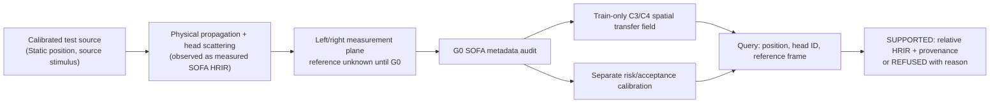

# EL-NF4 — SYSTEM / causal and architectural contract

- Ownership: source is outside receiver, no modification to Core, source/gesture, material, SMC or Studio. This experiment predicts measured static receiver transfer; it is not a source solver.
- The current `asmr/` distribution on main is metadata-only; `require_adopted` continues to refuse all non-adopted models. Research implementation stays in `experiments/048_el_nf4_receiver/` and `tests/`. No production public API.
- Source and receiver frame/unit must be obtained from SOFA. Coordinate operations are explicit; inferred az/el do not imply common microphone/reference plane.
- Magnitude, interaural level, interaural time and optional monaural spectral shapes are **observables**, not listener perception or timbral preference.
- A `SUPPORTED` tag is a research operating point with empirical held-out performance, not a proof of physical accuracy at arbitrary off-grid conditions.
- Provenance includes file SHA-256, training-role manifest and algorithm params. No raw measured IR data committed or distributed.
- No posthoc threshold adjustment against final samples; distinct human independent review G5 before feature adoption.

## Work artifacts
`INDEX.md` AI routing; `DATA.md` source and rights; `PREREGISTRATION.md` immutable D0; prospective `PREREGISTRATION_V1_1.md` G0 geometry-only if required; `EXPERIMENT.md` runnable procedure; `RESULTS.md` dated append-only log; `DECISIONS.md` explicit promotion gate.
