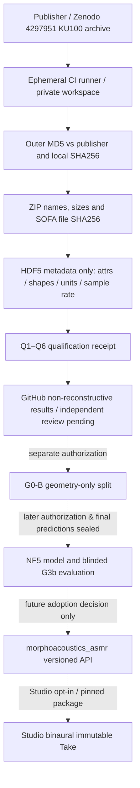

# G0-A2 SYSTEM — authority and measurement path

## Observation firewall
Permitted: original archive byte-level checksum, members' sizes/names and SHA256, root convention/rights attributes, Data.IR and Data.Delay **shape/dtype only**, source/receiver position **shape/coordinate units only**, scalar sampling rate. Refuse to read `Data.IR` samples or `Data.Delay` numerical contents. No per-location geometry values, no final HRIR, no automatic test-set split. Source/SOFA must remain ephemeral in the runner and never be uploaded as GitHub artifacts or added to git.

The metadata-only job cannot prove physical absolute time-of-flight, correct channel orientation, actual microphone plane, phase integrity, frequency-band fidelity, gain restoration, or independent spatial-block feasibility. It can detect unsupported/missing metadata, not validate unobserved physical acoustic truth.

## Physical boundary
The measured endpoint is an **artificial-head recording plane** until independently established, not the human eardrum. `Data.IR` is a postprocessed 128-tap response (as reported), not uncorrected physical pressure. Shared transformations may cancel in ILD or ITD, but channel-specific unknown operations cannot be assumed harmless. `Data.Delay` field existence is not a time-of-flight calibration.

Current Core owns body physics and source; research data here do not enter Core. ASMR workspace currently publishes registry metadata only and MUST refuse this study as an adopted runtime capability.
