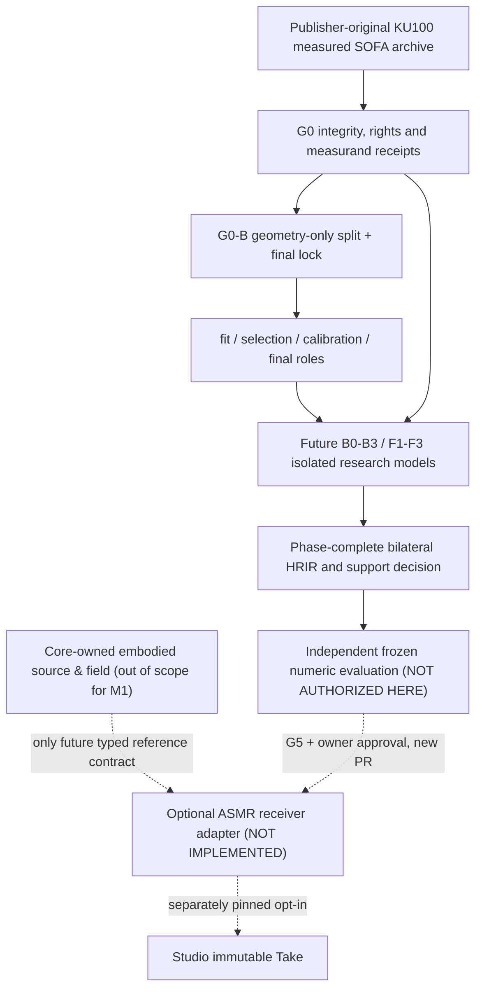

# SYSTEM — causal/ownership architecture
## Research-boundary diagram

## Ownership invariant
Core owns body morphology, gesture, speaker/source impedance and acoustic ports; ASMR may in future own a qualified measured receiver transfer and its bounded estimation. A measured HRTF is not an ear mechanical load, a physical head-scattering PDE solver, a subjective ASMR variable, or an unqualified absolute-pressure mapping. Studio may select source/listener poses and consume a versioned approved API; no experiment imports.
## Typed future boundary (NOT PUBLIC)
`ReceiverQuery(head_id, position_listener_m, coordinate_frame, source_reference_plane, input_excitation_convention, measurement_edition_sha)` →
`Supported(h_L, h_R, fs, window_origin, channel_plane, normalization, domain, model_hash, evidence_id)` OR `Refused(reason, unverifiable_field)`.
Never multiply a volume velocity derivative Qdot or Core Pa pressure by stored HRIR unless the measured excitation input/reference plane and source normalization make that transfer mathematically compatible. No double-counted free-field 1/r, ear-canal filter or source-to-head propagation. Composite rendering requires a subsequent separately audited source/receiver contract.
## Evidence boundaries
EVIDENCE_FREEZE = immutable positive/negative run; VALIDATED_COMPONENT_FREEZE = scientifically verified bounded estimator with G5 review; ADOPTED_CAPABILITY = separate owner-approved rights-compatible optional package release; Studio adoption is another independent decision. Mathematical C-TRANSFORM verification never implies full HRIR prediction.
