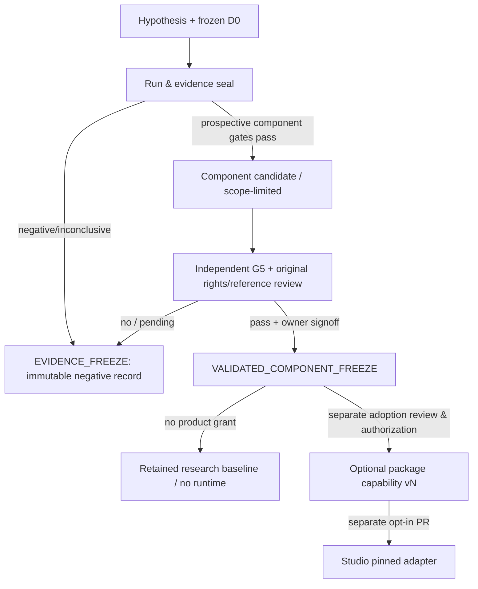

# EL-NF5 — COMPONENT_FREEZE_POLICY / prospective partial model freezing

**2026-11-01 | POLICY DESIGN ONLY. No selected predictor, component or coefficient is currently frozen, validated or adopted. This policy authorizes no implementation, data access or merge.**

## 1. Three distinct freeze concepts

**A. EVIDENCE_FREEZE:** Every completed run (positive, negative, inconclusive, blocked, failed integrity check) preserves immutable hypothesis/threshold/split/model/source SHA, per-block score and refusals, raw prediction seals as permitted, independent audit receipts and append-only negative notes. NF4's unsuccessful C4 remains a first-class frozen **negative experiment**, not an adopted algorithm.

**B. VALIDATED_COMPONENT_FREEZE:** A *specified* computation/predictor is immutable as a research comparison baseline after registered component-specific gate, externally qualified measurement endpoint and data evidence, independent code/acoustics review and precise claim limits. Different components may qualify separately; integrated F3 success is not inferred from one component.

**C. ADOPTED_CAPABILITY:** Separate owner-approved, rights-qualified, versioned production-facing adoption into optional `morphoacoustics_asmr` (not Core), with compatible Core contract, testing, rollback and no unreviewed physics. Studio opt-in/version pin and immutable Take are **another PR and decision**. B does not imply C, and A never implies B.

## 2. Eligible components / admissible claims

| ID | Candidate freeze unit | Evidence condition | Maximum claim |
| --- | --- | --- | --- |
| `C-TRANSFORM` | precise log-amplitude / ILD and delay/phase forward/inverse mathematical transform | Synthetic round-trip relative L2 <=1e-9, data-label/unit and hermiticity tests, exact reproducible implementation, independent arithmetic review | `VERIFIED_NUMERICAL_TRANSFORM` only; NO evidence of unseen-position receiver accuracy |
| `C-TIME` | hashed trainable arrival/ITD estimator with specific geometry/sample-rate/head domain | prereg §6 G3b: <=80% ITD error vs BOTH B0 and B*, both adjusted confidence lower bounds >0, S1/S2 improvement, adequate independent blocks/coverage, independent G5 | limited *measured-relative ITD* prediction on declared measured head/domain; no valid whole HRIR claim |
| `C-LEVEL` | common/interaural magnitude and frequency treatment, fixed weights | prereg §6 G3b: >=15% four-band ILD improvement vs BOTH, lower-band and p95 guards, adjusted intervals, S1/S2 and support, independent G5 | limited ILD and level-ratio prediction on this head/domain; not all-frequency timbre or eardrum pressure |
| `C-REASSEMBLY` | deterministic phase-complete complex-to-HRIR reconstruction, window/causality checks | numeric identity and L/R tests; if claiming physical HRIR accuracy then **also** prereg §5 G3b integrated full HRIR and review | numerical transform alone unless true measured reconstruction gate passes; not generic ear-canal physics |
| `C-SUPPORT+MODEL_HASH` | coupled abstention/risk policy plus exact frozen predictor and calibration | prereg §6 G3b: >=80% per-condition final coverage, tail/guard constraints, all refusals, separate calibration and independent G5 | error/coverage statement **only with exact associated predictor and measured regime**; cannot be transplanted freely |
| `NF5-INTEGRATED` | exact F1/F2/F3 selected predictor and its support policy | ALL integrated prereg §5 G3b criteria, independent G5 and rights/plane claim restriction | static relative bilateral HRIR interpolation for qualified head, geometry and measurement plane ONLY |

C-TRANSFORM / C-REASSEMBLY numerical identity may be kept in a **verified engineering baseline** without evidence from unseen HRIR. This is a different level from a **scientifically validated receiver predictor**. No physical accuracy should be inferred from a mathematically exact inverse transform.

## 3. Pre-registered selection, family error and guards

- Component candidates and associated endpoints are declared now, before any new G3b final-truth reveal. After seeing final results one may record exploratory effects but **cannot promote an unregistered best-looking subcomponent** to a retrospectively successful confirmatory freeze.
- ITD/ILD component improvement tests versus both baselines require all respective comparisons; if both C-TIME and C-LEVEL are proposed for independent freeze from the same final study, apply **Holm correction across their predeclared component endpoint tests** (or a reviewer-approved, prospectively committed more conservative family rule), record adjusted intervals/p-values, and declare the procedure before final-truth exposure.
- Coverage and S1/S2 block counts apply per component if that component is used as a predictor. C-SUPPORT is inseparable from the model/version and calibration-set hash.
- Component-specific claims require their own uncertainty, head/measurement-plane validity and exact success/failure protocol. No informal redefinition of a subcomponent or success threshold after scoring.
- Integrated model primary evidence and partial-freeze evidence remain distinct; no automatic full-model success from successful subcomponents.

## 4. Minimal immutable freeze manifest

Every frozen candidate should get a **read-only, versioned manifest** (prospective schema, no file created at D0) with:
```yaml
id: EL-NF5-C-TIME
freeze_class: VALIDATED_COMPONENT_FREEZE
version: v0.0.1-research
code_commit_sha: <specific tested commit>
model_or_coeff_sha256: <immutable if permitted>
data_original_sha256: <licensed source receipts>
data_license_and_derivative_rights: <reviewed grant and limits>
source_reference_and_listener_plane: <precise, claim-limited>
sample_rate_hz_and_time_zero: <declared>
coordinate_frame_and_unit: <listener-local metres, degrees>
training_role_manifest_sha256: <hash>
calibration_role_manifest_sha256: <hash>
blind_final_receipt_sha256: <hash>
final_truth_first_read_receipt: <timestamp and control>
registered_gates_and_results: <IDs, CIs, block counts>
coverage_domain_and_refusal_reasons: <explicit bounds>
failure_and_claim_limits: <human-readable>
independent_science_review_receipt: <review URL/identity>
owner_freeze_decision: <explicit decision ID>
promotion_status: RESEARCH_ONLY
```
Placeholders are illustrative, **not real filenames or values**. No unverified URL, fake hash, invented reviewer or model version is published as an actual frozen artifact.

## 5. Lifecycle and storage



- Research code/docs/evidence can remain in an isolated immutable commit, reviewed tag/commit and versioned manifest. **Do not merge it simply to freeze it**. Do not rewrite the old history or replace a negative run with a new positive tune.
- Component changes generate a **new** version and fresh compatible evidence; old version remains retrievable. If old data/license is revoked, mark distribution/deployment **DISABLED/RESTRICTED** without falsifying original experimental logs.
- Baseline reuse for newer experiments is allowed within its documented dataset/right/time/plane/domain; performance claims outside that domain require new qualification and testing. Pin exact version and refuse unsupported coordinates. Runtime auto-discovery remains disabled.
- Provenance must separate rights to read, research, redistribute the original, distribute transformed coefficients and commercial usage. E.g. SCUT embedded noncommercial clause cannot be defeated by freezing/deriving weights; commercial model/adoption requires independently established compatible rights.
- Store restricted raw measured data outside Git; publish only permitted hashes/aggregates. Preserve CI and independent review receipts even if time-limited GitHub artifacts expire via non-reconstructive checked summaries. Do not publish potentially reversible HRIR/weights in a metadata-only PR.
- No business/product `ADOPTED_CAPABILITY` status without separate approval, pinned public schema, compatible physical contract, support/refusal safety, regression tests, rollback and data/license audit.

## 6. Owner decision for this D0

**Approved today:** the definitions, prospective freeze-eligible components and criteria, the rule that evidence and adoption are separate, and documentation only.

**Not approved or decided today:** which component meets any gate, which concrete model or weight to freeze, whether any partial freeze is scientifically useful, any commercial license, any merged branch or ASMR/Studio API. Those decisions depend on future genuine evidence and independent review.
