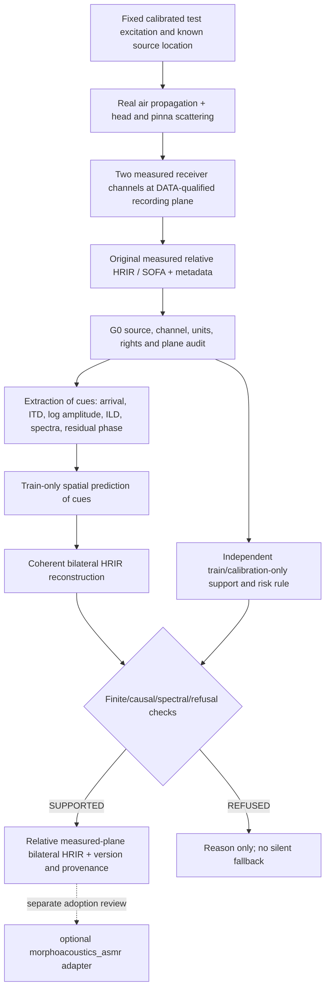

# EL-NF5 — SYSTEM / measured receiver and cue-factorized reconstruction

**Status: DESIGN_ONLY; hypothesis and proposed interfaces, not a model, solver or adopted contract.**

## Causal ownership / reference planes

- Core owns physical morphology, gestural realization, source and source-independent acoustics. NF5 predicts **receiver-side measured transfer**, never modifies source or physical movement.
- Physical measurand: per-head `h_L[n | q,H]`, `h_R[n | q,H]`, with `q=(r,az,el)` from the original SOFA coordinate and listener frame, stationary source/head, original sample rate and defined receiver measurement plane.
- An LTI convolution `y_e = s * h_e` applies only to compatible source/reference/normalization and stationary conditions. Unknown original free-field equalization/absolute amplitude remains **unverified**, so absolute Pa and inter-radius calibrated loudness are not claimed.
- It is a **measurement-constrained transfer estimator**, not a physical PDE/FEM/BEM/head scattering solver. Airborne vs cartilage/contact vs non-acoustic modalities are distinct. Do not cascade an ear-canal transfer onto an HRTF unless both measurement planes and source/load are proven compatible.

## Feature coordinates (all at measured-signal frequency bins)

For `H_L(f), H_R(f)` (with a preregistered magnitude floor and invalid-bin mask):
- Common log magnitude: `m(f) = 0.5 (ln|H_L| + ln|H_R|)`.
- Interaural log magnitude: `ell(f) = ln|H_L| - ln|H_R|`.
- `ILD(f) = (20/ln 10) ell(f)` dB.
- Left/right arrival `tau_L, tau_R`, common `tau_c = (tau_L + tau_R)/2`, difference `delta_tau = tau_R - tau_L`. **Positive delta_tau means right arrives later**, not an unlabelled ITD convention.
- Residual phase `phi_e,res` is the original complex phase after declared arrival delay removal. It is **not** assumed minimum phase or zero.
- Forward reconstruction hypothesis:
  `Hhat_e(f) = exp(mhat + sigma_e ellhat/2) exp(-i 2 pi f tauhat_e) exp(i phihat_e,res)`
  where `sigma_L=+1`, `sigma_R=-1`, `tauhat_L=tauhat_c-delta_tauhat/2` and `tauhat_R=tauhat_c+delta_tauhat/2`.
- Since `ell` and `m` exactly represent nonzero bilateral magnitudes but not phase, `phi_res` and timing must be checked and predicted or preserved through a declared, non-leaking training-only mechanism.

**Convention:** Fourier analysis uses `exp(-i 2 pi f t)` in the forward delay factor; inverse FFT outputs a real sampled FIR. Reconstruction must preserve Hermitian symmetry/DC/Nyquist treatment, finite length/time origin, independent L/R channel identity and unit tests with exact synthetic oracles. Artificial gain saturation/normalization is prohibited without declared evidence.

## Research algorithms (non-committed design)

- B0: measured training-position nearest-neighbor bilateral HRIR, with geometry and tie-breaking fixed before final.
- B1/B2: valid local/geometry interpolation, no silently extrapolated barycentric predictions.
- B3: regularized direction/radius SH baseline; orders and ridge selected only on development.
- F1: arrival-separated feature prediction, otherwise simple training-only magnitude/phase policy.
- F2: arrival + shared `m`/interaural `ell` prediction, with tested phase policy.
- F3: F2 plus per-ear spectral-detail/residual-phase prediction and reassembly.
- One-component-at-a-time ablations and oracle cue replacements are diagnostic only; final production cannot use withheld true cues.
- Lower and upper frequency approaches may differ, but do **not** select 2 kHz or any crossover from exposed NF4 final rows. Any frequency-adaptive basis/crossover search rule is frozen before G3b.
- Initial selection: deterministic NumPy/SciPy/h5py and simple local/regularized spatial methods; no neural model. A reproducible SUpDEq comparator is conditional on independent method/license qualification, not automatically assumed present.

## Refusal / support

Support estimation **separate from HRIR predictor**; input head ID, coordinate frame, qualified spatial domain, proximity to train directions/radii, held-out geometry and calibration-derived risk. Decision `SUPPORTED` or `REFUSED(reason)`; refusal of out-of-domain, invalid metadata and unknown reference plane is not an opportunity to relabel as a correct prediction.

Do not call magnitude >1 nonphysical: passive head scattering can yield local amplification. Check finite impulse response, pre-onset leakage, unexplained excess energy vs training envelopes, phase/time mismatch, numerical artifacts and scientifically identified propagation/reference effects. A strict global power/passivity identity requires different boundary-condition physics and is NOT a result of HRIR interpolation.

## Architectural release boundary

NF5 remains in docs and later isolated experiments if separately authorized. It MUST NOT create runtime hooks in `asmr/`, modify `src/`, change Studio's immutable Take or publish `receiver.static_binaural` now. Possible future versioned API is in [COMPONENT_FREEZE_POLICY](COMPONENT_FREEZE_POLICY.md), explicitly **design-only**.
