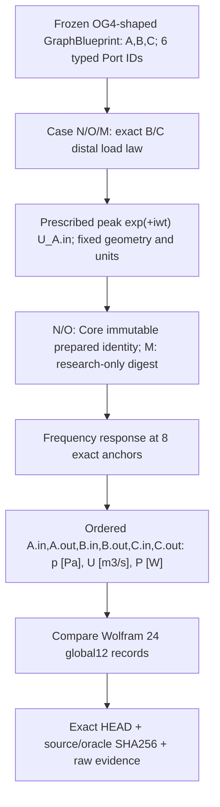
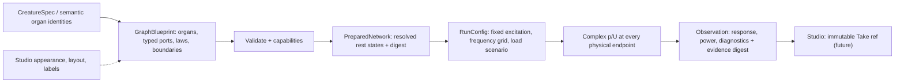

## NR-1a candidate implementation data flow (2026-10-17; not a public schema)



File inventory: [Experiment 041 runner](../../../experiments/041_nr1_static_oral_nasal_route/run.py), [Wolfram generating source](../../../experiments/041_nr1_static_oral_nasal_route/wolfram/global12_oracle.wl), [independent output JSON](../../../experiments/041_nr1_static_oral_nasal_route/wolfram/global12_oracle.json), [tests](../../../tests/test_experiment_041_nr1a.py), [CI](../../../.github/workflows/nr1a-research.yml).

The experiment's `canonical_sha` is research-evidence JSON identity and is **not** OG-4 binary canonicalization. N/O preserve actual authoritative `blueprint_digest`, `preparation_digest`, `observation_digest`; the M-only backend emits its own explicit research identifier. Mutable computed p/U and display position do not enter body identity. The evidence manifest distinguishes Git HEAD and content SHA; no WAV or physical body ID claims.

**2026-10-17 NR-1a scope correction — unapproved schema.** Immediate cases: N=(mouth B matched, nose C distal rigid_closed); O=(B matched,C matched); M=(mouth B distal rigid_closed,C matched). N/O are OG-4-limited cases; M is not supported by OG-4 and needs a separately named research-only implementation. A distal terminal closure does NOT disconnect the nasal side cavity or implement the VP gate. The vp_parameter_ref field in the older candidate below is future NR-1b ONLY. Persistent anatomy, physical run p/U, and Studio canvas layout stay separate. Exact implementation work order is [WORK_ORDER](./WORK_ORDER.md). No ABI adopted.

# NR-1 data structures and data flow — non-normative proposal

**2026-10-17; DESIGN ONLY**. Parent [Core #115](https://github.com/ryonakayama234/morphoacoustics/issues/115). No published schema, serialization bytes, hashes, or compatibility claim is created here. Do not replace existing CreatureSpec, PreparedMorphology, published OG-3/OG-4/OG-5 schemas, or Performance Contract v0 / draft v1.

## Distinct objects; versioned ownership

Dotted canvas link means creator editing could issue a validated revision; **canvas position is not a physical parameter**.

## Candidate semantic records — reviewable field ideas, NOT accepted ABI
```yaml
GraphBlueprint:
  schema_id: "nr1.proposal.v0"            # proposal namespace only
  blueprint_id: "example"
  blueprint_revision: "rev-example"
  medium: {rho_kg_m3: "...", sound_speed_m_s: "..."}
  organs:
    - {id: "pharynx", kind: "passive_tube_1d", geometry_ref: "...", material_ref: null, ports: ["in", "out"]}
    - {id: "oral", kind: "passive_tube_1d", geometry_ref: "...", ports: ["in", "out"]}
    - {id: "nasal", kind: "passive_tube_1d", geometry_ref: "...", ports: ["in", "out"]}
  couplings:
    - {id: "pharynx-branches", law_id: "ideal-acoustic-three-port/versioned",
       oriented_port_refs: ["pharynx.out", "oral.in", "nasal.in"]}
    # VP opening/closure representation MUST BE DESIGNED, not silently
    # substituted by a zero-area pipe or UI Boolean.
  termination_scenarios:
    - {id: "oral-only", oral_load_ref: "...", nasal_boundary_ref: "valid-closure-law"}
    - {id: "coupled", oral_load_ref: "...", nasal_load_ref: "...", vp_parameter_ref: "..."}
    - {id: "oral-sealed", oral_boundary_ref: "valid-closure-law", nasal_load_ref: "..."}
PreparedNetwork:
  backend_id: "..."
  backend_version: "..."
  resolved_port_index: "..."
  capability_scope: "bounded passive 1D only"
  input_blueprint_digest: "..."
  prepared_digest: "..."
RunRequest:
  scenario_id: "..."
  frequency_grid_hz: ["..."]
  acoustic_excitation: {physical_port_ref: "...", kind: "prescribed_volume_flow_phasor", unit: "m3/s"}
  backend_id: "..."
RunObservation:
  ports: {each_port: {pressure_phasor_pa: "...", volume_flow_phasor_m3_s: "..."}}
  input_impedance: "complex Pa s/m3"
  transfer_functions: "declared input/output normalization"
  powers: "signed W (peak phasor convention)"
  diagnostics: ["..."]
  run_digest: "..."
  evidence_artifact_sha256: "..."
```

## Important typing / unit invariants
| Field | Unit | Persisted or derived | Meaning |
|---|---|---|---|
| tube length | m | persistent geometry | fixed resting length in NR-1 |
| cross-sectional area | m^2 | persistent geometry | fixed positive area, never zero-area closure |
| density / wave speed | kg/m^3 / m/s | persistent run/medium | valid finite common medium |
| acoustic pressure phasor p | Pa | **derived run state** | fluctuating pressure, NOT pulmonary mean pressure |
| acoustic volume flow phasor U | m^3/s | **derived run state** | fluctuating flow, NOT respiration rate |
| termination impedance Z(f) | Pa s/m^3 | scenario/specification | generally complex and frequency dependent |
| port acoustic power | W | derived run | 0.5 Re(p conjugate(U)), correctly signed |
| tissue material | model-specific SI units | future linked body param | must not act as magic EQ/pitch slider |
| display coordinates | screen pixel | Studio only | never affect prepared physical digest |

**No conflation:** graph edge semantics ≠ typed p/U junction law; physical state ≠ morphology; selectable validated body revision ≠ persistent creative character identity. A 3-port junction constraint is naturally a *multiport relation*, not three unconstrained pairwise edges.

## Hash / reproducibility design questions (Gate A must freeze)
- Canonical blueprint digest includes schema/law versions, named topology, geometry, medium and physics-relevant boundary references; excludes UI layout and ephemeral p/U and WAV.
- Prepared digest includes resolved binding, accepted backend/settings, exact revision, normalized physical inputs and capability.
- Run digest includes scenario, frequency grid, excitation, actual solver revision and exact prepared digest. Artifacts include exact code SHA, evidence source and observation digest.
- Explicitly specify treatment of array order, signed ±0, finite values, duplicate IDs and invalid/unsupported precedence before implementation.
- Existing OG-5 normative canonical bytes/hashes are **not inherited or revised** without explicit compatibility review.

## Core / Studio synchronization
Creative app may request **only validated/revision-pinned selectable body** (Core CC-A1 #72 → Studio CC-A2 #14). This proposal does not inject a numerical port graph into CharacterSpec, redefine frozen creative v0, or make arbitrary anatomy editable.

## Linked views
[System](./SYSTEM.md) · [Experiment record](./EXPERIMENT.md) · [Core issue #115](https://github.com/ryonakayama234/morphoacoustics/issues/115)
