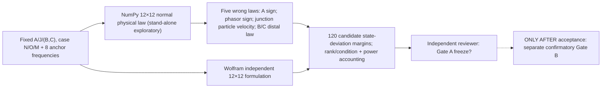
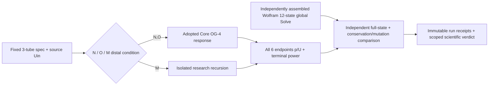
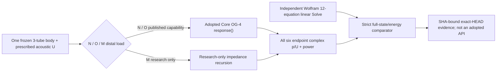
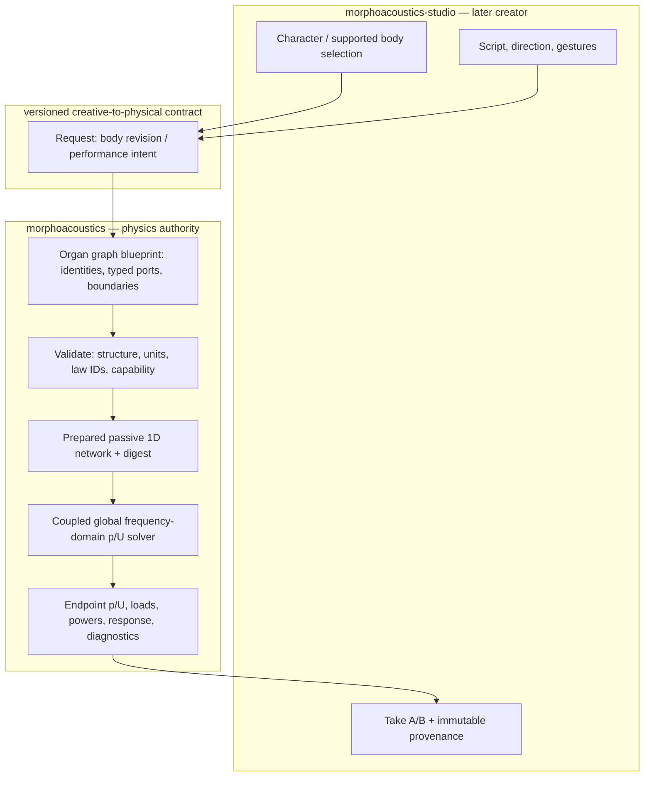
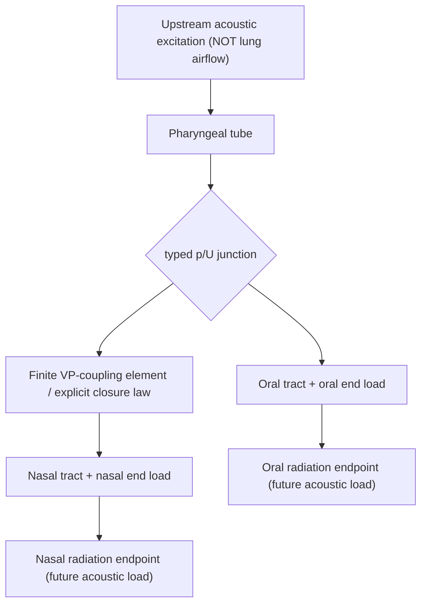

## 2026-10-17 — Exploratory Gate A mutation preflight (stacked draft; **not science adoption**)

[Experiment 042](../../../experiments/042_nr1a_gate_a_preflight/README.md) supplies a self-contained dimensionless **global 12-complex-state** acoustic matrix for the same frozen-candidate A/B/C tubes and five intentionally wrong **law-level** variants. It is **review instrumentation before prospective Gate A acceptance**, not a new full-state confirmation, Core backend, arbitrary organ graph, or dynamic VP junction. Original Experiment 041 historical evidence remains pre-Gate-A.

No result from this preflight is a preregistered run, and success cannot mark Gate C SUPPORTED_LIMITED. Complete source, CI boundaries, output scales and Wolfram provenance are linked from the Experiment 042 README.

---

# Current next work package — prospective NR-1a confirmation (2026-10-17, GATE A DRAFT)

**Decision: PLAN ONLY / NOT FROZEN / NOT ADOPTED.** Tracking [#118](https://github.com/ryonakayama234/morphoacoustics/issues/118). This section is a forward-looking work order, not a revision of past Experiment 041 results and not approval to publish new physics. Original research infrastructure and 24 N/O/M × 8 pre-Gate-A samples remain *exploratory/post-hoc*. Gate A needs critical review and explicit acceptance before a separate confirmatory Gate B.

## Exactly one scientific capability
Confirm that a fixed, passive, rigid-wall, lossless three-tube one-junction acoustic circuit distinguishes **distal mouth/nose terminal conditions** with physically lawful full-complex pressure/volume-flow observations. N = B matched / C distal rigid-closed; O = B/C both matched; M = B distal rigid-closed / C matched. Only N/O call the adopted OG-4 Core API; M is experiment-local and must remain unsupported by published OG-4. No real velopharyngeal disconnection, living nasal vowels, WAV, moving anatomy, Studio interface, nor new arbitrary graph backend.

**Next implementation boundary:** first a *docs-only* Gate A freeze candidate with independent numerical/ABI review; after written acceptance, a separate Gate B PR implements a **new prospective confirmation runner**, full-state comparison, law-level mutation matrix, conditioning/refusal stress, two exact-HEAD evidence runs, and CI. Do not silently modify OG-3/OG-4/OG-5, creative contracts, or Experiment 041 immutable source/oracles. Studio's body-preset #14 proceeds independently after Core contract #72. The later **NR-1b** VP coupling element needs its own physical law, topology/capability and protocol; changing the C distal load does *not* disconnect the nasal branch.

The original document below remains as historical context. Current per-layer data is in [DATA](./DATA.md), preregistration/evidence rules in [EXPERIMENT](./EXPERIMENT.md), and previous engineering integration history in [WORK_ORDER](./WORK_ORDER.md).

---

> **Integration amendment (2026-10-17):** PR #117 is an implemented **research-only candidate**, and PR #116 is design history, not approved Gate A. The conceptual proposal sections below remain historical; any “not implemented / no numerical Gate B run” statement there does not override the 24 exploratory cases. Engineering merge does not adopt physiology, public Core/Studio capability or scientific evidence. See [WORK_ORDER](./WORK_ORDER.md) and [EXPERIMENT](./EXPERIMENT.md).

## NR-1a implementation candidate — 2026-10-17 (PRE-GATE-A, NOT ADOPTED)

The narrow research code now lives at [Experiment 041](../../../experiments/041_nr1_static_oral_nasal_route/run.py). **No production Core or Studio source changed.**

Only the **distal mouth/nose terminals** change. The nose-side finite tube is still joined upstream when its outlet is rigid closed. No velopharyngeal (VP) valve closure is simulated. No spoken voice or breathing acoustics.

Gate A values and numerical tolerances are research CANDIDATES until independent sign-off. N/O keep existing OG-4 identity and ABI; M uses its own experiment-only identity, not a Core API. The new comparison does not make the 5-tube OG-5 or any general graph accepted.

**2026-10-17 NR-1a scope correction — design proposal only.** The first implementation proves STATIC DISTAL TERMINATION contrasts in a three-tube OG-4 layout, not actual velopharyngeal (VP) port closure or time-varying velum. A nasal outlet rigid closure retains the coupled nasal tube as a reactive side branch. B mouth terminal rigid closure is not supported by existing OG-4 API and may be tested only in an isolated research candidate. Actual VP junction shutoff / finite movable coupling belong to a separate NR-1b gate. This amendment supersedes broader wording below. See [WORK_ORDER](./WORK_ORDER.md) and [executed exploratory Wolfram probe](./WOLFRAM-PROBE.wl). No runtime or Studio adoption.

# NR-1 system architecture — oral/nasal routing research proposal

**Status:** DESIGN CANDIDATE ONLY, 2026-10-17 JST. Tracking [Core #115](https://github.com/ryonakayama234/morphoacoustics/issues/115). No numerical Gate B run; no scientific or public API adoption. Gate A protocol is **not yet frozen**.

## Reason for this slice
Core has OG-3 limited fixed2 and OG-4 limited fixed branch3. OG-5 #109 / draft PR #112 has Gate B3 machine pass but awaits Gate C; it is a passive 1D five-tube/two-junction *bounded physical fixture*, not validated nasal anatomy. Build on those equations, not a second generic graph implementation. The specific new question is whether **nasal-path boundary/VP coupling interventions** cause attributable acoustic differences, including the oral-closed/nasal-open case.

## Runtime causal layers (proposed, not implemented)

## Reference morphology vs physics topology (concept)

The branching diagram is semantic. Its exact number of tube modules/junctions and admissible terminations MUST be reconciled against current OG-4/OG-5 scope in Gate A; do not imply that arbitrary element count, two radiation models, a controllable VP gate or novel topology are already supported. Radiation **load** as a terminal impedance is distinct from reconstructing far/near-field microphone audio.

## What a passive acoustic connection actually calculates
At a lossless ideal three-port acoustic junction, small-signal harmonic pressure perturbations are equal, while **signed volume flows**, not particle velocities, sum to zero:
- p_1 = p_2 = p_3 [Pa]
- U_1 + U_2 + U_3 = 0 [m^3/s] with consistent outward orientation
- Acoustic mean port power in peak phasors: (1/2) Re(p conjugate(U)) [W].
For two terminal load impedances Z_o(f), Z_n(f) at the same node and a valid passive linear model, Y_eq(f) = 1/Z_o(f) + 1/Z_n(f), with geometry, finite branch lengths and boundary conditions affecting the **complex** Z terms. This is a **frequency-domain wave calculation**, not an algorithm that splits breath volume at a fixed percentage.

Research steps:
1. **NR-1:** static, passive oral/nasal coupling and closure cases, law/radiation-load validity and energy audit.
2. **NR-2 proposal later:** state-continuous VP movement + time-domain physical source coupling; requires independent time-domain validation.
3. **NR-3 proposal later:** DC respiratory airflow, turbulent nasal-breath source and spatial dual-source receiver. Do not claim this from NR-1.
4. **Material track independent:** validated constitutive material -> geometry and/or wall impedance -> sound. See EM-1 #87.

## Capability and ownership
- Core owns topology, preparation, physical laws, SI units, wave solution, refusal, and trace.
- Studio owns creative character design, supported embodiment selection, gesture direction, audition, and immutable Take. It may NOT invent a supported body based on a canvas wire.
- Invalid physical/semantic input = INVALID; valid out-of-backend scope = UNSUPPORTED; supported but physically unreachable gesture = INFEASIBLE; ill-conditioned legitimate numerical solve = NUMERICALLY_UNRESOLVED; infrastructure fault = FAILED. Do not synthesize plausible fallback.
- Keep imported original Core source and adopted OG-3/OG-4/OG-5 schemas unchanged. No new Studio feature released by this research plan.

## Connected contemporaneous documentation
- [Proposed data model](./DATA.md)
- [Preregistration / experimental ledger](./EXPERIMENT.md)
- [Organ-graph living architecture](../organ-graph-program.md)
- [OG-5 accepted Gate A design](../og5-gate-a-acceptance.md)
- [Core #115](https://github.com/ryonakayama234/morphoacoustics/issues/115)
- [Studio Character Creator #12](https://github.com/ryonakayama234/morphoacoustics-studio/issues/12)

## Scientific references
- Oral-nasal velopharyngeal coupling and acoustic antiresonances: https://pmc.ncbi.nlm.nih.gov/articles/PMC8492006/
- Passive network side branch precedent: https://pmc.ncbi.nlm.nih.gov/articles/PMC2677336/
- Nasal emission turbulence is a separate aeroacoustic regime: https://pmc.ncbi.nlm.nih.gov/articles/PMC7043896/
