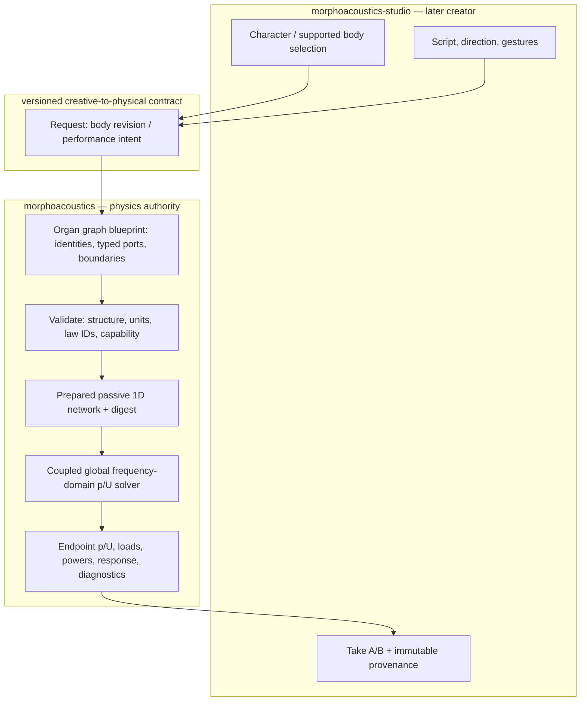
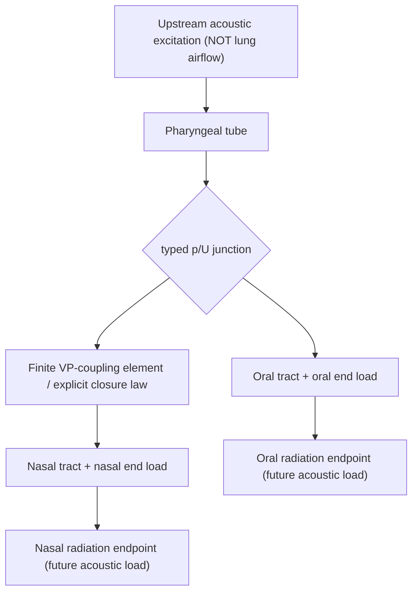

# NR-1 system architecture — oral/nasal routing research proposal

**Status:** DESIGN CANDIDATE ONLY, 2026-10-17 JST. Tracking [Core #115](https://github.com/ryonakayama234/morphoacoustics/issues/115). No numerical Gate B run; no scientific or public API adoption. Gate A protocol is **not yet frozen**.

## Reason for this slice
Core has OG-3 limited fixed2 and OG-4 limited fixed branch3. OG-5 #109 / draft PR #112 has Gate B3 machine pass but awaits Gate C; it is a passive 1D five-tube/two-junction *bounded physical fixture*, not validated nasal anatomy. Build on those equations, not a second generic graph implementation. The specific new question is whether **nasal-path boundary/VP coupling interventions** cause attributable acoustic differences, including the oral-closed/nasal-open case.

## Runtime causal layers (proposed, not implemented)

## Reference morphology vs physics topology (concept)

The branching diagram is semantic. Its exact number of tube modules/junctions and admissible terminations MUST be reconciled against current OG-4/OG-5 scope in Gate A; do not imply that arbitrary element count, two radiation models, a controllable VP gate or novel topology are already supported. Radiation **load** as a terminal impedance is distinct from reconstructing far/near-field microphone audio.

## What a passive acoustic connection actually calculates
At a lossless ideal three-port acoustic junction, small-signal harmonic pressure perturbations are equal, while **signed volume flows**, not particle velocities, sum to zero:
- p_1 = p_2 = p_3 [Pa]
- U_1 + U_2 + U_3 = 0 [m^3/s] with consistent outward orientation
- Acoustic mean port power in peak phasors: (1/2) Re(p conjugate(U)) [W].
For two terminal load impedances Z_o(f), Z_n(f) at the same node and a valid passive linear model, Y_eq(f) = 1/Z_o(f) + 1/Z_n(f), with geometry, finite branch lengths and boundary conditions affecting the **complex** Z terms. This is a **frequency-domain wave calculation**, not an algorithm that splits breath volume at a fixed percentage.

Research steps:
1. **NR-1:** static, passive oral/nasal coupling and closure cases, law/radiation-load validity and energy audit.
2. **NR-2 proposal later:** state-continuous VP movement + time-domain physical source coupling; requires independent time-domain validation.
3. **NR-3 proposal later:** DC respiratory airflow, turbulent nasal-breath source and spatial dual-source receiver. Do not claim this from NR-1.
4. **Material track independent:** validated constitutive material -> geometry and/or wall impedance -> sound. See EM-1 #87.

## Capability and ownership
- Core owns topology, preparation, physical laws, SI units, wave solution, refusal, and trace.
- Studio owns creative character design, supported embodiment selection, gesture direction, audition, and immutable Take. It may NOT invent a supported body based on a canvas wire.
- Invalid physical/semantic input = INVALID; valid out-of-backend scope = UNSUPPORTED; supported but physically unreachable gesture = INFEASIBLE; ill-conditioned legitimate numerical solve = NUMERICALLY_UNRESOLVED; infrastructure fault = FAILED. Do not synthesize plausible fallback.
- Keep imported original Core source and adopted OG-3/OG-4/OG-5 schemas unchanged. No new Studio feature released by this research plan.

## Connected contemporaneous documentation
- [Proposed data model](./DATA.md)
- [Preregistration / experimental ledger](./EXPERIMENT.md)
- [Organ-graph living architecture](../organ-graph-program.md)
- [OG-5 accepted Gate A design](../og5-gate-a-acceptance.md)
- [Core #115](https://github.com/ryonakayama234/morphoacoustics/issues/115)
- [Studio Character Creator #12](https://github.com/ryonakayama234/morphoacoustics-studio/issues/12)

## Scientific references
- Oral-nasal velopharyngeal coupling and acoustic antiresonances: https://pmc.ncbi.nlm.nih.gov/articles/PMC8492006/
- Passive network side branch precedent: https://pmc.ncbi.nlm.nih.gov/articles/PMC2677336/
- Nasal emission turbulence is a separate aeroacoustic regime: https://pmc.ncbi.nlm.nih.gov/articles/PMC7043896/
