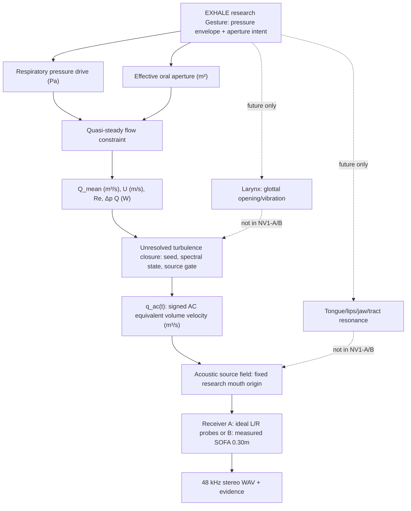

# NV1-EAR / Core — physical SYSTEM

## Ontology: task != source != observed sound
`EXHALE` is a **research-only task-level motor intent** (not a production enum or waveform control). Its realization produces time-varying physical conditions. **Breath sound is not necessarily a single source type.** A future embodied sigh can include laryngeal/glottal aspiration, oral constriction noise, weak phonation, and dynamic tract filtering; NV1-EAR **implements only a bounded aperiodic jet/noise closure**.

## Organ-graph readiness
Physical nodes: `RespiratoryDrive`, `EffectiveAperture`, `JetState`, `UnresolvedTurbulence`, `EquivalentMouthSource`, `AcousticReceiver`; graph is *read-only research schematic*, not a general editor.
Ports: `pressure[Pa]` (scalar per-frame), `aperture[m²]`, `mean_flow[m³/s]`, `jet_velocity[m/s]`, `source_volume_velocity_ac[m³/s]`, `acoustic_pressure_A[Pa]` or `relative_receiver_B[unscaled]`. **Do not connect mismatched units or substitute Q_mean for q_ac.** Distinguish graph edges that represent physical interaction from observation/rendering edges.

## Implementation boundary
Core owns physical laws, research closure, source placement, errors and receiver semantics. Studio owns performer intent, constrained controls, headphones preview, ratings, persistence; adapter validates versioned evidence and runs exact SHA-pinned Core checkout. No production public schema/API mutations.

## Important physical caveats
- `Δp(t)` and `A(t)` are a **limited research actuation fixture**, not solved lung/laryngeal biomechanics, full anatomical geometry, or a coupled airway pressure network. The pressure drop across the *effective* constriction is prescribed; do not simultaneously count another pressure drop without a network model.
- The effective round-equivalent diameter is diagnostic only; it is not a claim that all human mouth apertures are circular. Flow discharge factor, viscosity, geometry and spectral law are declared hypotheses, not human calibration.
- An ideal *monopole equivalent source* approximates an effective volume-velocity fluctuation; direct turbulent jet dipole/quadrupole physics, source impingement and distributed source location are outside this gate.
- Existing EL-G0a A and B have unresolved receiver/reference-plane calibration. A can carry model Pa; B remains relative and must never be compared for absolute SPL without independent audit. Avoid double 1/r, delay and canal filtering.
- Real silence may contain room noise, breathing elsewhere and sensor noise; modeled zero drive must give exact zero source energy.
- Keep all work in `experiments/042_nv1_breath_ear/` or a newly validated experiment number if 042 is taken at code time; do not rewrite prior experiments.
## Literature / repo baselines
- K. N. Stevens (1971), *Airflow and Turbulence Noise for Fricative and Stop Consonants* (DOI: 10.1121/1.1912751).
- Yoshinaga et al. (2024), *Sound source locations and their roles in Japanese voiceless “glottal” fricative production* (DOI: 10.1121/10.0034229): source placement need not be exclusively glottal for Japanese [h].
- Zhang (2016/2017), *Mechanics of human voice production and control*, PMC5412481: glottal closure and turbulent leakage matter for future breathy phonation.
- Repository Issues #30, #53, #128, #133 and PR #129 are authoritative project baselines.
