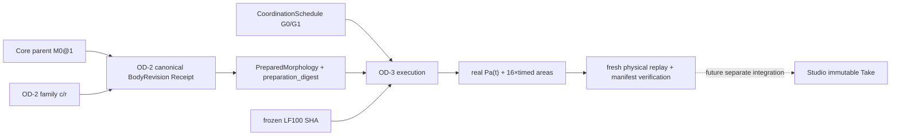

# OD-3 DATA — research-local, not a published SDK/schema
**A0 prospective**. Immutable identification separates `BodyRevisionRef` from `CoordinationSchedule`, `ExecutionReceipt` and future `Studio Take`.

## Canonical items
- `BodyRevisionRef`: exact Core OD-2 receipt's `revision_id`, parent id/revision/preparation digest, family/version, 16× SI length/area hex, preparation_digest, backend_id. For r=1 alias original M0; do not mint a new body.
- `CoordinationSchedule`: id `G0` or `G1`, schema `od3.coordination-3.v0-research`, canonical 3 tasks (OPEN, CONSTRICT, CONSTRICT), immutable task fields and onset/offset; G1 changes only task1 onset and offset by +0.020s. No free text, F0, formant, output gain or waveform target.
- `Execution`: exact revision + schedule + source/hash + inherited solver/backend identity + observer (Exp009 0.2m proxy), 48000 Hz, 24000 samples, 102 acoustic calls (from current frame renderer) and precise runtime/compiler/source pins.
- `PhysicalObservation`: native f64 Pa NPY, positive finite 16-section geometry probes at fixed t=(0.0,0.2,0.27,0.35,0.4,0.5)s, signed raw comparisons, waveform norm, same-unit independent loaded transfer where applicable. No inferred human anatomy, ear SPL or formants.
- `Artifact`: `raw_pressure_pa.npy`, common-gain `preview.wav`, condition records with SHA256 plus a manifest marker/decision. WAV is a reproducible PCM derivative of native Pa, not the authority. Cases in one pair/suite share **one** gain and remain labeled as playback-only; no calibrated SPL.
- `ErrorRecord`: stage (`INPUT`/`CAPABILITY`/`PHYSICS`/`VERIFY`/`IO`), code, message; neither constructor exception nor unsupported backend is represented as a FEASIBLE physical outcome.
- Future `Studio Take`: character/body/schedule/solver/scene/source exact references and verified artifacts, distinct from physical-body state. No G4 Studio Take is created during OD-3 Core research.

## Selected research CLI (logical operations, NOT an existing API claim)
- `inspect`: supported body center+ratio, schedules, source/observer, declared limitations
- `perform-pair --center <4|8> --ratio <canonical> --output-dir PATH`: physical G0 and G1 under one body; allow only (4,1.00),(4,1.10),(8,0.90) in adopted OD-3 study. Refuse invalid/unsupported requests.
- `perform-suite --output-dir PATH`: all 3×2 cases, fresh physics.
- `verify --output-dir PATH`: verify selected archive mode and exact content, recompute all saved cases from trusted body/schedule, validate Pa/WAV/decision data/geometry, refusal if any divergence.

Define strict keyed JSON and canonical serialization for real implementation. Runtime paths are private trusted-local, not authenticated remote HTTP. Unkeyed hashes provide integrity against accidental/naive edits, **not cryptographic authentication against a hostile repository editor**. Only a source-pinned checkout plus full fresh physical replay can assert provenance within trust scope.

## Compatibility
Existing OD-2 `BodyPresetRegistry`, `preparation_digest` and generated body identities are unchanged; old CC-B1 site08, CC-A2 and old Takes are never migrated or reidentified. No alteration to Studio vendor contract or V2 slot registry. Add `src/morphoacoustics` public facade only after proof and separate API decision; `src/morphoacoustics_graph` stays passive topology.
