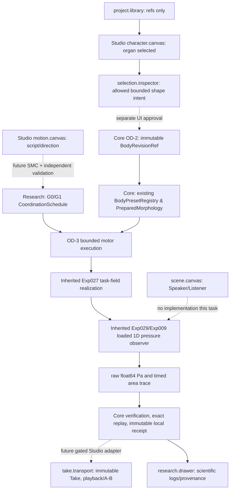

# OD-3 SYSTEM — approved responsibilities and selected implementation path
**A0 prospective design, not a claim of implemented operations.**

## Frozen mathematical logic
For body B, section j, task k in {0,1,2}: `log A_j(B,G,t)=log A_j^rest(B)+2 sum_k alpha_k^G(t) d_kj`, where d_kj is **existing Exp027** Gaussian task field in log diameter and `alpha` is Exp027 sample-grid interpolated smoothstep. `G0`: exact Exp027 TASKS. `G1`: same exact 3 tasks and geometry, but Task index 1 onset_s +0.020, offset_s +0.020. Use `Exp027.task_activation_at_time(task,t,control_step_s=PRIMARY_CONTROL_STEP_S)`, `Exp027.realize_task_geometry_from_activations`, `Exp029.CountingTransfer().evaluate` (Exp009 resistive outlet and 0.2m free-field monopole pressure proxy), `Exp026.EXP12.frame_render(..., hop_size=PRIMARY_HOP_SIZE, edge_mode="preroll_edge")`. Do NOT modify canonical globals `TASKS`, frozen source code or frame_render. G0 output must agree with `Exp029.evaluate_condition`.

## Versioned boundaries
Core OD-2 is the authority for family, parent, receipt and preparation digest. A0 derived body from (c4,1.00) must alias original M0; c4 1.10 and c8 0.90 must rederive exact OD-2 receipt. Rebuild using existing prepared physical geometry and EXACT OD-2 provenance, never interpret 16 tube cells as 16 organ graph nodes. No second registry.
Experiment-local schedule version `od3.coordination-3.v0-research`; reject unknown fields, unsupported schedules, nonfinite times, invalid body selectors. G1 schedule is not a language-level /ai/ phonetic outcome, nor a different tissue/material.
Physical source: LF100 fixed exp13 24000 samples at 48000Hz; same source SHA, 0.5sec, numeric environment Python3.11/NumPy2.4.6. No per-condition gain for pair/suite; use one shared playback gain for the complete archive only, native float64 Pa always authoritative.
Pair mode: select one legal body and perform G0+G1 anew. Suite mode: perform all 6 anew. Verify by fresh computation, not merely matching stored unkeyed hashes; no overwrite; manifest marker published only after verified complete directory.
A future Studio contract adapter binds character/ref and motion/ref to Core run results; **do not modify Performance Contract v0/v1 or any Studio file as part of this task**.

## Source-of-truth panels
Studio V2 ADR `docs/product/STUDIO_WORKSPACE_V2_DECISION.md` (Studio main merged #34): `project.library` references; `character.canvas` graph selection; `motion.canvas` gesture scheduling; `selection.inspector` selected allowed attributes; `take.transport` playback/A-B of immutable results; `research.drawer` provenance and full traces; `scene.canvas` unchanged. No new panel/mode, no inert edit controls, no UI import by Core.
