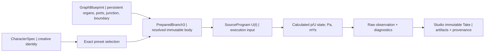

# OG-AUD1 / DATA — Proposed organ graph and Take boundary

> 2026-10-20. **CANDIDATE contract only; not an official schema or live API.** [SYSTEM](./SYSTEM.md) · [EXPERIMENT](./EXPERIMENT.md) · [Core #130](https://github.com/ryonakayama234/morphoacoustics/issues/130) · [Studio #20](https://github.com/ryonakayama234/morphoacoustics-studio/issues/20).

## Keep six distinct objects



- **Persistent physical Blueprint** (Core owner): OG-4 schema `og4.passive.branch3.v1` and *its complete exact-key, exact-capability contract* remain authoritative. The names A/B/C, `A.in,A.out,B.in,B.out,C.in,C.out`, zero-volume J with law `ideal.branch3.p_u`, source and matched B/C loads are physical identifiers, not UI positions. Section length/area, medium, orientation, law ID, module revisions and source/load references affect the prepared identity. No semantic "nose" or "tongue" assertion.
- **Read-only Studio diagram** (Studio owner): positions, coordinates, collapsed panels, icons and colors cannot affect Core's prepared-graph identity/digest. No unvalidated inferred physical connection from visual lines.
- **Prepared graph** (Core owner): the existing OG-4 immutable `PreparedBranch3`, backend ID, exact Blueprint digest, preparation digest and capability; revalidate rather than trusting a supplied digest. Morphology provenance is distinct from acoustic time state.
- **SourceProgram** (candidate, Core owner): canonical 48,000 samples/s finite input **volume-flow** samples U(t) in m³/s (not signal gain, microphone pressure or LF amplitude without dimension). Frozen source id/revision and sample content SHA-256; deterministic phase/envelope and initial rest assumptions; exact source-plane `A.in`. No source substitution across the A/B experiment.
- **Physical observation** (candidate, Core owner): `p_A.in(t)` raw Pa array; corresponding source U(t); per-port complex pressure/volume-flow on frozen oracle anchors, passivity and condition/accuracy diagnostics; band, time, buffer and solver revision. Pa/flow must not be confused with playback PCM.
- **Creator Take** (Studio owner): immutable content-addressed raw pressure, source, labeled `MONITOR_PRESSURE_NON_RADIATED` playback WAV, typed result and exact Core body+source+code/solver provenance; persist success only after complete checks.

## Minimal human-inspectable candidate request (NOT a normative v1 schema)

```json
{
  "candidate_kind": "og-aud1/physical-monitor/v0-proposal",
  "character_id": "character-demo",
  "body_preset": {
    "id": "graph-small-C",
    "revision": "1",
    "graph_schema": "og4.passive.branch3.v1"
  },
  "source_ref": {
    "id": "og-aud1-fixed-volume-flow",
    "revision": "candidate",
    "port": "A.in",
    "unit": "m3/s"
  },
  "observation": {
    "kind": "source-port-pressure-monitor",
    "port": "A.in",
    "unit": "Pa",
    "band_hz": [0, 4000],
    "sample_rate_hz": 48000
  }
}
```

**Only a conceptual handoff**, not copy/paste valid input for any current API. Design review must settle source timing/length, exact identifier spelling and revision pinning, hash canonicalization, window/padding, frequency-grid and anti-alias requirements before publication. The second preset selects C area 0.0006m²; first 0.00015m². Do not treat labels themselves as physical values: resolve exact OG-4 Blueprint and verify digest.

## Response/record inventory proposal

| Field / artifact | Owner / rule |
|---|---|
| result status & typed refusal | Core; invalid request != unsupported backend != numerical failure != genuine gesture infeasibility != execution failure |
| graph schema + organ IDs/revisions + typed ports & J law | Core canonical; Studio snapshot for display |
| `blueprint_digest`, `preparation_digest`, solver/source/code pinned SHA | Core only; checked at Studio trust boundary |
| U(t) [m³/s], p(A.in,t) [Pa] raw, time grid | Core; exact array length, endian and dtype must be frozen |
| per-port complex p [Pa], U [m³/s], mean power [W] and residuals | Core scientific evidence; oracle-compatible |
| spectral band, FFT/window/pad and monitor plane | Core; compulsory to interpret pressure and alias artifacts |
| WAV 48 kHz mono PCM16, separate playback normalization scale | Core emission / Studio checked; never marketed as calibrated free-field |
| SHA-256 for input/physics/PCM + final receipt | Core creates; Studio verifies and archives only after all checks |
| Character, script/direction context, Take name, comparison, UX diagram layout | Studio; not part of physics digest |

## Refusal and backward compatibility

- Retain OG-4 `Branch3Error` `INVALID / UNSUPPORTED / NUMERICALLY_UNRESOLVED` semantics. A malformed graph is INVALID; structurally lawful but unverified frequencies/bodies and arbitrary ports are UNSUPPORTED; ill-conditioned physics is NUMERICALLY_UNRESOLVED. Job crash is FAILED. This slice makes no promise of articulated gesture `INFEASIBLE`: do **not** misuse that status for a bad graph, unknown preset or source.
- Result receipt must be the final atomic marker, stored only after all raw/PCM checks and hashes. Never write accepted partial artifacts or an immutable success Take for refusals. No fallback to CC-A2, static WAV, guessed radiation or extrapolated branch.
- Do not modify historical CC-A2 / X2a Takes, v0/v1 Performance Contract schemas or their exact trusted code checkouts. A future interface receives **a new version/capability label**; Studio consumes Core-authoritative schema/receipt and does not invent JS-side canonical digests.
