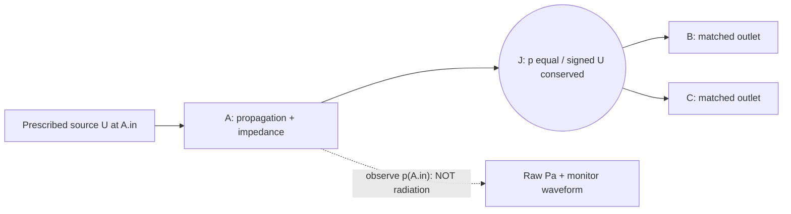

# OG-AUD1 / Gate A focused physical audit — 2026-10-20

> **EXPLORATORY REVIEW ADDENDUM, not frozen acceptance.** This note makes a testable physical limitation and a creator-audition confound explicit before Gate B. It does not ratify the preregistration, implement a broadband solver, or authorize Studio integration. Read with [SYSTEM](./SYSTEM.md), [DATA](./DATA.md), [EXPERIMENT](./EXPERIMENT.md), [Core #130](https://github.com/ryonakayama234/morphoacoustics/issues/130), [Studio #20](https://github.com/ryonakayama234/morphoacoustics-studio/issues/20).

## 1. The physics which a future waveform must preserve

For the **only** supported OG-4-style ideal branch3 topology, fixed area on A and B and two ideal matched terminal loads, define characteristic *volume-flow* impedance `Z_i=rho_i*c_i/S_i` [Pa s/m³], frequency `f` [Hz], `theta=2*pi*f*L_A/c_A`, and `Z_J = (1/Z_B + 1/Z_C)^(-1)`. For the `exp(+i omega t)` convention:

```text
                  A (source inlet monitor)
prescribed U_A.in(t) ---> [ A, L_A, S_A ] ---- J ---- [B, S_B, L_B] ---- matched B
                        p(A.in,t) [Pa]          |
                                               +---- [C, S_C, L_C] ---- matched C
```



The exact analytic source-port transfer is

```text
Z_in(f) = Z_A ( Z_J cos(theta) + i Z_A sin(theta) )
             / ( Z_A cos(theta) + i Z_J sin(theta) )
p_A.in(f) = Z_in(f) * U_A.in(f)
Re[Z_in(f)] = Z_A^2 Z_J / ( Z_A^2 cos(theta)^2 + Z_J^2 sin(theta)^2 ) > 0
```

assuming all positive finite real `Z_A,Z_J`. This is a **scalar cross-check**, not an independent substitute for the future full twelve-state global linear-equation solver and its per-port residuals. In the adopted OG-4 frequency API only eight isolated frequencies are verified: the formula's mathematical definition for other frequencies **does not extend the adopted Core capability**.

**Identifiability / mandatory negative control:** when both B and C loads are perfectly matched, their *input* impedances are respectively `Z_B,Z_C`, independent of `L_B,L_C`. Therefore this input-pressure monitor is provably insensitive to independently changing *only* either distal tube length under these boundary laws (ideal 1D lossless small-signal model). Do **not** sell B/C length editing as an audible capability at this gate. Include a branch-length-only null test; otherwise the solver may be accidentally assigning reflection to matched terminations. Later unmatched/radiating terminations can change this, but require separate verification.

## 2. Exploratory Wolfram calculation — not confirmatory Gate B evidence

Wolfram Language evaluated the scalar equations above for `rho=1.2 kg/m³`, `c=343 m/s`, `L_A=0.08 m`, `S_A=S_B=0.0003 m²`, `U0=(1+0.4 i)*10^-6 m³/s`, and both matched outlets. B and C lengths remain `0.09 m` / `0.06 m`, respectively. The following newly checked examples are from **existing OG-4 anchor frequencies only** (unit of Z: Pa s/m³).

| Hz | C area [m²] | Re Z_in | Im Z_in | peak |p_A.in| [Pa] |
| ---: | ---: | ---: | ---: | ---: |
| 80 | .00015 | 921672.26 | 89222.46 | 0.997312 |
| 80 | .00060 | 462963.68 | 143415.01 | 0.522004 |
| 733 | .00015 | 1603112.27 | 559611.88 | 1.828780 |
| 733 | .00060 | 1461638.16 | 1632724.23 | 2.360195 |
| 997 | .00015 | 2027606.88 | 183917.71 | 2.192765 |
| 997 | .00060 | 3755701.44 | 1090136.36 | 4.211969 |
| 4000 | .00015 | 1008362.46 | -313602.65 | 1.137350 |
| 4000 | .00060 | 537198.67 | -534623.39 | 0.816278 |

The peak pressure entries are *harmonic phasor amplitude* for that input phasor, **not** an output WAV, a calibrated listener SPL, or the amplitude of the eventual finite-time source. In particular, these numbers do not license interpolation of eight values as a broadband transfer. This exercise shares the same reduced scalar assumptions as the plan, hence **independent full-system verification is still missing**.

Reproducible Wolfram Language scalar evaluation (cross-check only):

```wl
rho = 1.2; c = 343.; aA = .0003; LA = .08;
u0 = (1. + .4 I) 10^-6;
zA = rho c/aA; zB = zA;
zin[area_, f_] := Module[{zJ, theta},
 zJ = 1/(1/zB + area/(rho c));
 theta = 2 Pi f LA/c;
 zA (zJ Cos[theta] + I zA Sin[theta])/
   (zA Cos[theta] + I zJ Sin[theta])
];
Table[{f, area, Re[zin[area,f]], Im[zin[area,f]],
 Abs[zin[area,f] u0]}, {f,{80,733,997,4000}},
 {area,{.00015,.0006}}]
```

## 3. Playback experiment must not erase the causal treatment

The two Takes must retain raw `p_A.in(t)` [Pa] plus exactly identical source `U(t)` [m³/s]. For the creator's **causal A/B** default, select **one common playback gain for the pair** (based on a documented bounded peak over both candidate raw pressure clips) before PCM16 quantization, and archive it in both receipts. Individually peak-normalizing the two separately can mask their physically meaningful amplitude ratio; if loudness-matched listening is later desired, make it an explicitly *separate blinded perceptual trial* and retain original physical data.

The proposed common-gain rule is a **Gate A decision candidate**, not yet part of a normative interface. Freeze zero-source/silence handling, 16-bit saturation and rounding, finite pressure checks, peak computation/guard, exact source and observation plane, DC treatment, taper at 4 kHz, FFT length/padding, circular wrap leakage, edge artifacts, reference time and two-run deterministic hashes *before* any confirmatory Gate B waveform experiment. Document how attenuation impacts audibility and how WAV playback is **not** calibrated Pa or a radiated mouth signal.

## 4. Required independent physics and creator checks

| Test | What must be demonstrably different or invariant | Gate |
| --- | --- | --- |
| C area intervention; all else fixed | broadband source-port Z and raw Pa may differ; positive-real/passive and correct signed p/U | B science |
| B/C length-only change, both matched | **Z_in is invariant** at every tested frequency | B science negative control |
| Mutate J to conserve particle velocity, not volume flow | full-law/global-matrix oracle rejects | B falsification |
| Independently assemble global p/U matrix (Wolfram) | compare *all port states*, power balance and complex flow residuals, not only p inlet | B independent |
| 8 OG-4 anchors | strict comparison while using a **new**, separately named broadband solver for new frequencies | B regression |
| FFT wrapping, out-of-band content, wrong source plane | refuse or fail numerical acceptance without playable output | B evidence |
| Two playback clips with shared gain | same prescribed source, exact Core body ID/revision, raw Pa and signed audio gain retained | C integration |
| Corrupt hash, wrong Core revision, unsupported graph | Studio persists no playable Take, no fallback | C security |
| Headphone listening of A/B | subjective difference useful but **not** physical proof of vocalization | D creator |

### Gate decisions still OPEN

- Decide and freeze a finite **source U(t)** with SI amplitude, envelope and reproducible bytes; DC/FFT/grid/window/padding/guard; declared valid 0–4 kHz; shared playback scale, clipping tolerance, numeric error criteria, oracle frequencies and full state convention.
- Commission independent numerical/port-law and trust-boundary reviews. AI model reviews do not substitute for a distinct independent reviewer.
- Maintain statuses: **A=CANDIDATE**, **B=NOT IMPLEMENTED**, **C=NOT IMPLEMENTED**, **D=NOT ADOPTED** until evidence warrants changing each separately.

This audit records physical predictions **prior to** implementing the new broadband solver or listening bridge and must not be relabeled as a prospective registered acceptance test without explicit review/freeze and timestamp.

## 5. Subsequent preflight evidence (same date; addendum, not replacement)

After this candidate review note was written, [Experiment 043](../../../experiments/043_og_aud1_preflight/README.md) executed a **separately assembled 12-state global p/U matrix** in Wolfram, using pressure-scaled q=Z_ref U internally. The [recorded results](../../../experiments/043_og_aud1_preflight/RESULTS.md) compare against this scalar model at existing OG-4 anchors; a wrong particle-velocity-law mutant disagrees by 0.24–0.48 relative source impedance, and matched-branch length null changes remain at numerical roundoff. No broadband/time-domain signal was computed; independent external review and prospective full-band Gate B numerical thresholds remain **OPEN**. This preflight establishes neither a frozen Gate A nor any new Studio or Core runtime capability.
