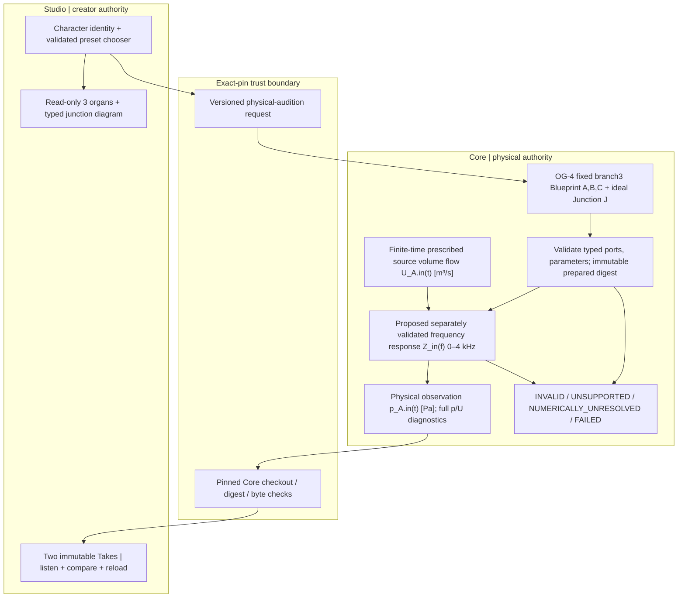
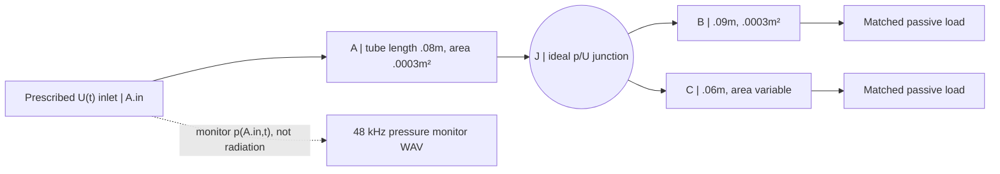

# OG-AUD1 / SYSTEM — Graph-to-audible research architecture

> 2026-10-20. **Gate A candidate, NOT frozen; no implementation, no accepted physical waveform, no production or Studio API change.** Tracking: [Core #130](https://github.com/ryonakayama234/morphoacoustics/issues/130), [Studio #20](https://github.com/ryonakayama234/morphoacoustics-studio/issues/20). Use together with [DATA.md](./DATA.md), [EXPERIMENT.md](./EXPERIMENT.md).

## Why this exact missing link?

Adopted [OG-4 branch3](../og4-branch3-api-v1.md) provides fixed, lossless 1D acoustic three-port complex p/U states at eight validated frequencies; it does **not** generate sound or solve a continuous broadband transfer. Adopted [CC-A2](../cc-a2-two-body-live.md) generates and stores two new physical waveforms for two fixed serial-tract morphologies; it does **not** bind a branching organ graph to audible physics. Gate A investigates **one scoped causal bridge** without absorbing OG-5 #112 (unmerged five-organ) or NR-1a (research-only oral/nasal routes).

## System diagram — future path (dashed boundary indicates review-only)

No UI canvas edge is a valid acoustic connection on its own. The **ideal three-way junction** is a typed multi-port physical relation and must enforce pressure equality and signed conservation of volume flow. One graphic edge is not one universally valid physical law.

## Physical fixture, signal and observation planes

C area is constrained to two **already OG-4 supported** values: 0.00015 m² versus 0.0006 m². Tube A/B geometry, density 1.2 kg/m³, sound speed 343 m/s, source waveform U(t), source phase, junction orientation, and terminal load **must be identical** in both conditions. Frozen OG-4 legal source phasor and scaling remain the eight-frequency *oracle anchor* only; a new time-domain drive needs its own exact source calibration/gate.

For each tube and e^(+i omega t) phasors, characteristic **volume-flow** impedance `Zc=rho*c/area` [Pa·s/m³]. At J, p_A.out=p_B.in=p_C.in and U_A.out=U_B.in+U_C.in in the declared direction. With both branches matched, `Z_J=(1/Z_B + 1/Z_C)^(-1)`. A source-flow drive produces `p_A.in(f)=Z_in(f) U_A.in(f)`; Z_in is calculated from A's propagation and Z_J (do not model this as a single combined length or as particle-velocity equality). This creates **morphology-to-pressure** causation; it is not self-oscillating vocal-fold physics.

## Sound meaning / model boundary

1. **First auditory observable:** band-limited time trace of **source-port acoustic pressure** p(A.in,t), with separate unchanged source-flow trace. Convert raw Pa into a separately named playback-normalized mono WAV so the creator can listen to relative pressure coloring. The raw physical Pa is never replaced by that normalized WAV.
2. **This is not exterior radiated sound.** A matched branch termination absorbs acoustic energy; extracting a pressure monitor does not assert that an ear receives that pressure, or that a mouth/nose emits a realistic voice. Do not silently add a free-field or HRTF renderer. Listener reception is a later, separately tested subsystem.
3. The first broadband candidate is **0–4000 Hz**. A 48 kHz WAV sample grid does not make the underlying model valid to 24 kHz. High-band rejection/windowing, FFT conjugate symmetry, zero-frequency handling, phase/reference plane, circular-wrap/finite-record artifacts and waveform onset must be explicitly specified, independently verified and preregistered.
4. The adopted OG-4 solver's **eight legal isolated frequency samples are NOT a waveform transfer function**. Gate B must implement a separately named experiment-local continuous-grid solver and independent oracle before acoustic time-series or Studio integration claims.
5. A two-body comparison may show different spectra **without** implying phoneme contrast, timbre preference, physiology or calibrated sound pressure level. No freeform graph assembly in this milestone; graph visualization is read-only for two validated physical presets.

## Development gating / ownership

- **Gate A (this draft):** physics, renderer/source reference plane, data schema candidate and preregistration *proposal* in SYSTEM/DATA/EXPERIMENT. Separate critical review must freeze source calibration, FFT/time boundary, frequency grid, thresholds and correct failure behavior **before Gate B**.
- **Gate B:** experiment-local Core executable + a new scientific test with independent global matrix Wolfram oracle, wrong-law mutants, passivity and per-port state checks, raw hash-linked reproducible result. Leave OG-3/4 public solver ABI and the CC-A2 pinned inventory intact.
- **Gate C:** versioned trusted Core audition API and Studio fixed-preset selector + immutable Takes. Preserve current v0/v1 contract, add rather than silently retrofit; reject unverified graph/body revision and missing outputs.
- **Gate D:** exact-HEAD numerical/contract/security review, no-fallback regression and creator listening. Explicit `GO_LIMITED`/`HOLD`/`REJECT` with audibility and voice-naturalness distinguished.

Core owns all sound-making physical truth; Studio owns intention, diagram, selection and take archive. Each implementing PR must update **system diagram + data flow/schema + experiment ledger** together, with review at the exact revision.

## Gate A audit addendum — matched-branch identifiability (2026-10-20, proposed)

[Gate A focused physics/UX audit](./GATE_A_REVIEW.md) is an exploratory supplement, **not adopted**. With both distal outlets perfectly matched, the branch input impedances are independent of B/C lengths; a length-only perturbation is therefore an essential **null-control** for this exact ideal lossless model. C area does change the junction impedance and source-port pressure. The observed signal remains **p(A.in)**, not emitted/received radiation. Gate B must validate a new broadband solver independently and cannot reuse eight OG-4 samples as an interpolated filter.

For the proposed *paired causal A/B audition*, investigate **one common playback gain across the two raw Pa clips**, preserving physical amplitude ratios. The raw SI pressure and the shared gain belong to the recorded derivation, not to the organ graph identity. Freeze paired timing/commit semantics and gain rule at Gate A before implementation.

### Preflight numerical-model audit (experiment-local; 2026-10-20)

[Experiment 043](../../../experiments/043_og_aud1_preflight/README.md) assembled the 12-state p/U global junction equations in Wolfram Language and compared source-plane impedance with a separately reduced scalar formula at four frozen OG-4 anchor frequencies for both C areas. To avoid a units-induced matrix conditioning warning, the global linear system **internally scales q=Z_ref U** with `Z_ref=1,372,000 Pa·s/m³` and converts back to SI for signed flow/power diagnostics. The scaled matrix's measured condition numbers are approximately **8–25** in the tested cases; incorrect particle-velocity conservation produces observable disagreement. This is **not** a validated broadband solver or time-domain audio result; confirmatory independent Gate B still requires a preregistered full-band design.

## Experimental 044 — full-grid monitoring prototype (2026-10-20; NOT adopted)

[Experiment 044](../../../experiments/044_og_aud1_monitor/README.md) demonstrates a standalone candidate **new full 0–4 kHz analytic input-impedance grid** followed by source-port pressure IFFT and common A/B gain. This does not modify the adopted OG-4 eight-frequency API. Same graph A → J → (B,C), with prescribed `U(t)` at A.in, both distal outlets matched, and p(A.in) monitoring. It is not radiated speech and is not linked to Studio. The filter sets all frequencies >4kHz to zero, formally introducing an acausal spectral-projection kernel; measured pre-start and end guards are disclosed in the [result evidence](../../../experiments/044_og_aud1_monitor/RESULTS.md). New experiment-local status: `EXPLORATORY_ENGINEERING_PASS`; **Gate A still unratified, Gate B unconfirmed, no production source or Studio integration authorization**. Core→Studio integration requires a distinct exact pinned trusted capability.
