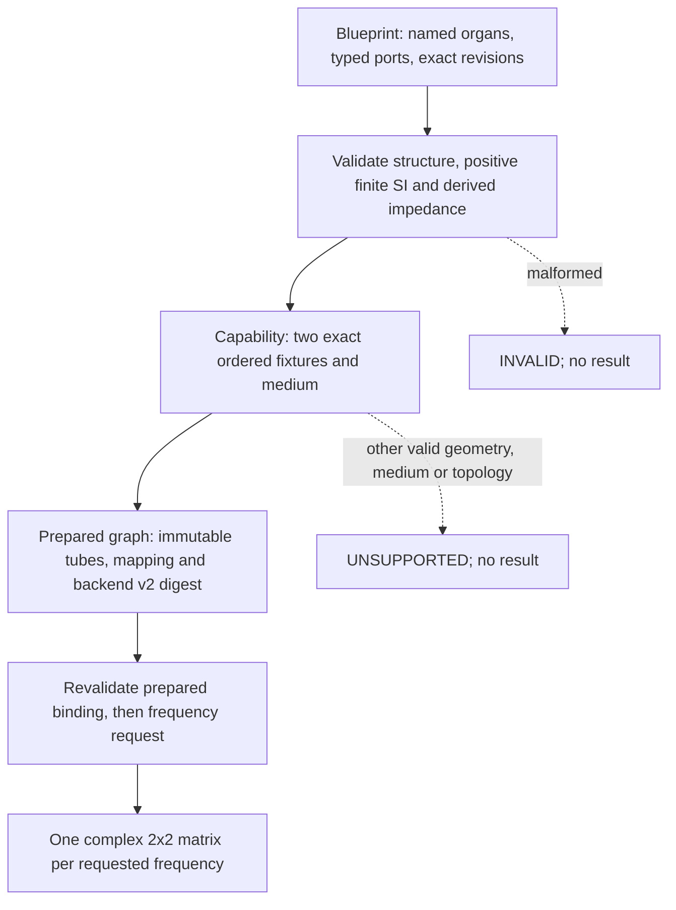

# OG-3 Gate B — bounded two-fixture graph candidate (2026-10-15)

**Current Gate C status (2026-10-16): `ADOPTED_LIMITED_FIXED2_PASSIVE_SERIAL_CORE`** — [PR #104](https://github.com/ryonakayama234/morphoacoustics/pull/104) merged into `main@8fb021ef2abc9eb92275a9e6cc6f92e8a6cb405f`. [Release evidence and scoped decision](./og3-gate-c-limited-adoption.md). The **DRAFT / NOT ADOPTED** paragraphs below are time-stamped historical Gate B *pre-merge* records, not the current Core status. All numerical runner receipts still say `PROVISIONAL_...` because machine evidence alone is not an adoption verdict; separate Gate C decision controls adoption. Fixed-two-fixture only, no arbitrary geometry or stable Studio ABI.

**DRAFT / NOT ADOPTED / implementation review pending.** Design [PR #102](https://github.com/ryonakayama234/morphoacoustics/pull/102) merged documentation-only to main `6d38d8b219e72170ca97a895134bf98f0babcbc9`. This implementation incorporates that design/main history and is based on main. It does not imply an adopted public API, new voice generator or Studio capability. [Reconciliation work order](./og3-gate-b-reconciliation.md) records acceptance before this trial; [parent #100](https://github.com/ryonakayama234/morphoacoustics/issues/100).

## System and capability

- New Core-owned code lives only in `src/morphoacoustics_graph/`: `model.py`, `preparation.py`, explicit package initializer. It reuses unchanged `morphoacoustics.acoustics.uniform_tube.UniformTube`. Entire old `src/morphoacoustics/`, including X2a manifest and original pins, remains byte-identical. No experiment Python runtime imports. Setuptools includes the sibling; mypy now explicitly checks both packages.
- RFC §11 capability: first tube 0.08 m/3e-4 m²; second 0.09 m and 3e-4 or 6e-4 m²; both density 1.21 kg/m³ and sound speed 343 m/s. Exact matching after validated binary64 conversion; no tolerance or rounding-to-fixture. Physical path comes from source/edge/load, not collection order or literal IDs. Valid other geometry/medium or three-way branch is UNSUPPORTED; invalid input is INVALID before capability. This is controlled regression of ideal rigid lossless 1D acoustics, not arbitrary geometry or physiological validity.
- Candidate backend is `og3.fixed.passive.serial2.pu.v2`. It refuses older v1 prepared snapshots rather than silently rebinding historical trial identities. `observe_transfer` reconstructs the expected binding from the blueprint and checks all prepared fields before transfer; direct construction of a frozen dataclass cannot bypass capability or substitute tubes. Both snapshot and numerical-body forgery refusal are tested before any transfer call.
- Law: `[p_in,U_in]=T_A T_B[p_out,U_out]`, `e^(+iωt)`, U is volume flow, `Z=ρc/A` in Pa·s/m³. Full complex output is normalized `M=S T S^-1`, `S=diag(1,Z_A)`. Matched/pressure-release are immutable blueprint metadata; unloaded M remains identical under terminal-only changes. No loaded-power inference from a pressure-release outlet.

## Observation and identities

- An explicit nonempty 1-D array of `1<=N<=4096`, finite `0<=f<=4000` Hz, for supported fixtures only. One matrix per requested frequency `(N,2,2)`; source order and duplicates retained. The seven-point grid is only the frozen oracle comparison. 0 Hz is a static identity, not a traveling-wave validation.
- Preserve scalar types before NumPy coercion. Bool (including mixed bool/float), string, complex, malformed shape, negative or nonfinite values are INVALID. Inspect all values first; valid oversize grids yield UNSUPPORTED/resource-limit, then out-of-band values yield UNSUPPORTED/frequency-capability. No output/digest on refusal; never truncate or resample.
- ±0 becomes positive zero before evaluation/snapshot/hash. Tests verify the exact `0000000000000000` frequency bytes and reconstruct the complete public observation hash payload, plus identical response/digest and order sensitivity.
- Blueprint hash: sorted named nodes/edges, oriented port tuples, exact revisions, SI big-endian binary64 hex, source/load/termination/schema. Prepared digest adds backend v2 and resolved mapping; observation digest adds ordered frequencies and complex results. Raw evidence includes source/analytic/oracle hashes and exact HEAD. No Python/JavaScript cross-runtime digest promise until byte fixtures exist. Snapshot roundtrip retains exact body identity.

## Physics gates and evidence

- Unchanged Experiment039 oracle, seven frequencies, max full complex normalized error <=1e-10; equal-area vs analytic 0.17 m single-tube comparator <=1e-10. The comparator is not an extra supported public geometry.
- Supplementary positive-frequency power metric `J_flux=[[0,1],[1,0]]`: every correct defect `max(abs(M† J_flux M-J_flux))<=1e-12`. Wrong particle-velocity continuity must have defect >1e-3 and abs(defect-0.5)<=1e-12 at every point. Compare with [committed Wolfram analysis](./og3-wolfram-gate-a-result.json); retain separate reversed-order matrix mismatch >1e-3 because reversed lossless tubes can conserve flux.
- Exact body profile, nextafter mutations, large area, alternate shared medium, physical path reversal, IDs/order/terminations, prepared/snapshot bypass, 1/3/7/4096/4097 grids, refusal precedence and exact zero bytes are exercised by `tests/test_prepared_graph_public.py`.
- [Dedicated workflow](../../.github/workflows/og3-gate-b.yml): original Experiment028/029 decisions, X2a unknown/tampered-file refusals, two genuine 0.5s WAV/raw pressure/trace Takes with NumPy 2.4.6, two fresh evidence runs, artifact hashes, clean tracked checkout, wrong/stale HEAD/output rejection. Generic CI covers full pytest on Python 3.11–3.13 and mypy including sibling code. No source repin or old oracle change is allowed.
- [Evidence runner](../../checks/check_og3_gate_b.py) exports exact HEAD, all seven complex matrices, oracle error, per-frequency good/wrong flux defects, reversed-order discrepancy, geometry/resource/type/refusal controls, source SHA-256 and sidecar hash. Status is at most `PROVISIONAL_NUMERICAL_PASS_REVIEW_PENDING_NOT_ADOPTED`. Run links and exact SHA are recorded in PR #104 after execution; the result artifact carries its own exact HEAD to avoid a self-referential commit hash.

## Preserved failed trial and review boundary

Initial in-package additions and X2a-only pin extension failed original source fingerprints ([run 38730478593](https://github.com/ryonakayama234/morphoacoustics/actions/runs/38730478593)). This approach was rejected and is never an operative option; the old source/oracles were not recaptured. Corrected prior sibling trial `ce6af25a` was machine-green before the later geometry/refusal/flux amendments. It is historical evidence, not evidence for current code. These amendments are explicitly post-trial, for future acceptance, and not called prospective physiological preregistration.

Current review is AI analysis in the same conversation context. Computational Wolfram/NumPy crosschecks do not constitute independent human sign-off. Gate B remains Draft even if machine-green; release/adoption needs a separate decision. No Studio change or voice/WAV capability is introduced by this graph API; X2a smoke protects the separate existing physical renderer.

### Gate C external Codex P1 disposition / corrective pre-merge amendment (2026-10-16 JST)

**No public adoption or main merge before fixes and fresh exact-head evidence.** A distinct Codex review on PR #104 found two P1 blockers: (1) a structurally valid long serial graph (~1000+ tubes) exhausts recursive `validate_graph` cycle/connectivity traversal instead of yielding typed `UNSUPPORTED/FIXED2_SERIAL_ONLY`; (2) OG-3 dedicated workflow path filters did not trigger when inherited `UniformTube`, numerical dependencies, original Experiment039 oracle or Wolfram source/results changed. Both represent fail-closed/reproducibility regressions despite the previous `a97a9ac` green CI.

**Corrections:** use an explicit iterative DFS stack with enter/exit marker and active/visited sets, preserving full structural-first INVALID semantics and cycle rejection without the recursion limit. Add a positive 1205-organ valid-but-unsupported graph, plus a negative malformed-last-organ variant showing `INVALID` takes precedence. Expand **both** push and pull_request path filters to encompass all `src/**`, `experiments/**`, `tests/**`, `checks/**`, OG-3 and organ-graph research docs, `pyproject.toml` and its own CI definition. This re-runs the full frozen V3/X2a/OG-3 gate whenever a known physical or evidence dependency changes; no old frozen package/source/oracle edits.

**Evidence rule:** old `a97a9ac` green CI and prior author-context physics/code reviews are **stale for the corrected code**. Re-run complete tests and dedicated gate on exact new HEAD; request new Codex critical review of the corrected SHA and do not resolve P1 threads or decide adoption unless both fixes are seen in CI and reviewer disposition. Physical 7-frequency model and original oracle unchanged.
