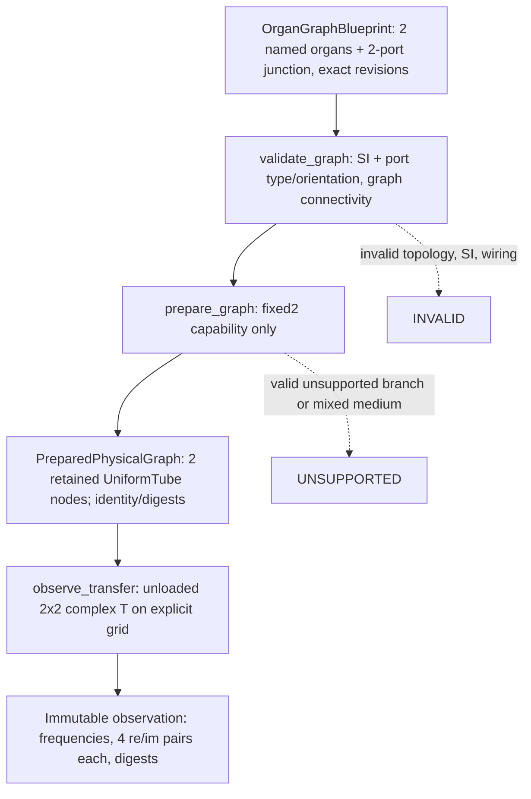

# OG-3 Gate B — minimal public fixed two-port candidate (2026-10-15)

**IMPLEMENTATION CANDIDATE / DRAFT / NOT ADOPTED.**
Parent [Core #100](https://github.com/ryonakayama234/morphoacoustics/issues/100); physical design [Gate A PR #102](https://github.com/ryonakayama234/morphoacoustics/pull/102), X2a isolation [#103](https://github.com/ryonakayama234/morphoacoustics/issues/103). This separate implementation PR **stacks on the Gate A design branch**, NOT on main; no merge or independent reviewer approval implied. The code may change after automated CI/independent critique.

## System, data and physics

- Code in `src/morphoacoustics/physical/organ_graph.py` and `src/morphoacoustics/preparation/graph.py`, **direct subpackage imports**; no old initializer or old acoustic primitive changes; no runtime imports of Experiment039. Only fixed passive lossless **serial two-node** topology is computed. Legal three-port graph validation stays valid then returns `UNSUPPORTED` for this backend.
- `[p_in,U_in]=T_A*T_B[p_out,U_out]`, `e^(+iωt)`, `Z=ρ c/A` [Pa s/m³]. Complex normalized output `S T S^-1`, `S=diag(1,Z_A)`. Ideal p and **volume flow U** continuity at serial zero-volume junction. No waveform, flow excitation or glottal dynamics. `matched` and `pressure_release` are only provenance/terminal metadata for an **unloaded two-port**; the full complex T does not depend on which is recorded.
- Candidate identities: `blueprint_digest` hashes sorted *named* organ/junction collections, oriented edge ordering, exact versions/physical SI parameters encoded as big-endian binary64 hex, source/load/termination and schema. `preparation_digest` adds backend/version/port mapping; `observation_digest` adds ordered frequency bytes (with normalized signed zero) and real/imag binary64 values. Core authoritative; **no Python/JavaScript cross-runtime byte verification claimed yet**. Snapshots must roundtrip exact prep digest.
- Explicit requests: nonempty 1-D **at most 4096** finite numerical frequency points in `0..4000 Hz`. >4000 Hz `UNSUPPORTED`; negative/NaN/Inf/wrong shape `INVALID`; `-0.0` normalized to `+0.0` before evaluation and hash. The 4 kHz cap is an engineering *capability window*, **not scientific validation of every frequency/body**: OG-2 frozen scientific comparisons cover only seven specified points.
- Status: `INVALID` for ill-formed/ill-typed graph, `UNSUPPORTED` for recognized backend capability absent, `NUMERICALLY_UNRESOLVED` for nonfinite computed matrix. `INFEASIBLE` remains reserved for task-level motor realization outside this API; `FAILED` is the job/runtime outcome. No fabricated WAV on failure.

## Validation contract — **not acceptance evidence until CI/artifacts exist**

- Clean-room `tests/test_prepared_graph_public.py` imports only `src/morphoacoustics/` plus separately reads the immutable OG-2 Wolfram JSON **as oracle data**, never imports experiment Python.
- Compare full complex normalized 7-frequency matrix to `experiments/039_og2_prepared_graph/wolfram/og2_oracle.json` with `≤1e-10`, equal-area A+B vs one 0.17-m tube `≤1e-10`, lossless flux `T†JT≈J`, and negative false particle velocity connection.
- Test port/ID/units, disconnected graph, valid unsupported branch, exact B-only revisions/physics/digest, reordered organ collection digest identity, snapshotted reconstruction, terminal-invariant *unloaded* T, shape/frequency and ±0.0 identity.
- Source-freeze: `limited_live.py` adds **only two new explicitly hash-pinned files**:
  - `physical/organ_graph.py` Git blob `ea72548dd3fb771436dbfe0980ae5ab5ed3e9b17`
  - `preparation/graph.py` Git blob `405fb65ce65118b86384896e3406871da9408528`
  All **23 old pins and original source blobs remain unchanged**, original unknown-file/tamper failure tests must continue to pass. This manifest change only makes the audit aware of new physically isolated source; true preflight X2a smoke **must still be demonstrated**.
- Require full 3.11/3.12/3.13 CI, mypy, exact PR head, direct re-evaluation of Wolfram/clean output. Genuine X2a audited-NumPy 2.4.6 two-Take 0.5s WAV+physical trace with immutable sha256 artifacts remains a **blocking unverified gate**, not implied by generic pytest.
- Independent numerical and code/API review required; correlated AI feedback is not independent human acceptance. This PR is draft and must not merge or be declared publicly adopted even on green CI.

## Future Studio contract

Studio sends named graph/revision + explicit physical selection through a separately versioned adapter. No UI canvas coordinates, Character narrative, Script/Direction or generated audio enters Core blueprint digest. No Studio changes in this PR.

## CORRECTIVE IMPLEMENTATION AMENDMENT: frozen research requires sibling package isolation (2026-10-15)

**This supersedes all earlier paths and pinned-new-files statements above.** Exact initial Gate B GitHub CI [run #38730478593](https://github.com/ryonakayama234/morphoacoustics/actions/runs/38730478593) failed. Experiment028/029 frozen preflights and X2a live smoke also failed because **even explicitly hash-pinned new Python files under `src/morphoacoustics/` violate upstream Experiment028's frozen source identity**. Merely extending X2a's `AUDITED_PACKAGE_GIT_BLOBS` is **NOT sufficient**. The original experiment oracles, source pins, and old package must not be mutated to conceal this failure. Typecheck also found 7 genuine typing errors in initial candidate, corrected before the next CI.

**Revised boundary:** new Core-owned, distribution-packaged **sibling** `src/morphoacoustics_graph/__init__.py`, `src/morphoacoustics_graph/model.py`, `src/morphoacoustics_graph/preparation.py`. Public candidate imports `from morphoacoustics_graph.model import ...` and `from morphoacoustics_graph.preparation import ...`. Its physical primitive `UniformTube` comes from existing `morphoacoustics.acoustics.uniform_tube`. No file is added or modified under frozen `src/morphoacoustics/`; **revert** the attempted X2a manifest extension. The siblings are only a distribution/package boundary, not a separate physics authority or Studio subsystem. Both remain in one Core repository and Core-owned versions/contracts. New package can evolve without retroactively altering fixed V3 Experiment028/029 sources.

**Acceptance still REQUIRED:** rerun complete Experiment028/029 and X2a genuine smoke at new exact HEAD, inspect Python 3.11–3.13 and mypy, validate all research evidence/negative controls; if upstream freezes still fail, reject and investigate further. Do not treat the first failed run as a pass, and do not relabel the failed preflight as numerical physics failure. Downstream import path `morphoacoustics_graph` is a *candidate API* and may be renamed in independent review. No adoption or merge.

## Dedicated exact-head evidence workflow (2026-10-15, pending execution)

[Gate B workflow](../../.github/workflows/og3-gate-b.yml) runs the sibling-package public API tests and mypy, **both original Experiment028 and 029 decision gates**, frozen X2a tests and **two independent actual limited-live CLI Takes**, then two fresh public physics evidence runs with frozen Experiment039 Wolfram JSON comparison. [Evidence runner](../../checks/check_og3_gate_b.py) asserts exact Git HEAD and clean tracked checkout, refuses stale outputs and wrong expected-head. Expected gate result is **PROVISIONAL_NUMERICAL_PASS_REVIEW_PENDING_NOT_ADOPTED** only if all machine checks pass. The 3.11–3.13 generic CI matrix remains separate. Actual run links and per-run decisions will be added only after GitHub has executed them. Legacy frozen source stays untouched.
