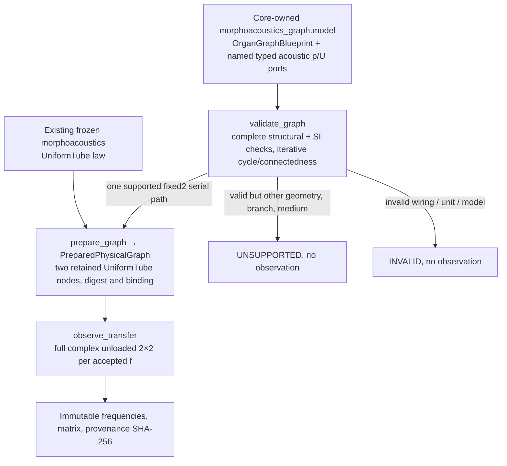

# OG-3 Gate C — fixed-two-fixture Core adoption and post-merge evidence

**Decision effective:** 2026-10-16 JST. **Status: ADOPTED_LIMITED_FIXED2_PASSIVE_SERIAL_CORE.** This authoritatively supersedes dated “Draft / NOT_ADOPTED” headings in the Gate A and Gate B candidate documents **only for the strictly bounded physical API described here**.

- **Code PR:** [#104 — merged](https://github.com/ryonakayama234/morphoacoustics/pull/104)
- **Accepted/reviewed exact code HEAD:** `a83d801346fa0d36196ba4fabd0c9cdd3d4501d0`
- **Resulting main merge commit:** `8fb021ef2abc9eb92275a9e6cc6f92e8a6cb405f`
- **Formal limited decision:** [PR #104 Gate C decision](https://github.com/ryonakayama234/morphoacoustics/pull/104#issuecomment-6197561497)
- **Physics/Numerics GPT-6 AI audit:** [exact-head review](https://github.com/ryonakayama234/morphoacoustics/pull/104#pullrequestreview-5536838839)
- **Code/API/Evidence GPT-6 AI audit:** [exact-head review](https://github.com/ryonakayama234/morphoacoustics/pull/104#pullrequestreview-5536845128)
- **External Codex corrected-head review:** [no major issues](https://github.com/ryonakayama234/morphoacoustics/pull/104#issuecomment-6197510252), following two P1 findings fixed and documented
- **Post-merge general CI:** [#38773196256](https://github.com/ryonakayama234/morphoacoustics/actions/runs/38773196256), Python 3.11/3.12/3.13 full pytest and mypy **SUCCESS**
- **Post-merge dedicated OG-3 + V3 + actual X2a physics:** [#38773196170](https://github.com/ryonakayama234/morphoacoustics/actions/runs/38773196170), **SUCCESS** and [artifact #11992676624](https://github.com/ryonakayama234/morphoacoustics/actions/runs/38773196170/artifacts/11992676624). **All 27 post-merge push workflows SUCCESS.**

## Core architecture and strict law

The serial acoustic two-port uses pressure **p** (Pa) and **volume flow U** (m³/s), `e^(+iωt)`, physical `T_A T_B` with ideal pressure and volume-flow continuity and `Z=ρc/A`. The recorded full complex result is dimensionless `S T S^-1`, `S=diag(1,Z_A)`. No source waveform, loaded terminal power, anatomical radiation, vocal tract motor execution or new WAV production is inferred from this observation. Terminal `matched` / `pressure_release` is blueprint metadata for an **unloaded** two-port result, not a computed transmission claim.

### Accepted numerical and body domain

Only **two exact fixed fixtures**, with A length 0.08 m, area 0.0003 m²; B length 0.09 m, area 0.0003 or 0.0006 m²; shared density 1.21 kg/m³ and speed 343 m/s. Explicit ordered frequency grid `1≤N≤4096`, `0≤f≤4000 Hz`, finite values. +0/-0 Hz canonicalized to identical positive-zero SHA input. Malformed/illegal graphs and values: `INVALID`; valid geometry, other media, three-port topology, oversized or out-of-band frequency: `UNSUPPORTED`; nonfinite computed response: `NUMERICALLY_UNRESOLVED`. `INFEASIBLE` is a motor task realization outcome, **not** a passive graph capability error.

The 4 kHz window is **a software capability window**, not verified universal plane-wave anatomy or physiological bandwidth. The **seven frozen test frequencies** `{80,200,400,733,1200,2200,4000}` Hz cover the independently preserved Experiment039 Wolfram oracle. `ComplexTransferObservation` returns an `(N,2,2)` matrix at all accepted queries but only those seven have separately frozen numeric reference.

### Release-audit evidence and limitations

- At reviewed PR head and again at the merged `main`, maximum full normalized complex error against unchanged Wolfram oracle `1.942890293094024e-15 ≤ 1e-10`; flux-conserving model satisfies `M†J M≈J` at the seven points (threshold `1e-12`), and deliberately wrong particle-velocity-continuity junction violates normalized power flux by 0.5.
- Independent direct Wolfram re-evaluation of committed source `docs/research/og3-wolfram-gate-a.wl` Git blob `1e147a3267276b6d5936627d078edf48eb1e7320` agrees with all 56 real/imag values in unchanged research oracle at recorded precision. Equal-area combination, swapped-order mutation, passive-interface reflection and power conservation verified.
- Post-merge original Experiment028/029 frozen decisions pass; X2a source/tamper freeze remains unchanged (23 pinned source pairs). Two real X2a CLI Takes generated at 48kHz for 0.5s with raw pressure/trace, fresh-directory and artifact SHA checks; not an OG-3 waveform claim.
- Codex initially found **P1 recursive long-graph rejection** and **P1 incomplete workflow trigger** at `a97a9ac`; iterative DFS now returns `UNSUPPORTED` for 1205-organ valid chain or `INVALID` for malformed chain without RecursionError, both triggered by post-correction tests. Both `push` and `pull_request` dedicated workflow path filters include inherited `src/**`, research `experiments/**`, tests/checks, relevant research docs, `pyproject.toml` and workflow itself. Original red CI preserved; do not erase failed experiments or retroactively alter preregistered thresholds.
- **Auditor independence:** Two different critical scopes were reported through the **same GPT-6 conversation**. The executed Wolfram mathematical path and GitHub Codex critical review are distinct, but there is **no claimed independent human review**. This is consistent with repository [AI-Machine v1 policy #98](https://github.com/ryonakayama234/morphoacoustics/issues/98) as applied in the exact-head decision.

The **scientific evidence runner** intentionally still emits `PROVISIONAL_NUMERICAL_PASS_REVIEW_PENDING_NOT_ADOPTED`; this machine outcome is *not* itself a governance adoption. This Gate C decision **separately** authorizes the bounded Core integration and is what now makes it **ADOPTED_LIMITED** on main. Research evidence and release decision must never be conflated.

## What comes next (independent scope/gates)

The broader bodily Organ Graph framework, 3-port oral/nasal branch, physical source, soft-wall mechanics, air–tissue FSI, motion-dependent closures, general nonlinear flow, external/Studio stable cross-language digest and new voiced WAV output **are NOT ADOPTED** by OG-3. A new independent bounded gate should promote OG-1's previously tested **ideal passive three-port p/U branch**, then add realistic oral/nasal acoustic loads and velopharyngeal geometry change with independently established error controls; motor and source interactions are later separate gates. Preserve one physical-law authority in Core and the creative assembly/performance UX in Studio.
