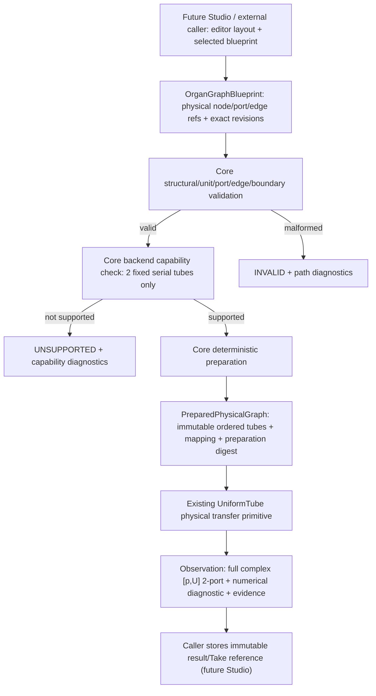
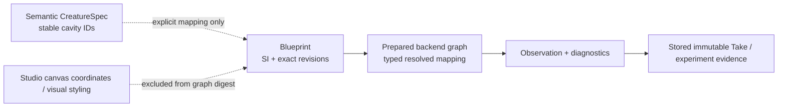

# OG-3 Gate A — narrow public Organ Graph preparation RFC (candidate)

Date: 2026-10-15 JST · Tracker: [Core #100](https://github.com/ryonakayama234/morphoacoustics/issues/100) · Base: `1fb6c9f691f94558c6d5ccaf4b018eb05389cafe`

**Status: DESIGN REVIEW / NOT APPROVED / NO PRODUCTION IMPLEMENTATION / NO MERGE AUTHORIZATION.**
This RFC is an actionable proposed public boundary, NOT a published schema or proof that OG-3 works. Prior OG-0, OG-1 and OG-2 results are **limited research evidence**, not a generic solver. Inherited fixtures are controlled regression, not prospective independent scientific replication. Preserve original Experiment039 evidence and post-hoc amendment.

## 1. One strictly bounded API capability

A Core client constructs **exactly two immutable named fixed rigid uniform 1D passive acoustic tubes**, each with inlet/outlet acoustic p/U ports, and exactly one typed zero-volume serial junction. Core validates and prepares an immutable backend-specific graph preserving identities, exact revisions, units, endpoints and terminal conditions; it returns a full complex frequency-domain two-port response and provenance. No 3D physiology, nonlinear airflow, organ deformation, actual voice, WAV, self-oscillation, arbitrary topology, branched public solver or Studio graph editor is claimed.

### Product / causal boundary

A drawn Studio edge is never automatically a legal acoustic coupling. Core alone owns physical laws, units, capability and feasibility.

## 2. Relationship to current adopted types — no conflation

| Existing authority | OG-3 mapping / non-disruption |
| --- | --- |
| `CreatureSpec` and `CavityConnection` | Semantic cavity/source/articulator relationships; no metric lengths, area or p/U conservation equations. Preserve unchanged. An explicit identity mapping may link them to physical graph nodes, but DO NOT infer a validated junction from `CavityConnection`. |
| `PreparedMorphology[T]`, `PreparationProvenance` | Established generic semantic-to-backend binding. OG-3 prepared *physical graph* is a typed numerical topology; decide a composition/adapter route without changing the universal domain schema or claiming each graph directly satisfies an existing `Tract1DGeometry` contract. |
| `UniformTube` | Adopted fixed lossless plane-wave primitive: reuse `transfer_matrix` and its sign/units without cloning mathematical tube law. |
| `BodyPresetRegistry` | Existing exact-version registry is specifically `PreparedMorphology[Tract1DGeometry]`. Do not insert a graph into this typed registry or silently widen it. A separately reviewed adapter/migration may follow. |
| Performance Contract v0 and **draft** v1 PR #101 | Creative identity, Script, Direction and selected exact body preset are separate from graph preparation. No v0 changes and no dependency on unreleased v1. |
| X2a limited live integration | The **entire src/morphoacoustics Python inventory** and audited git blobs are frozen. Merely adding a new .py file will fail its source preflight. See §6. |
| Experiment039 `og2.py` | Preserve research code, original Wolfram oracle, regression and amendment unchanged; extract/reimplement minimal generalizable implementation behind a new reviewed public contract, then compare without importing experiment code in the public API. |

## 3. Candidate stable public surface, not yet named ABI

- **Input:** schema/canonicalization version; exactly two immutable organ IDs and exact revisions; SI `length_m`, `area_m2`, common `rho_kg_m3`, `sound_speed_m_s`; named inlet/outlet `acoustic.p_u` ports; one `ideal.series.p_u` law/version with explicit orientation; one specified input boundary and one output termination (`matched` or `pressure_release` for the fixed tests).
- **Preparation:** distinct `validate_graph` then `prepare_graph` operations (final naming delegated). Structural validation precedes capability check. Preparation returns `BOUND` or a typed diagnostic, never a silent fallback.
- **Prepared value:** immutably resolves named node/port/edge to **two separately retained `UniformTube` objects**; maintains physical path order, exact module revisions, backend/coupling/canonicalization versions, input graph digest and preparation digest. NEVER flatten away organ identity.
- **Observation request:** finite supported frequency grid (no hidden default), explicit observation/termination metadata; backend uses `[p_in,U_in]^T=T_A T_B[p_out,U_out]^T` with `e^(+i ω t)`. `p` in Pa, **volume flow** `U` in m³/s; `Z_c=ρc/A` in Pa·s/m³. Normalization of entire 2x2 matrix: `S T S^-1` with `S=diag(1,Z_ref)`, `Z_ref=Z_c,A`.
- **Observation output:** 7-frequency full **complex** matrix (real and imaginary parts), evaluation settings and numerical diagnostics. WAV, formants and p/U transients are not supplied by OG-3.
- **Status semantics:** malformed graph or primitive/derived impedance: `INVALID` with precise path; well-formed three-way branch or mixed medium outside backend: `UNSUPPORTED`; numerical singularity/conditioning only when relevant: `NUMERICALLY_UNRESOLVED`; runtime infrastructure failure: `FAILED` at execution layer. `INFEASIBLE` belongs to supported task/body realization and must not be reused for invalid wiring. No fabricated response on any failure.

## 4. Canonical identity, stored data and compatibility

Declare separate hash domains:
1. **Blueprint hash**: schema/canonicalization version, organ IDs/exact revisions and SI parameters, medium, typed port references/directions, coupling law/version and identity-relevant boundary semantics; sort named organ/edge collections consistently; exclude presentation coordinates.
2. **Preparation digest**: blueprint hash plus actually resolved backend/version, solver preparation settings and stable numerical mapping; reject positive-but-subnormal areas when `ρc/A` or reciprocal overflows or underflows to invalid numbers.
3. **Observation/evidence digest**: prepared digest + ordered frequency grid, chosen termination/evaluation, complex raw results, algorithm/code SHA, dependency versions and oracle/run identity.
4. **Historical Take reference**: resolved immutable body/preparation identity and observation artifact. Updating a preset must never retroactively rebind old Takes.

Do not claim cross-language canonical SHA identity until JavaScript/Python fixture byte-for-byte tests exist; Core-computed digest is authoritative meanwhile. Specify float encoding/nonfinite rejection and version namespace before public ABI adoption.

## 5. Thin-slice execution & review gates

**Implementation candidate paths only:** `src/morphoacoustics/physical/organ_graph.py` for typed graph; `src/morphoacoustics/preparation/graph.py` for validation/preparation; small `src/morphoacoustics/acoustics/` observation façade reusing `UniformTube`; `tests/test_prepared_graph_public.py`, `tests/scientific/test_graph_port_physics.py`, and dedicated CI. Names and splitting are implementer discretion; public contract/data invariants are not.

- Gate A (this PR): design and proposed pre-implementation gates only. Independent critical review should approve semantics, defaults, failure taxonomy, hash domains and old API mapping before Gate B.
- Gate B: implement a two-node **clean-room client from production imports only**; pass frozen Experiment039 full complex 7-frequency oracle, equal-area tube identity, area-only causal intervention, orientation/particle-velocity mutations, invalid/unsupported refusal and roundtrip/provenance, Python 3.11–3.13, mypy, complete regressions. Pin exact HEAD and source/oracle/evidence SHA; produce raw outputs and link green CI.
- Gate C: separate physics/numerics and code/API adversarial audits, disclose correlated AI model/context, independent executable Wolfram oracle (machine path only), inspect all blocking findings and make explicit public **GO / INCONCLUSIVE / REJECT** decision. CI green is not scientific validity or API adoption.

No implementation/merge/rerecording legacy oracles is authorized by Gate A alone.

## 6. CRITICAL BLOCKER — X2a frozen package inventory

`src/morphoacoustics/integration/limited_live.py` audits **all 23 other package Python files** and rejects added/removed files, including files not imported by the experiment. `tests/test_limited_live_policy.py::test_frozen_package_source_inventory_is_complete_and_matches_checkout` enforces it. New OG-3 production `.py` modules, even if only additive, will break this audited runtime.

**Gate B cannot be considered regression-green by bypassing this check.** Before it: inspect source reachability/eager `__init__` imports, propose a **narrow explicit hash-pinned addition** to the frozen manifest (or equally rigorous separately reviewed isolation), show old pinned 23 source hashes unchanged, new module hashes known, no unlisted package file permitted, and execute the existing X2a CLI preflight+physical WAV smoke on the exact changed checkout. Re-audit the revised manifest and do not replace old oracle/pins to make tests green. A failed audit blocks public promotion. No such remediation is performed in Gate A.

## 7. Decision questions for independent Gate A review

1. Is a narrow new typed physical graph object correctly distinguished from `CreatureSpec` and `PreparedMorphology[T]`?
2. Are the fixed 2-port law, `e^(+iωt)`, port sign/orientation, shared medium, boundaries and dimensionless similarity transform unambiguous?
3. Does the graph fingerprint exclude view data but preserve exact body/solver/coupling versions?
4. Are malformed topology, valid unsupported branches, infeasible gestures, numerical unresolved and execution failures mutually meaningful?
5. Can the X2a frozen manifest be extended with an *audited*, fail-closed process without silently expanding its physical claims?
6. Is the seven-frequency OG-2 regression correctly distinguished from a new prospective biological validation?

**If any answer is unclear: record BLOCKED/INCONCLUSIVE and amend this RFC visibly before implementation.**

See companion [Gate A physics/acceptance protocol](./og3-gate-a-protocol.md), [Wolfram verification source](./og3-wolfram-gate-a.wl), living [architecture](./organ-graph-program.md), [data map](./organ-graph-data-candidate.md), [ledger](./organ-graph-experiment-ledger.md).
