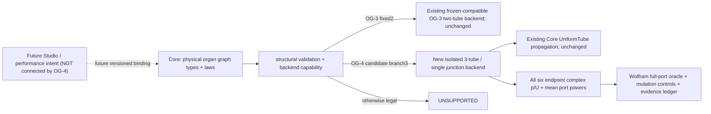
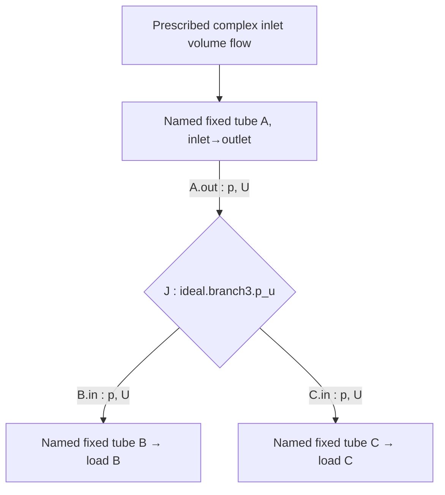
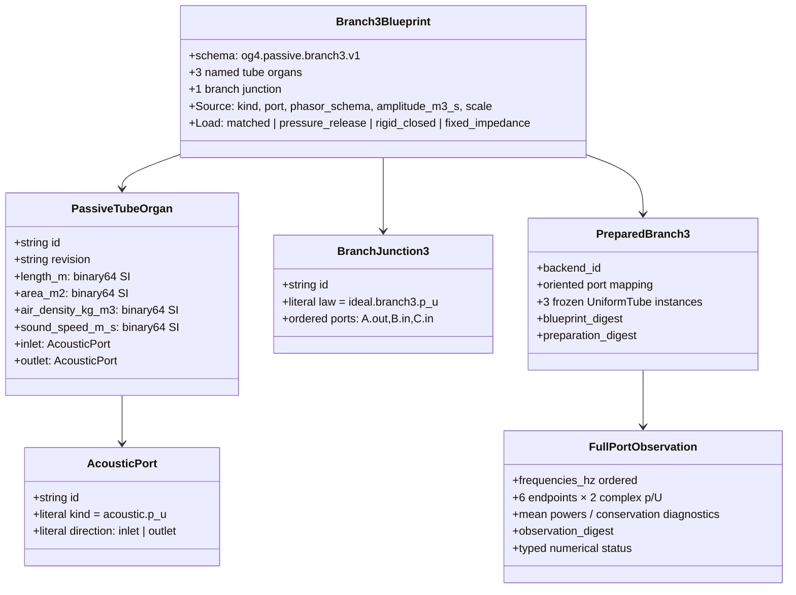

# OG-4 Gate A — Core typed ideal 3-Port branch preparation RFC (PROPOSAL)

**Date:** 2026-10-16 JST. **State: GATE A DESIGN / NOT ADOPTED / NOT IMPLEMENTED.** Parent [#106](https://github.com/ryonakayama234/morphoacoustics/issues/106), inherited [OG-1 research #94](https://github.com/ryonakayama234/morphoacoustics/issues/94) and [OG-3 limited Core Gate C](./og3-gate-c-limited-adoption.md). This RFC promotes **no** code or studio contract by itself. **Amendment A1:** the [normative branch3 v1 API contract](./og4-branch3-api-v1.md) fixes every input/output field, old-schema refusal, snapshot identity, canonical byte grammar and resource/validation boundary. It supersedes the original underspecified API bullets; acceptance still requires review.

## Causal product/system architecture





The three ports are **physical acoustic** pressure/volume-flow ports, not scene-graph arrows or free-form anatomical wiring. The source defines a prescribed *complex harmonic inlet flow*, not speech. Schematic path arrows designate tube orientation only: acoustic waves can propagate in both directions.

## 1. Typed graph and stage separation



The **candidate** may reuse common immutable OG-3 `AcousticPort` and `PassiveTubeOrgan` if semantically compatible, but it must NOT claim `og3.passive.fixed2.v1` schema or `og3.fixed.passive.serial2.pu.v2` backend as a branch backend, change existing OG-3 digests, relax its fixture validator, or add any Python file to frozen `src/morphoacoustics/`. Prefer `src/morphoacoustics_graph/branch3.py` plus versioned `Branch3Blueprint`/law (under independent review); only immutable `UniformTube` from original Core is allowed as a shared physics primitive. Research `experiments/038_og1_passive_branch/network.py` MUST NOT be a production runtime dependency. Existing OG-3 `prepare_graph(valid_three_port)` MUST continue refusing `UNSUPPORTED:FIXED2_SERIAL_ONLY`.

Do not conflate semantic `CreatureSpec`, prepared morphology type, physical graph blueprint, numeric prepared backend, physical state, observed complex port state and WAV. Studio drawing coordinates, character names, scripts and artistic direction must not contaminate physical identity hashes.

## 2. Frozen physics, SI, sign and boundary semantics

`e^(+i ωt)` and harmonic **peak** phasors; `p` in pascals and volume flow `U` in m³/s; `Z=ρc/A` Pa·s/m³. A/B/C lengths `(0.08,0.09,0.06) m`, areas `(3e-4,3e-4,r×3e-4) m²` for `r ∈ {1/2,1,2}`. COMMON `ρ=1.2 kg/m³`, `c=343 m/s`: **not** the OG-3 1.21 kg/m³ profile. This is a specifically versioned OG-1 inherited test fixture, not silently normalized to the OG-3 medium.

At the ideal zero-volume junction J, port orientation **toward/outward from J** must be explicit. Tube inlet-to-outlet flow convention gives:
```text
p_A.out = p_B.in = p_C.in
(-U_A.out) + U_B.in + U_C.in = 0
```
Thus **flow sum**, not equal particle velocities or three same-sign flows. Lossless power check at J: `(1/2) Re(p_J conj(-U_A.out + U_B.in + U_C.in)) = 0` to declared tolerance. Distributed tube transfer uses unchanged `UniformTube` law.

Boundary fields/variants and exact source values are normative in [API §§1–2](./og4-branch3-api-v1.md). Boundary families: B outlet **matched**. C outlet **matched-to-own-area**, **pressure_release** (p_C.out=0), **rigid_closed** (U_C.out=0), and **fixed_impedance** equal to the **baseline** C-load impedance when changing C area. Matched-varying load changes boundary with area; fixed-impedance isolates geometry intervention. For an ideal released or closed load, the terminal average power is **zero** even if local pressure/velocity field is nonzero; no false claim of total power disappearance. Inlet forcing fixed `U_A.in=1e-6(1+0.4i) m³/s` with prescribed amplitude-scale controls (`0.5`, `-1`, 1). Fixed C load is explicitly `{real:1372000,imag:0}` Pa·s/m³, never recomputed from changed C area.

## 3. 3-Port scattering and independent check

Let `Y_i = A_i/(ρc)` for real positive admittance and define incoming/outgoing pressure wave amplitudes `a_i,b_i` (away-from-junction volume flow `Y_i(b_i-a_i)`). Then `b=S a` and:
```math
S_ij = 2 Y_j / (Y_A + Y_B + Y_C) - δ_ij
S† diag(Y) S = diag(Y)
diag(Y) S = (diag(Y) S)^T
```
The **pressure-amplitude** S is NOT generally unitary under ordinary Euclidean power; admittance-weighting is mandatory. Equivalent power-normalized S is real orthogonal. Explicit area-ratio energy splits for only-A incidence: `r=.5 -> (1/25,16/25,8/25)`, `r=1 -> (1/9,4/9,4/9)`, `r=2 -> (1/4,1/4,1/2)`. Pure equal-particle-velocity mutation can *pass* at `r=1` but fails at `r=2` with weighted-power residual `8/9`; do **not** misdiagnose the equal-area control.

[Executed new Gate A Wolfram source](./og4-wolfram-gate-a.wl) and [recorded analytic rational results](./og4-wolfram-gate-a-result.json) attest exact zero weighted-power, reciprocity and power-normalized orthogonality residual for arbitrary positive `Y_i`. The immutable **older** [OG-1 Wolfram oracle](../../experiments/038_og1_passive_branch/wolfram/oracle.json) also re-evaluated from its own unmodified source: all **24 full-port records**, **576** real p/U components and **72** port power numbers match the frozen JSON **exactly at emitted serialization**. This is *repeat computational verification*, not novel empirical evidence.

## 4. Validation, identity and failure semantics

- Full schema/wiring/port uniqueness/source/terminal validation first. Bad `kind`, swapped or dangling port, duplicate ID/edge, nonfinite/negative SI or derived impedance, invalid load/source or ambiguity -> `INVALID`, with explicit code/path; never emit plausible matrix. Iterative graph traversal is mandatory (Codex-found OG-3 long graph recursion failure).
- Well-formed **other** geometry, another medium, changing A/B dimensions, more than one ideal three-port, cyclic/non-tree network or unsupported boundary -> `UNSUPPORTED` and no simulated result; no extrapolative acceptance. For a well-formed unsupported graph containing an invalid subpart, `INVALID` takes precedence.
- Lossless internal singular fixture from OG-1 (3 identical tubes, B/C pressure released, `f=c/(2L)=2143.75Hz`): condition number over frozen `1e8` threshold or rank failure -> `NUMERICALLY_UNRESOLVED`, no damping, no manufactured finite-state fallback. This diagnostic fixture may be **separate from supported nominal geometry** and needs an explicit scientific negative-control harness, not silently admitted by production.
- Strictly typed immutable prepared object reconstructs independently from `og4.branch3.prepared.snapshot.v1`; revalidate forged public objects before every call. [API §§1–2](./og4-branch3-api-v1.md) fixes the complete blueprint, discriminated source/load variants, exact complex `{real,imag}` representation, backend ID, snapshot envelope and old fixed2 refusal. No OG-3 schema/digest change.
- [API §5](./og4-branch3-api-v1.md) freezes `og4.canonical.binary.v1`: typed length-framed binary grammar, complete fields, ASCII collection ordering, concrete domain/version tags and positive-zero encoding for **every numeric field**. [Golden JSON](./og4-branch3-api-golden.json) and [encoding checker](./og4-branch3-api-vectors.py) cover blueprint/preparation/observation. These are executable design fixtures, not a solver.
- Backend accepts **only eight frozen nominal frequencies** `{80,250,400,733,997,1200,2000,4000}` Hz in a nonempty **1-D list of 1..256 points**, preserving order/repeats. Full shape/value invalidity precedes point-limit refusal, which precedes unverified-frequency refusal. [API §§3–4](./og4-branch3-api-v1.md) freezes codes, paths, output dimensions and atomic failure. 733/997 carry the original 24 Wolfram snapshots; the other six frequencies use the separately pinned inherited Python reference, as [protocol provenance](./og4-gate-a-protocol.md) specifies. The list is a software capability, not biological validity; no resource boundary remains deferred to Gate B.
- Numerical solver candidate: six tube end states = 12 complex unknowns, 6 transfer equations + 2 pressure equalities + 1 signed flow sum + 2 terminal constraints + 1 inlet source equation. Scaling `p_ref=Z_A×1e-6Pa`, `U_ref=1e-6m³/s`; only honest fixed-system solve with condition and backward residual diagnostics. Alternative solver implementations may be used if they meet the preregistered tests; no hard-coded algorithm required.

## 5. Governance / adoption stops

**Gate A:** review this RFC and [test protocol](./og4-gate-a-protocol.md) in docs-only Draft PR, explicit human/AI provenance and Codex scrutiny. **No production code**, no research oracle changes. **Gate B:** only separate Draft implementation PR and same-commit architecture/data/ledger synchronized; exact-head GitHub matrix 3.11/3.12/3.13 + mypy, archived OG-1/OG-3 tests, OG-3+V3/X2a genuine 2-Take proof and fresh OG-4 full-port acceptance. **Gate C:** two distinct critical tasks (physics/numerics vs code/API/evidence), independent executable Wolfram paths, external Codex if available, explicit limited decision and only then SHA-guarded merge/post-merge audit. These AI passes are correlated if sharing a context; do not invent a human signature.

Not claimed here: mouth/nose anatomy, nasal radiative impedances, velopharyngeal motion, multimodal organ graph, FSI, nonlinear glottal source, voice quality, WAV rendering, universal frequency or arbitrary multiport graph. A future nasal branch is an **application after** separately modeling physical organs, openings and loads.
