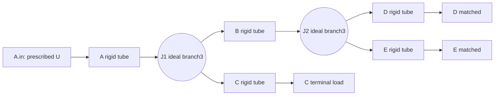

# OG-5 Gate A: five passive tubes, two ideal 3-port junctions

**Status: GATE A ACCEPTED / SPECIFICATION FROZEN / CORE IMPLEMENTATION NOT ADOPTED. 2026-10-16 JST.**
Parent [#109](https://github.com/ryonakayama234/morphoacoustics/issues/109); inherited OG-3 fixed2 [#104](https://github.com/ryonakayama234/morphoacoustics/pull/104), OG-4 branch3 [#108](https://github.com/ryonakayama234/morphoacoustics/pull/108). All work here is DESIGN + Wolfram exploration, not runtime or public support. Existing OG-1/OG-3/OG-4 evidence immutable.

**Amendment A1 is normative:** [complete handoff](./og5-gate-a-amendment-a1.md), [full fixtures](./og5-contract-goldens.json), [supplementary Wolfram receipt](./og5-wolfram-gate-a-a1-result.json). [Gate A acceptance](./og5-gate-a-acceptance.md) records the exact reviewed specification and permits a separate Gate B trial.

## Physical fixture and explicit claim boundary



Exactly A,B,C,D,E; one oriented A.out -> (B.in,C.in) and B.out -> (D.in,E.in); no feedback cycle. Five fixed uniform rigid passive lossless 1D ducts, two **zero-volume** ideal pressure/volume-flow 3-port *constraints*, shared rho=1.2 kg/m³ and c=343 m/s. Lengths A/B/C/D/E=(.08,.09,.06,.07,.05) m; areas=(.0003,.0003,{.00015,.0003,.0006},.0003,.0006) m². C terminal either matched or rigid_closed; D/E matched. A.in U is peak phasor 1e-6*(1+0.4i)*scale m³/s, scale in {1,.5,-1}. Predecessor frequency anchors {80,250,400,733,997,1200,2000,4000} Hz.

At tube endpoints p is Pa and **U is volume velocity** (m³/s), not particle velocity; characteristic impedance Z=rho*c/area, units Pa·s/m³. Phasors exp(+i omega t), k=omega/c:
```text
[p_in]   [cos(kL)       +i*Z*sin(kL)] [p_out]
[U_in] = [+i*sin(kL)/Z  cos(kL)     ] [U_out]
J1: p(A.out)=p(B.in)=p(C.in); U(A.out)=U(B.in)+U(C.in)
J2: p(B.out)=p(D.in)=p(E.in); U(B.out)=U(D.in)+U(E.in)
A.in: U=prescribed amplitude; terminals: p=Z U (matched), U=0 (closed)
Peak-phasor mean power: 0.5*Re(p*conjugate(U)).
```

The reference global system contains **20 complex unknowns** = p/U for 10 endpoints and **20 complex equations** = 10 tubes + 6 junction + 1 source + 3 terminal. Positive reference direction follows tubes inlet -> outlet; junction outward orientation is (-U_parent.out,+U_child1.in,+U_child2.in). Junction is a multiport relation, not a collection of independent unconstrained pairwise wires.

**NOT** arbitrary graph, voiced speech, 3D anatomy, wet contact, moving geometry, distributed losses, flow nonlinearity, tissue constitutive law, source-tract interaction, WAV, Studio UI or creature biology.

## H0, H1 and predeclared falsification

H0: two otherwise lawful junctions fail to compose into one pressure/flow-consistent network; some nondegenerate test reveals wrong port mapping, flow law, pressure continuity, energy gain, or disagreement with a separate scalar impedance recursion.
H1: a bounded prepared five-tube/two-junction implementation returns **all 10 complex p/U endpoint pairs** with independent numerical agreement, signed junction conservation, passive terminal power balance, determinism, typed refusal and unchanged older APIs.

**Required 144/144 successful Gate B positive evaluation cases** (any refused/missing positive is not a passed case; see A1.4): 3 C areas × 2 C terminations × 3 source scales × 8 frequencies, exhaustively evaluated; do not silently drop near-singular instances. Two named comparison families:
1. fresh Core backend vs separately evaluated independent Wolfram scalar recursion and global-system values on every supported case; the backend MUST produce actual states; and
2. fresh Core backend vs **8 frozen exploratory full-port Wolfram records** in [Gate A result](./og5-wolfram-gate-a-result.json) at f=733,997, C area=.00015/.0006, C load matched/closed, scale=1. These are known **before** formal Gate A review (nonblind/controlled inheritance), NOT eight prospective blind confirmations.

Target max normalized complex endpoint error ≤1e-10 across **20 complex numbers** per case, using fixed p_ref=(1.2*343/.0003)*1e-6 Pa and U_ref=1e-6 m³/s independent of scale. Max normalized J1/J2 pressure and signed-flow residual ≤1e-10; relative source/three-terminal mean power mismatch ≤1e-10 using denominator max(abs(P_source),0.5*p_ref*U_ref*abs(scale)^2). Condition number assessed on the **dimensionless** coefficient matrix; require all 20 singular values (including zeros), full numerical rank, cond2 ≤1e4 and scaled absolute infinity-norm algebraic residual ≤1e-12, else **atomic** NUMERICALLY_UNRESOLVED (no pseudoinverse, clamp, hidden repair or partial observation). Gate A review must ratify these numbers **before** implementation; revise with an amendment if simulations show a pathological case.

Mutation/negative controls (deterministically visible failure): use signed U not summed particle velocities; inject wrong signed-J1 and wrong signed-J2 law independently; pressure sign inversion; reverse inlet/outlet; swap reported D.out/E.out identities while retaining original port_ids (child-slot permutations alone are physically equivalent and are separate identity/capability controls); impose wrong C impedance; mutate C area and source; tamper with prepared snapshot; duplicated/dangling/ill-typed ports, malformed numbers, unknown laws, structurally invalid cycles, lawful larger binary trees, and actual rank/condition failure injected at the solver boundary after capability validation. A conservation-only oracle is insufficient: wrong physically self-consistent equations can pass local residuals, so the independent full-state comparator is mandatory. Use unequal-area fixtures to kill a particle-velocity law.

## Independent Wolfram exploration, 2026-10-16 (known, NOT blind)

Source [og5-wolfram-gate-a.wl](./og5-wolfram-gate-a.wl) (full 20x20 scaled coefficient equations and separately formed recursive impedance/forward-state solution). Output [og5-wolfram-gate-a-result.json](./og5-wolfram-gate-a-result.json) includes **8 complete cases × 10 endpoints × 2 complex p/U observables** plus powers and residuals. Source does not import Python/Core and is not an accepted runtime. Re-run independently using Wolfram Language's evaluation of the source. The two paths share the *physical tube transfer identity* (by design), not the global equation assembly/linear solve.

- Max scaled comparator error 9.930136612989092e-16.
- Max scaled global linear residual 2.2887833992611187e-16; max signed junction flow residual 1.1102230246251565e-16; max pressure continuity residual 2.220446049250313e-16.
- Max relative source/terminal power mismatch 8.094900779320129e-16; max scaled 20x20 condition number 24.344944491350603.
- A.in at 733 Hz / C=.00015 / matched = 1.9145547310352657+0.23147567288386797 i Pa, U=1e-6+4e-7 i m³/s. This is **not** an unseen prediction.

**Important failed exploration:** before scaling, a 20x20 mixed-unit Wolfram Solve emitted a bad-conditioning warning; never treat unscaled raw condition number as invariant numerical physics. Preserve this finding. No claim for all 144 cases, full independent anatomy or Core verification yet.

## Mandatory controlled execution

1. **Gate A (this design specification):** reviewers ratify physical signs, full source/output provenance, candidate schema [OG-5 API](./og5-tree5-api-v1.md), sample matrix, numerical floors, golden hashes and independent physical/kind/compatibility review. No code merge by author self-assessment alone.
2. **Gate B (SEPARATE Draft after Gate A accepted):** isolated `morphoacoustics_graph.tree5`, `prepare_tree5` / `restore_tree5` / `response`; reuse public `UniformTube` without changing OG3/OG4. Production NEVER imports experimental oracle. Actual backend 144 cases × 20 complex endpoint states, compare independent Wolfram reference and the 8 frozen records; mutation trials, entire 3.11/3.12/3.13+mypy, OG3/OG4, original Exp028/029 and genuine X2a two-Take preservation.
3. **Gate C:** independent critical physics/numerics and separate data/ABI/security review at exact HEAD, two fresh evidence runs, hashes, source/oracle pin, workflow and downloadable raw artifact examination. Explicit `SUPPORTED_LIMITED` / `INCONCLUSIVE` / `REJECT` receipt; only reviewed accepted version may merge; recheck postmerge.
4. Updating the **architecture, candidate schema, execution plan and ledger** is mandatory in every capability-related PR. Historical decisions remain immutable.

The original proposal did not claim approval. The subsequent Gate A acceptance is recorded separately in og5-gate-a-acceptance.md; no Gate B implementation or runtime adoption is implied.


## Amendment A1 review response — 2026-10-16 JST

[Review R1–R4](https://github.com/ryonakayama234/morphoacoustics/pull/110#pullrequestreview-5546195786) led to the [normative supplement](./og5-gate-a-amendment-a1.md). Complete snapshot/output domains, exact field/shape/byte contracts and stable refusal receipts are now prospective fixtures. Cycle is INVALID in the split-only connected v1 language; a valid 7-organ tree is the unsupported control. Rank-safe full SVD supersedes the truncated-SVD diagnostic and the draft 1e10 cutoff. Eight explicit wrong-law/identity mutants, numerical seams and 144/144-positive scoring are fixed before implementation.

The new [A1 Wolfram source](./og5-wolfram-gate-a-a1.wl) and [receipt](./og5-wolfram-gate-a-a1-result.json) evaluate 144/144 design-model cases, max full-state global-vs-recursive discrepancy 1.320372144714677e-14, maximum condition 223.7427248146297, maximum scaled linear residual 3.376611507232129e-16. All eight mutants exceed the predeclared 1e-6 detection floor (minimum 0.3681067345986977). Duplicate-row, full-rank ill-conditioned and nonfinite guards refuse as specified. The original 8-case JSON remains immutable historical exploration; these new results are supplementary nonblind design analysis, not Core Gate B execution or automatic Gate A approval.
