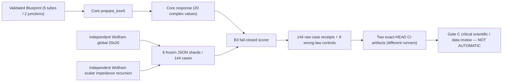
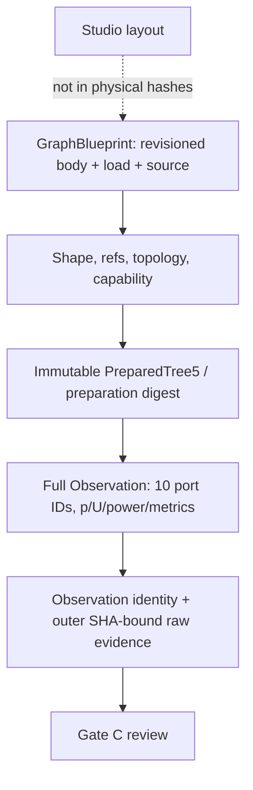

# OG-5 Gate B3 — independent Core/full-port evidence candidate

**Current review: Gate C INCONCLUSIVE at `ca07c974`; remediation and new-HEAD evidence are tracked in [Gate C remediation](./og5-gate-c-remediation.md). Earlier B3 successes below are historical receipts.**

**State: GATE B3 MACHINE PASS at historical exact HEAD `205484690250b366760c574f8621dc066710e5a0` / GATE C PENDING / NOT ADOPTED.** PR #112. A1 frozen acceptance remains authoritative; this file is a live experiment receipt and workflow instruction, not a Gate C scientific decision.

## What is being checked

Two **separate Wolfram 15.0.1 methods**, a 20×20 coupled global complex equation solve and passive impedance recursion/full endpoint reconstruction, generated and archived 144 immutable case-input/output bundles in `og5-b3-oracle-00.json` through `07.json`. Each shard has 18 named cases and complete 10 endpoint complex `p` and `U` results for **both** algorithms. Their source is `og5-gate-b3-independent-oracle.wl`; no production Core imports. The evaluation stage separately ran all 144 before archiving.



**Frozen acceptance:** 144/144 no omissions; for each case and **each** Wolfram reference, max over 10 ports of `abs(p-p_ref)/1.372 Pa` and `abs(U-U_ref)/1e-6 m³/s` ≤1e-10. Scorer independently verifies power reconstruction, scaled junction diagnostics ≤1e-10, scaled matrix residual ≤1e-12, condition2 ≤1e4, zero power at closed port, positive source power, physical identity and exact ordered port names. Eight prescribed wrong-law/output mutants must differ >1e-6 or return an explicit valid numeric refusal. No waveform or anatomy claim.

Archived independent Wolfram generation summary: **144/144 cases, ten p/U port pairs each**, max global-vs-recursion normalized discrepancy `2.602356456953343e-14`, max recursive power defect `3.0408037606009796e-15`, max branch flow defect `2.711828597234095e-15`. These are **reference-only**, not a Core-versus-Wolfram pass.

## Reproducible machine procedure

After installing `pip install -e '.[dev]'` on a checked-out exact candidate HEAD, run:

```bash
HEAD="$(git rev-parse HEAD)"
python checks/check_og5_gate_b3.py --expected-head "$HEAD" --output-dir /tmp/og5-b3-evidence
```

The dedicated `.github/workflows/og5-gate-b3-independent.yml` uses the PR's **head SHA**, not GitHub's synthetic PR merge commit, with two isolated workers `a` and `b`. Each stores 144 raw Core+oracle case outputs, eight control outcomes, metrics, versioned source/oracle SHA256, Git HEAD, workflow run identifiers, and per-file checksum sidecars. A comparison job checks each archive byte-exact against its own checksums, then compares physical outputs using frozen A1 tolerances; cross-worker floating-point bytes need not match. Failure does not satisfy adoption.

The scorer uses the real `prepare_tree5().response()` public candidate path; it never supplies Wolfram states to the physical solver. The mutation harness injects changes only into the Core linear-system rows or Core's reported endpoint identity, leaving the oracle pinned. It reverts each injection after one case.

## Documentation/ABI and limitations



The gate does not support arbitrary graph topologies, 3D anatomy, FSI, active motor gestures, biological speaking, WAV, Studio body editing or release of generalized Character Creator. It reuses the **frozen** A1 Blueprint/Snapshot/Observation types, stable INVALID/UNSUPPORTED/NUMERICALLY_UNRESOLVED, and all existing B2 refusal fixtures; new B3 JSON records are *outer scientific evidence*, not an ABI extension. Prior OG-3/OG-4, Exp028/029 and original X2a physical smoke must be reaudited separately on final exact HEAD.

**Gate C remains required:** examine actual CI logs, both raw archives and checksum identities, historic negative run evidence, numerical laws and API security/reproducibility; disclose shared assistant context; record LIMITED/INCONCLUSIVE/REJECT before merge. An unverified PR cannot claim a new supported Core feature.


## First scientific CI discrepancy and corrected audit criterion (2026-10-16)

Initial HEAD `09dc943f83bc7a65f378c439bffe33fdf63ae5ca`, push run [38910977477](https://github.com/ryonakayama234/morphoacoustics/actions/runs/38910977477): both *independent* raw trial workers **passed** the real Core-versus-Wolfram 144-case scorer and all eight mutants and emitted separate SHA-bound artifacts. The downstream twin audit **FAILED** on `case-results.jsonl` byte equality. That failed acceptance attempt is retained.

Requiring cross-run byte-identical floating-point responses was **not** a frozen Gate A physics criterion. Different BLAS workers can produce distinct last-bit complex outputs; A1 explicitly says different solvers may have different Observation digests while passing numerical tolerances. The corrected `checks/check_og5_b3_twin.py` tests each raw file against its own exact SHA256, requires the two archives' source/oracle SHA256 and semantic Blueprint/preparation identities to agree exactly, and compares all 144 × 20 complex Core outputs with A1's normalized ≤1e-10 tolerance. Mean powers and diagnostics are also compared with explicit bounds; mathematical Observation digests are preserved but not required to match across workers. No invalid/unsupported case or mutant exclusion is allowed.

The fix changes **only the evidence audit**, not the production Core, frozen A1 acceptance, oracle numbers, or scientific scorer. New HEAD and two new actual CI runs are required; neither this explanation nor the earlier failed audit is a Gate B3 pass.


## Fresh exact-HEAD B3 scientific trial — completed machine receipt (2026-10-16)

**Revision under test:** `205484690250b366760c574f8621dc066710e5a0` (Draft [PR #112](https://github.com/ryonakayama234/morphoacoustics/pull/112)). [B3 Actions push run 38911540920](https://github.com/ryonakayama234/morphoacoustics/actions/runs/38911540920) **SUCCESS**: two separate `exact-head-scientific-comparison` workers plus `twin-raw-evidence-audit` successful. Exact second-run independent artifacts [og5-b3-a, og5-b3-b](https://github.com/ryonakayama234/morphoacoustics/actions/runs/38911540920#artifacts), from separate workers, individually hash-verified and checked for physical equivalence. Two archives are still available in GitHub Actions (90-day declared retention).

| Frozen metric | Observed maximum / audit |
| --- | ---: |
| Supported cases | 144/144 |
| Complex states per case | 20 / all 10 port identities |
| Core vs Wolfram global20 normalized full-state error | 1.3137052261585382e-14 |
| Core vs independent Wolfram recursion normalized full-state error | 1.6014810956929108e-14 |
| Core independently recomputed relative power defect | 1.9258423817139507e-15 |
| Core max condition2 | 223.742724814632 |
| Eight numerical wrong-law / identity mutants | 8/8 detected |
| Two-run normalized max endpoint difference | 0.0 |
| Raw evidence | two archives; separate per-file SHA-256, full 144 Core+oracle records, exact HEAD, source/oracle hashes |

The **same pinned HEAD** [OG-3](https://github.com/ryonakayama234/morphoacoustics/actions/runs/38911549700), [OG-4](https://github.com/ryonakayama234/morphoacoustics/actions/runs/38911549665), [Gate A design](https://github.com/ryonakayama234/morphoacoustics/actions/runs/38911549629), [B1/B2](https://github.com/ryonakayama234/morphoacoustics/actions/runs/38911549911), and [general Python 3.11–3.13 + mypy](https://github.com/ryonakayama234/morphoacoustics/actions/runs/38911549654) were **SUCCESS**. OG-3/4 workflows explicitly reran original frozen Exp028/029 and genuinely produced two separate physical X2a Takes.

### Historical failed checks preserved

- `09dc943f...` [run 38910977477](https://github.com/ryonakayama234/morphoacoustics/actions/runs/38910977477): both science worker passes but a *too-strict bitwise floating-point cross-worker* evidence comparison failed. Corrected to independent strict raw SHA256 plus frozen physical tolerances; no physics or oracle change.
- `c1da2ded...` [run 38911385728](https://github.com/ryonakayama234/morphoacoustics/actions/runs/38911385728): both science worker passes but checkout after artifact download cleaned away downloaded evidence. Corrected operation ordering; no Core physics change.
- The corrected run `205484...` is the first **full B3 workflow success**, not an erasure of failed attempts. The next documentation commit must rerun exact-head CI.

### Decision boundary

**B3 machine trial supports the bounded five-tube/two-junction numerical and error contracts only**; there is no human-independent scientific signature and no claim that real biological anatomy, active dynamics or voice is simulated. Separate Gate C critical review must explicitly choose `SUPPORTED_LIMITED`, `INCONCLUSIVE` or `REJECT` and verify the *final* code SHA and archived source evidence before any merge.
