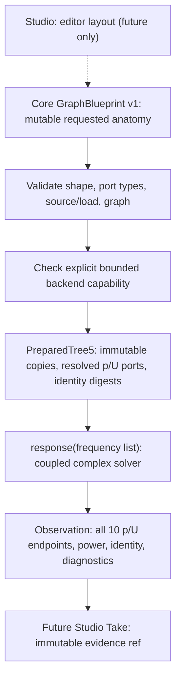

# OG-5 tree5 v1 candidate API — DESIGN CONTRACT, NOT ADOPTED

**Gate A proposal, 2026-10-16.** See [protocol](./og5-gate-a-protocol.md) and [#109](https://github.com/ryonakayama234/morphoacoustics/issues/109). Distinct version namespace; no implicit upgrade of OG3/OG4, CC-A1 or Studio.

## Logical objects and operations



Proposed new module `morphoacoustics_graph.tree5`, entry points `prepare_tree5(blueprint: dict[str,object]) -> PreparedTree5`, `restore_tree5(snapshot: dict[str,object]) -> PreparedTree5`, methods `PreparedTree5.to_snapshot()` and `PreparedTree5.response(frequencies_hz: list[int|float]) -> dict`. Return values JSON-compatible; complex values exactly `{"real":float,"imag":float}`; no native Python complex values in API. Names/identifier regex `[A-Za-z0-9][A-Za-z0-9_.:-]{0,127}`.

## Exact blueprint schema proposal

```text
GraphBlueprint {
 schema: "og5.passive.tree5.v1",
 organs: [ Organ{ id,revision,length_m,area_m2,sound_speed_m_s,air_density_kg_m3,
                  inlet:Port{id,kind:"acoustic.p_u",direction:"inlet"},
                  outlet:Port{id,kind:"acoustic.p_u",direction:"outlet"} } ],
 junctions: [ Junction{id,law:"ideal.branch3.p_u",ports:[parent.out,child1.in,child2.in]} ],
 source: {kind:"prescribed_volume_flow",phasor_schema:"og5.peak.exp_plus_i.v1",
          port:"A.in",amplitude_m3_s:{real,imag},scale},
 loads: [Load{port,kind:"matched"|"rigid_closed"}]
}
```

Exact keys for each object, no omitted defaults, strings-to-number, tuple-to-array, booleans-as-numbers, NaN, infinities, array scalar coercion or unknown fields. Built-in finite int/float only; canonical round-to-nearest binary64 at parse boundary, normalize -0.0 to +0.0. Reject duplicate JSON member keys **at adapter level before dict construction**. Positive finite length, area, speed, density; finite real+imag amplitude and finite scale; source physical flow not a gain. Restrict sample size to nonempty built-in list length 1..256, each built-in finite nonnegative int/float (reject bool), preserve request order and duplicates.

Organs have unique IDs/revisions; ports globally unique and exactly assigned once; junction IDs unique, source and loads each bind one port, resolve all references; physically typed connections only; no inactive dangling ports; junction ports[0] an outlet, ports[1:3] distinct inlets of other organs. Orient signed flow parent.out = sum child.in. Multiport law is a junction node/constraint; do not treat visual lines as independent physical edge laws. Traverse iteratively, fully validate all input structures and relationships **before capability**; avoid recursion depth/security issues.

## Fixed capability after complete structural validity

- Exactly organs {A,B,C,D,E}; exact port names S.in/S.out for each; junctions `J1:["A.out","B.in","C.in"]` and `J2:["B.out","D.in","E.in"]`, both law `ideal.branch3.p_u`.
- Common c=343 and rho=1.2; A/B/C/D/E lengths .08/.09/.06/.07/.05 metres; A/B/D areas .0003, E=.0006, C area in {.00015,.0003,.0006} m². Arbitrary valid revisions.
- A.in prescribed complex 1e-6+0.4e-6i m³/s; source scales in {1,.5,-1}. Loads C.out matched or rigid_closed, D/E matched.
- Frequency anchors {80,250,400,733,997,1200,2000,4000} Hz; each output sample has all ten ordered ports sorted by canonical fixed organ/endpoint order, each with p and U complex SI and the source/terminal powers. No graph-specific WAV.
- Well-formed cycle, extra organ/junction, different geometry or source: `UNSUPPORTED` *after complete validation*. Unknown schema/version: `UNSUPPORTED` only after validating the envelope where meaningful. Malformed type/relationships: `INVALID`. Expected sample numerical singularity: `NUMERICALLY_UNRESOLVED`, not a fabricated result or `INFEASIBLE`. Job crashes separate `FAILED`.

## Immutable binding and hashing candidate

Prepared snapshot schema `og5.tree5.prepared.snapshot.v1`; `digest_version="og5.canonical.binary.v1"`, `backend_id="og5.fixed.passive.tree5.pu.v1"`, `blueprint`, `blueprint_digest`, `preparation_digest`. Observation schema `og5.tree5.observation.v1` includes exact requested frequencies, full complex endpoint states for every frequency, source and terminal powers, backend and prepared identity, status/digest and numerical diagnostics. **State p/U must never enter the stored physical anatomy digest.** Source amplitudes/scales and load kinds, tube revisions/material and law semantics **must** enter blueprint identity; Studio canvas x/y coordinates must not. Preparations are bound by recomputation, not trusted merely because a digest field matches a regex. Snapshot restoration rejects forged/extra fields, recomputes graph and complete backend mapping. No partial observation/digest on any error.

Proposed canonical byte encoder uses ASCII for all version IDs/keys and version-scoped numeric input: `d` + IEEE754 big-endian binary64 for each number (positive zero), `s` + u32be length + ASCII string; `l` + u32be count + concatenated values; `m` + u32be count + keys sorted ASCII byte order and encoded key/value pairs. Canonicalize the collections organs by id, junctions by id, loads by port; **do not sort each junction's oriented `ports[]`**, as it is semantic. Blueprint hash = `sha256:` + lowercase SHA256(ASCII `morphoacoustics.og5.blueprint.v1` + zero byte + canonical full blueprint). Use [four golden fixtures](./og5-blueprint-goldens.json) to check hash agreement *in another language before adoption*. Prepared and observation domains are separate; their **full exact field layouts and golden bytes are still Gate A review blockers**, not unspecified freedom for Gate B implementers.

## Proposed deterministic status taxonomy and precedence

Validation stages: (1) envelope and scalar field shape/type, collect lexical lowest JSON Pointer (2) cross-reference and unique port/ID, assign each port exactly once (3) physical port directions / law structure (4) full structure connectedness/acyclic structural analysis (5) fixed capability / version (6) sample numeric-domain request (7) solve/atomic result. If multiple malformed errors, report smallest JSON Pointer; then graph relationship diagnostics, then capability. A valid-but-unsupported cycle is `UNSUPPORTED:TOPOLOGY_NOT_SUPPORTED`, but any malformed port in that graph remains `INVALID`. Example error interface `Tree5Error(ValueError)` with string fields `status/code/path`; message `STATUS:CODE:/json/pointer`. Specific stable codes, numeric condition threshold and error golden fixtures require critical Gate A review; *this draft is not authoritatively final ABI*. Preserve old OG3/OG4 schemas, digest bytes, implementation and refusals unchanged.

## Non-negotiable tests for Gate B

Roundtrip snapshot, deterministic normalizations and collection reorders, tamper/mutating revision and C area, all invalid structural families, scalar and frequency malformed cases, unknown schema and legal unsupported topology, N=1205 iterative structural traversal control, both-junction wrong-law independent mutants, source scale/sign, first-frequency-success then later numerical failure atomicity, OS/process/order-independent golden hash. Never import experimental oracles from production. Gate B begins only after documented Gate A acceptance.
