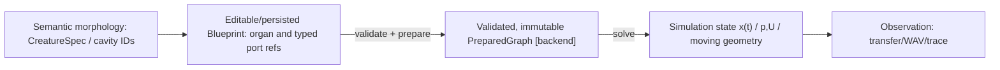

# Organ Graph data contracts — experiment-local candidate (2026-10-14)

**NOT A PUBLISHED API.** This is a reviewable, minimal conceptual schema for [Core OG-2 #96](https://github.com/ryonakayama234/morphoacoustics/issues/96), not a replacement for `CreatureSpec`, `PreparedMorphology[T]`, `Tract1DGeometry` or the Studio Performance Contract v0. Exact field names and JSON serialization are unapproved.

## Four different objects — do not collapse them



- A `CreatureSpec.CavityConnection(source_id,target_id,kind)` provides semantic relationships, **not** a complete physical port equation. The new preparation layer must explicitly bind identities and constraints, not reinterpret such a connection as a mathematically verified junction.
- A `Blueprint` describes a creator-chosen anatomical/numerical configuration. It contains **persistent parameters**, not instantaneous values of pressure, velocity or wave samples.
- `PreparedGraph` is a backend-bound immutable object with validated resolved ports, solver rest state, mapping, preparation provenance, and a digest. Its existence must not imply every gesture or future dynamic behavior is feasible.
- Simulation state / observables are evaluated later and are not part of the blueprint digest.

## Candidate serial 2-organ fixed passive example

```json
{
  "schema_version": "organ-graph-candidate/v0",
  "model_scope": "fixed-rigid-linear-1d-passive",
  "organs": [
    {"id":"organ-A","revision":"1","kind":"rigid-tube-1d","length_m":0.08,"area_m2":0.0003,
     "ports":[{"id":"in","kind":"acoustic-pu","role":"inlet"},
              {"id":"out","kind":"acoustic-pu","role":"outlet"}]},
    {"id":"organ-B","revision":"1","kind":"rigid-tube-1d","length_m":0.09,"area_m2":0.0006,
     "ports":[{"id":"in","kind":"acoustic-pu","role":"inlet"},
              {"id":"out","kind":"acoustic-pu","role":"outlet"}]}
  ],
  "medium": {"rho_kg_m3": 1.2, "c_m_s": 343},
  "edges": [
    {"id":"edge-A-B","from":"organ-A.out","to":"organ-B.in",
     "law":"ideal-series-pu/v1"}
  ],
  "boundaries": [
    {"port":"organ-A.in","kind":"excitation","value_ref":"fixture-input"},
    {"port":"organ-B.out","kind":"matched-impedance"}
  ]
}
```

This is an *illustrative fixture*, not a production schema or a new experiment result. Fixed source and boundary conditions used by a solver may instead be kept in an **evaluation request** rather than a reusable blueprint; the experimental gate must make this separation explicit.

## Type and law constraints

| Quantity | Unit | Role |
| --- | --- | --- |
| acoustic pressure perturbation `p` | Pa | **computed** port state |
| acoustic volume velocity `U` | m³/s | **computed** port state; local signed direction |
| acoustic characteristic impedance `Zc = rho*c/A` | Pa·s/m³ | **derived** and must remain finite |
| cross-sectional area `A` | m² | static input in this 1D candidate |
| tube length `L` | m | static input |
| acoustic power `p U` | W | power audit, with appropriate mean/phasor convention |

At ideal zero-volume fixed passive series connection, `p_A.out = p_B.in` and global-direction `U_A.out = U_B.in`; with local outward signed flows their sum is zero. **Do not impose particle-velocity equality** across unequal areas; it is a falsifying wrong law. For an ideal three-port junction, all port pressures are equal and outward signed volume velocities sum to zero. Both are limited small-signal 1D laws.

**Never assume** an edge between `acoustic-pu` and `mechanical-force-velocity` is legal without an explicit transduction model. A graphically connected node must be physically validated.

## Preparation output proposal

```text
PreparationResult
  ├ outcome: BOUND | INVALID | UNSUPPORTED | NUMERICALLY_UNRESOLVED
  ├ prepared_graph: backend-specific rest topology, ONLY on success
  ├ resolved_mappings: semantic ID ↔ numeric organ/port/edge IDs
  ├ capability: fixed passive serial p/U (not general anatomy)
  ├ provenance: schema / organ revisions / law versions / backend / settings
  ├ graph_digest: canonical content hash independent of UI coordinates
  └ diagnostics: path, code, failed law/boundary, context
```

Preparation failure codes here are **proposal vocabulary**. Keep the adopted Core realization statuses unchanged: `INFEASIBLE` describes a *supported physical task* that a body cannot realize, not an invalid or unsupported graph. Numerical singularity is not a plausible audio fallback. `FAILED` belongs to execution infrastructure, not biological capability.

## Digest and versioning

The canonical graph/preparation digest should include topology, organ IDs/revisions, SI-valued parameters, medium, port roles and coupling law IDs, boundary definitions when they affect prepared identity, backend + numerical configuration, and canonicalization/schema version. It should **exclude** visual canvas coordinates, selection state, derived WAV, transient p/U state, and UI theme. Define separately the **input/blueprint digest**, **prepared rest-state digest**, **run/evidence hash**, and **immutable Take hash**.

Changing organ B area or revision must change the appropriate digest while A's identity stays fixed. Reordering JSON arrays of otherwise identical named nodes/edges should not change a canonical structural digest if canonicalization intentionally sorts IDs. Old Takes must retain the old exact revision and resolved hash.

## Core ↔ Studio contract boundary

Creative `CharacterSpec` is *not* `CreatureSpec`; Studio appearance mesh is not the numerical acoustic/solid mesh. A reusable Character/Body binding selects an exact validated body revision; future Performance Contract v1 should carry selected `preset_id` + `preset_revision` in the request and actual `preparation_digest` / `backend_id` in result. This is separately tracked by [Core #72](https://github.com/ryonakayama234/morphoacoustics/issues/72) and [Studio #14](https://github.com/ryonakayama234/morphoacoustics-studio/issues/14).

## Required counterexamples before promotion

- Same two tubes, equivalent single tube: full complex transfer equality after correct unit normalization.
- Same graph, different B area: nonzero physical reflection and digest change; unchanged A.
- Wrong port type/direction, duplicated edge, missing boundary, negative/nonfinite dimensions: fail closed as invalid.
- Well-formed legal branch supplied to a serial-only backend: `UNSUPPORTED`, never silently flattened.
- Deliberate particle-velocity junction, reversed organ order, wrong port power sign: independent oracle rejects.
- Near-zero but positive area causing derived `Zc` overflow: explicit invalid diagnostic.
- Frozen fixtures and new integrated-base conditions: exact head SHA + CI + reproducible independent machine evidence.

Companion [program](./organ-graph-program.md) and [evidence ledger](./organ-graph-experiment-ledger.md).
