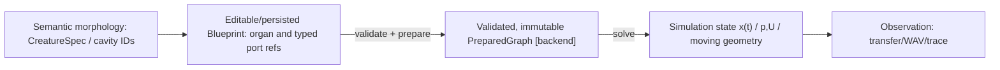

# Organ Graph data contracts — experiment-local candidate (2026-10-14)

**NOT A PUBLISHED API.** This is a reviewable, minimal conceptual schema for [Core OG-2 #96](https://github.com/ryonakayama234/morphoacoustics/issues/96), not a replacement for `CreatureSpec`, `PreparedMorphology[T]`, `Tract1DGeometry` or the Studio Performance Contract v0. Exact field names and JSON serialization are unapproved.

## Four different objects — do not collapse them



- A `CreatureSpec.CavityConnection(source_id,target_id,kind)` provides semantic relationships, **not** a complete physical port equation. The new preparation layer must explicitly bind identities and constraints, not reinterpret such a connection as a mathematically verified junction.
- A `Blueprint` describes a creator-chosen anatomical/numerical configuration. It contains **persistent parameters**, not instantaneous values of pressure, velocity or wave samples.
- `PreparedGraph` is a backend-bound immutable object with validated resolved ports, solver rest state, mapping, preparation provenance, and a digest. Its existence must not imply every gesture or future dynamic behavior is feasible.
- Simulation state / observables are evaluated later and are not part of the blueprint digest.

## Candidate serial 2-organ fixed passive example

```json
{
  "schema_version": "organ-graph-candidate/v0",
  "model_scope": "fixed-rigid-linear-1d-passive",
  "organs": [
    {"id":"organ-A","revision":"1","kind":"rigid-tube-1d","length_m":0.08,"area_m2":0.0003,
     "ports":[{"id":"in","kind":"acoustic-pu","role":"inlet"},
              {"id":"out","kind":"acoustic-pu","role":"outlet"}]},
    {"id":"organ-B","revision":"1","kind":"rigid-tube-1d","length_m":0.09,"area_m2":0.0006,
     "ports":[{"id":"in","kind":"acoustic-pu","role":"inlet"},
              {"id":"out","kind":"acoustic-pu","role":"outlet"}]}
  ],
  "medium": {"rho_kg_m3": 1.2, "c_m_s": 343},
  "edges": [
    {"id":"edge-A-B","from":"organ-A.out","to":"organ-B.in",
     "law":"ideal-series-pu/v1"}
  ],
  "boundaries": [
    {"port":"organ-A.in","kind":"excitation","value_ref":"fixture-input"},
    {"port":"organ-B.out","kind":"matched-impedance"}
  ]
}
```

This is an *illustrative fixture*, not a production schema or a new experiment result. Fixed source and boundary conditions used by a solver may instead be kept in an **evaluation request** rather than a reusable blueprint; the experimental gate must make this separation explicit.

## Type and law constraints

| Quantity | Unit | Role |
| --- | --- | --- |
| acoustic pressure perturbation `p` | Pa | **computed** port state |
| acoustic volume velocity `U` | m³/s | **computed** port state; local signed direction |
| acoustic characteristic impedance `Zc = rho*c/A` | Pa·s/m³ | **derived** and must remain finite |
| cross-sectional area `A` | m² | static input in this 1D candidate |
| tube length `L` | m | static input |
| acoustic power `p U` | W | power audit, with appropriate mean/phasor convention |

At ideal zero-volume fixed passive series connection, `p_A.out = p_B.in` and global-direction `U_A.out = U_B.in`; with local outward signed flows their sum is zero. **Do not impose particle-velocity equality** across unequal areas; it is a falsifying wrong law. For an ideal three-port junction, all port pressures are equal and outward signed volume velocities sum to zero. Both are limited small-signal 1D laws.

**Never assume** an edge between `acoustic-pu` and `mechanical-force-velocity` is legal without an explicit transduction model. A graphically connected node must be physically validated.

## Preparation output proposal

```text
PreparationResult
  ├ outcome: BOUND | INVALID | UNSUPPORTED | NUMERICALLY_UNRESOLVED
  ├ prepared_graph: backend-specific rest topology, ONLY on success
  ├ resolved_mappings: semantic ID ↔ numeric organ/port/edge IDs
  ├ capability: fixed passive serial p/U (not general anatomy)
  ├ provenance: schema / organ revisions / law versions / backend / settings
  ├ graph_digest: canonical content hash independent of UI coordinates
  └ diagnostics: path, code, failed law/boundary, context
```

Preparation failure codes here are **proposal vocabulary**. Keep the adopted Core realization statuses unchanged: `INFEASIBLE` describes a *supported physical task* that a body cannot realize, not an invalid or unsupported graph. Numerical singularity is not a plausible audio fallback. `FAILED` belongs to execution infrastructure, not biological capability.

## Digest and versioning

The canonical graph/preparation digest should include topology, organ IDs/revisions, SI-valued parameters, medium, port roles and coupling law IDs, boundary definitions when they affect prepared identity, backend + numerical configuration, and canonicalization/schema version. It should **exclude** visual canvas coordinates, selection state, derived WAV, transient p/U state, and UI theme. Define separately the **input/blueprint digest**, **prepared rest-state digest**, **run/evidence hash**, and **immutable Take hash**.

Changing organ B area or revision must change the appropriate digest while A's identity stays fixed. Reordering JSON arrays of otherwise identical named nodes/edges should not change a canonical structural digest if canonicalization intentionally sorts IDs. Old Takes must retain the old exact revision and resolved hash.

## Core ↔ Studio contract boundary

Creative `CharacterSpec` is *not* `CreatureSpec`; Studio appearance mesh is not the numerical acoustic/solid mesh. A reusable Character/Body binding selects an exact validated body revision; [Draft v1 contract PR #101](https://github.com/ryonakayama234/morphoacoustics/pull/101) now carries selected `preset_id` + `preset_revision` in the request and actual `preparation_digest` / `backend_id` in result; the source of truth is the still-unadopted `contracts/performance/v1` proposal, with unchanged nested creative v0 schemas. This is separately tracked by [Core #72](https://github.com/ryonakayama234/morphoacoustics/issues/72) and [Studio #14](https://github.com/ryonakayama234/morphoacoustics-studio/issues/14).

## Required counterexamples before promotion

- Same two tubes, equivalent single tube: full complex transfer equality after correct unit normalization.
- Same graph, different B area: nonzero physical reflection and digest change; unchanged A.
- Wrong port type/direction, duplicated edge, missing boundary, negative/nonfinite dimensions: fail closed as invalid.
- Well-formed legal branch supplied to a serial-only backend: `UNSUPPORTED`, never silently flattened.
- Deliberate particle-velocity junction, reversed organ order, wrong port power sign: independent oracle rejects.
- Near-zero but positive area causing derived `Zc` overflow: explicit invalid diagnostic.
- Frozen fixtures and new integrated-base conditions: exact head SHA + CI + reproducible independent machine evidence.

Companion [program](./organ-graph-program.md) and [evidence ledger](./organ-graph-experiment-ledger.md).

## 2026-10-15 evidence boundary (WP-01 / WP-03)

OG-2 Experiment039 is now **accepted only as fixed-geometry passive 1D research** via [formal #98 decision](https://github.com/ryonakayama234/morphoacoustics/issues/98#issuecomment-6182585021) and merged [#97](https://github.com/ryonakayama234/morphoacoustics/pull/97). Its experiment-local `Blueprint`/`PreparedPhysicalGraph` are **not** the illustrative JSON schema in this document, nor an adopted production interface; do not copy field names from the example and claim ABI stability. Further public promotion requires [OG-3 #100](https://github.com/ryonakayama234/morphoacoustics/issues/100).

Parallel [CC-A1 Draft PR #101](https://github.com/ryonakayama234/morphoacoustics/pull/101) defines `PerformanceRequest v1`'s exact `{preset_id,preset_revision}`, and result's `{status,preset_id,preset_revision,backend_id,preparation_digest}` **only when bound**. This creator binding is separate from physical graph law and from `CreatureSpec`, and preserves v0 creative snapshots. Status is DRAFT CONTRACT, not a new physical solver or released Studio adapter. Contract request digest hashes full v1 request + backend ID/version; resolved preparation digest remains the Core registry's physical binding digest.

## OG-3 candidate public binding (2026-10-15; NOT a published ABI)

See the [Gate A RFC](./og3-public-preparation-rfc.md) for exactly two fixed serial tubes, typed p/U law, immutable identity and separate blueprint/preparation/observation digests. The illustrative JSON and Experiment039 private types are not the public ABI. `CreatureSpec`, registry and draft CC-A1 remain separate. New code is isolated in `src/morphoacoustics_graph/`; original Core tree/manifest/pins remain byte-identical, with separately audited sibling hashes/imports and legacy regression. X2a manifest extension alone is rejected.

### OG-3 Gate A canonical-byte candidate, review pending (2026-10-15)

[OG-3 RFC §8](./og3-public-preparation-rfc.md) proposes versioned structural/preparation/observation digest domains, SI binary64 big-endian hex within canonical sorted JSON, exact named revisions, stable organ/edge sorting but **order-preserving directional port tuples**, with Python↔JS byte fixture test before cross-runtime promises. Terminal condition is Blueprint identity metadata; unloaded complex two-port `T` does not vary with load, and no observation-time termination override is provided by candidate v1. JSON complex response entries are explicit `[real,imag]`; frequency grid is nonempty 1D finite nonnegative Hz. Identifier normalization policy and resource caps require review. This is **not a published schema**; see [candidate test amendment](./og3-gate-a-protocol.md).

### Candidate normalized observation-grid bytes (Gate A review 2026-10-15)

Ordered frequencies are finite float64 SI Hz, `1<=N<=4096`, `0<=f<=4000`. Normalize ±0 before evaluation/snapshot/hash to exact binary64 hex `0000000000000000`, never `8000000000000000`. Output `(N,2,2)` complex pairs preserves order/duplicates; seven points apply only to the frozen oracle. A well-formed finite nonnegative N>4096 grid is `UNSUPPORTED` (resource limit); >4000 Hz is `UNSUPPORTED` (frequency capability). Malformed/type/nonfinite/negative input is `INVALID`. All refusals carry no observation/matrix/digest. Invalid input takes precedence, then resource cap, then band. This is numerical support, not full-band physiology. See RFC §9 and protocol boundary cases.

### Gate A approved-for-trial only: Core sibling graph type, original frozen physics unchanged

The candidate `OrganGraphBlueprint`/prepared value is now held in sibling `src/morphoacoustics_graph/`, with `UniformTube` imported unchanged from frozen `src/morphoacoustics/acoustics/`. All original 23 X2a pins and source bytes are retained, and no generic branching solver is inferred. Exact frequency capability 0..4000Hz, signed-zero normalization, identity splits and orphan invalid refusal remain the proposal. The first failed-in-frozen-tree trial and corrected machine-green sibling trial are linked in [scientific ledger](./organ-graph-experiment-ledger.md); this is not an adopted external ABI.


### Geometry-domain correction and Gate B handoff (2026-10-15)

[RFC §11](./og3-public-preparation-rfc.md) restricts every 0..4000 Hz support claim to the two frozen **ordered** fixtures (first 0.08 m/3e-4 m², second 0.09 m/{3e-4,6e-4} m²; rho 1.21, c 343). All other valid geometry/medium is UNSUPPORTED before preparation; malformed input is INVALID. No arbitrary-geometry 4 kHz claim. Caller IDs/revision labels and collection reorder remain independent of physical path. Backend candidate v2 must refuse old candidate snapshots and forged prepared values rather than bypass capability. New code stays in the sibling package; old Core tree/oracles/pins stay unchanged. The [reconciliation work order](./og3-gate-b-reconciliation.md) records #104 blockers and acceptance before its next exact-head run. Design-only merge does not release or scientifically adopt Gate B.


## Historical Gate B trial receipt retained during design reconciliation

### OG-3 Gate B proposed data implementation (Draft, 2026-10-15)

[Implementation documentation](./og3-gate-b-implementation.md) identifies concrete named immutable `OrganGraphBlueprint` and `PreparedPhysicalGraph` candidates. Python-only canonical `blueprint_digest` (explicit SI finite binary64-hex; collections sorted by node/edge ID but ordered junction endpoints retained), `preparation_digest` (backend/version/path mapping), `observation_digest` (normalized ±0, ordered f-grid, full complex real/imag bytes). Output represents **unloaded transfer** regardless of blueprint terminal metadata; no loaded impedance asserted. Compatibility: existing `CreatureSpec`, `PreparedMorphology[T]`, `BodyPresetRegistry`, experiment039, and creator contract unchanged. Cross-runtime JS/Python canonical bytes not yet demonstrated. Candidate interface not accepted until independent reviewed Gate C.

#### Gate B data placement correction (after first CI, 2026-10-15)

Proposed physical graph types are owned by sibling Core Python package `morphoacoustics_graph.model`, and prepare/observation API by `morphoacoustics_graph.preparation`, **not** the frozen `src/morphoacoustics/physical` and `preparation` Python tree. Exact typed p/U, SI, node revisions, oriented junction and three digest domains are unchanged; this change affects package distribution/import location, not physical equations or existing `CreatureSpec`. Original X2a source manifest restored. Docs above describing two newly pinned files inside the old source tree are superseded. See [correction](./og3-gate-b-implementation.md).

#### Gate B evidence identity and pristine source protection

The sibling graph package's observation stores seven ordered frequencies and all 4 complex two-port entries per frequency as explicit `[real,imag]` pairs, plus exact backend/blueprint/preparation/observation digests. A separate raw `checks/check_og3_gate_b.py` run attests Git head SHA, original Wolfram JSON hash, NumPy version and maximum normalized complex error. This **evidence identity** is distinct from immutable physical digest; no recorded X2a files are used as new audio. Dedicated CI verifies two freshly computed physical Takes.


### Gate B reconciled implementation trial (2026-10-15; verification pending)

PR #104 incorporates merged Gate A main `6d38d8b`. Sibling backend v2 enforces RFC §11's two exact geometry/medium fixtures and reconstructs prepared binding before evaluation. Old v1 candidate snapshots are refused, never rebound. Observation validation preserves original scalar types, checks all malformed values before resource/frequency capability, returns UNSUPPORTED for valid 4097-point grids, preserves N matrices/order/duplicates and hashes exact positive-zero bytes. Supplementary per-point flux threshold <=1e-12, wrong defect 0.5 and separate reverse-order controls are explicit. Tests and evidence runner match the [reconciliation work order](./og3-gate-b-reconciliation.md); current exact-head CI/artifact receipt will be attached to [#104](https://github.com/ryonakayama234/morphoacoustics/pull/104). No legacy package, source pins or experiment/oracle changes; no release/adoption. Old trial receipts above are historical and do not attest this new implementation.

### Gate C long-graph & CI dependency coverage (2026-10-16)

Well-formed large graphs remain syntactically representable although only two fixture organs have a solver. Structural validation uses iterative DFS (cycle/connectedness, full port/finite checks); a valid 1205-organ serial chain MUST return typed `UNSUPPORTED/FIXED2_SERIAL_ONLY`, not a runtime RecursionError. Its structurally malformed counterpart MUST return `INVALID` first. Dedicated OG-3 CI is re-triggered on inherited `src/**`, Experiment039 oracle/`experiments/**`, Wolfram research docs, python project configuration, tests, and checks; do not rely on a stale older PR evidence run. [Notes](./og3-gate-b-implementation.md).
