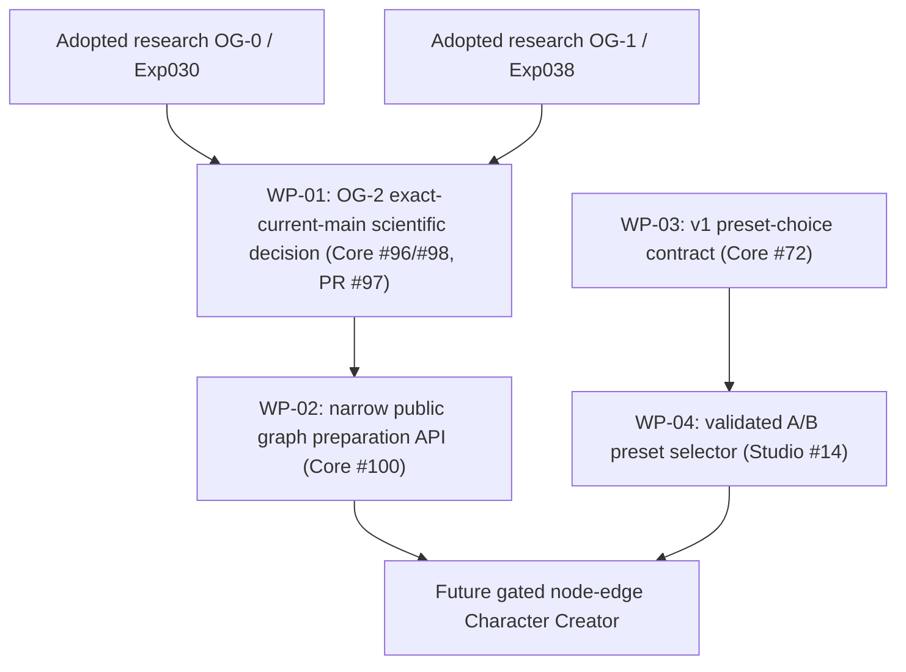

# Organ Graph Foundation — execution work orders / acceptance plan (2026-10-14 JST)

**Status: WORK PLAN / 2026-10-15 UPDATE — WP-01 ADOPTED LIMITED RESEARCH AND MERGED; WP-03 DRAFT IMPLEMENTED, NOT ADOPTED; WP-02/04 UNIMPLEMENTED.**
Parent [Studio Character Creator #12](https://github.com/ryonakayama234/morphoacoustics-studio/issues/12), previous synchronized proposal [Draft PR #99](https://github.com/ryonakayama234/morphoacoustics/pull/99). This document records exact expected work, outputs and fail-closed gates so implementation may be delegated without authoring decisions about the science during coding.

## Milestone definition

Demonstrate that a body containing **two immutable named fixed 1D passive rigid acoustic organ modules** connected by **one typed ideal p/U port law** can be:
1. validated (including invalid-connection rejection);
2. bound reproducibly to a backend-specific prepared physical graph;
3. observed as a full complex transfer response against independent Wolfram oracle;
4. stored/reloaded under exact graph/module/backend identity;
5. later selected by creator-facing contract with separate character identity and immutable Take provenance.

This is a **physical body preparation and small-signal acoustic demonstration**, NOT a human-like voice or waveform demonstration. Stage A Studio preset comparison may proceed independently with already validated bodies; arbitrary node-edit UI is not in this milestone.

## Parallel dependency map

## WP-01 — OG-2 research experiment Gate: review/accept, not rewrite

**Owner:** Core. Existing [PR #97](https://github.com/ryonakayama234/morphoacoustics/pull/97), [audit #98](https://github.com/ryonakayama234/morphoacoustics/issues/98), [tracking #96](https://github.com/ryonakayama234/morphoacoustics/issues/96). **Input baseline:** PR #97 `68b24375d374902f4793d32e35214d07bc720f4d` versus adopted main `0def163fadcf8fc59aece773faecd7ca852e1ea7` when this plan was drafted. Pin freshly read SHAs at execution; these are historical identifiers.

**Concrete candidate change scope:** `experiments/039_og2_prepared_graph/`, `tests/test_experiment_039_og2.py`, `.github/workflows/experiment-039-og2.yml`; dedicated architecture/data/ledger updates in this plan PR lineage. No `src/morphoacoustics/`, public contracts or Studio modifications.

**Implementation actions:** integrate/rebase the experiment-only PR onto adopted main; inspect overlapping tests/scientific provenance; preserve `AMENDMENT_001` as post-implementation correction and existing frozen 7-frequency oracle; run exact-head Python 3.11–3.13 full pytest + experiment mypy + generic CI + runner twice; verify clean HEAD, source/oracle hashes, SHA-256 evidence, fresh-output rejection and wrong-expected-SHA rejection; independently recompute Wolfram complex matrices/isolated power and falsifying wrong connection/orientation controls; independently critique physics and code/API/evidence, disclosing shared AI context.

**Acceptance:** the frozen OG-2 gate in `PREREGISTRATION.md`: max dimensionless full complex transfer error `<=1e-10`; power/scattering absolute error `<=1e-12`; false particle-velocity coupling max normalized mismatch `>1e-3`; identity invariance vs B intervention, both positive/negative structural/capability diagnostics; no experimental code import from production. Results must be tied to **new integrated exact HEAD** and cannot rely only on old 38430414632 successes. Human voices/3D/FSI/WAV not claimed.

**Decision/output:** exact SHA-scoped [audit #98](https://github.com/ryonakayama234/morphoacoustics/issues/98) with `SUPPORT_LIMITED_PASSIVE_2PORT_PREPARATION` / `INCONCLUSIVE` / `REJECT`; research PR may be considered for merge only after the decision, and its merge is **not** public API approval. Post-merge main exact-SHA regression if merged.

### WP-01 execution receipt — 2026-10-15 JST

Integrated exact HEAD `5711a3a` passed [scientific CI #38667264999](https://github.com/ryonakayama234/morphoacoustics/actions/runs/38667264999) and [full regression #38667265000](https://github.com/ryonakayama234/morphoacoustics/actions/runs/38667265000), with [artifact hash and 11 controls](./organ-graph-experiment-ledger.md), [independent audit and explicit limited decision](https://github.com/ryonakayama234/morphoacoustics/issues/98#issuecomment-6182585021). [PR #97 merged](https://github.com/ryonakayama234/morphoacoustics/pull/97) as research only to `main@2f325956`; production graph ABI remains unapproved. Post-merge main CI is separately tracked in the ledger.

### WP-03 initial execution receipt — 2026-10-15 JST

[Draft PR #101](https://github.com/ryonakayama234/morphoacoustics/pull/101) adds v1 JSON schemas, fixtures, exact binding semantics, request digest and contract tests with unchanged v0; the reference resolver is **under `contracts/performance/v1/`, not published `src/`**, to keep the frozen limited-live source inventory byte-identical. Initial [green v1 CI #38668068786](https://github.com/ryonakayama234/morphoacoustics/actions/runs/38668068786) Python 3.11/3.12/3.13 and mypy followed remediation. A fresh integrated-head CI is required before acceptance.

## WP-02 — Core narrow public graph API, only if WP-01 supported

**Owner:** Core; [planning and design gate #100](https://github.com/ryonakayama234/morphoacoustics/issues/100). **Deliverable:** versioned, production-visible **exactly-two-module fixed passive serial** `validate_graph` / `prepare_graph` / acoustic observation façade, with the specific final function/class names selected in a reviewed RFC. Preserve current `CreatureSpec`/semantic cavities, `PreparedMorphology[T]`/preparation provenance, and `BodyPresetRegistry`; do not elevate the Experiment039 Python class directly without API/compatibility review.

**Likely source locations (suggestions, NOT present claims):**
- `src/morphoacoustics/physical/organ_graph.py` — immutable typed physical organ/port/edge blueprint
- `src/morphoacoustics/preparation/graph.py` — validation, typed outcomes and deterministic resolved graph digest
- `src/morphoacoustics/acoustics/` — keep existing `UniformTube`, thin observation adapter only if necessary
- `tests/test_prepared_graph_public.py` and `tests/scientific/test_graph_port_physics.py`
- `docs/architecture.md`, `docs/invariants.md`, formal data contract notes and `experiments/README.md`.

**API case:** a caller constructs A (0.08 m, 3e-4 m²) and B (0.09 m, 3e-4 or 6e-4 m²) with named inlet/outlet `acoustic.p_u` ports, physical `ideal.series.p_u` edge and explicit source/load boundaries, then obtains either typed refusal or immutable prepared identity and the dimensionless normalized full complex 2-port matrix at the frozen grid. No fallback flattening to anonymous segments; do not treat visual graph coordinates as physics.

**Quantitative regression:** inherit *only* existing Experiment039 fixed-fixture mathematical oracle and errors. For any novel fixture, fix hypotheses and thresholds BEFORE implementing the new experiment. Structural invariants: module reorder with same IDs → same canonical digest, B area/revision change → changed digest but invariant A, stable roundtrip serialization and exact no-`latest` semantics, nonfinite `rho*c/A` refused, valid three-port shape but unsupported serial backend refused. Distinguish validation INVALID, capability UNSUPPORTED, supported physical task INFEASIBLE, numerical unresolved and infrastructure FAILED.

**Decision:** independent public API compatibility/capability review and machine evidence. Expected visible success is **prepared body and response**, not playable WAV. No automatic general graph API endorsement from one fixed two-node success.

## WP-03 — creator-selected exact body preset contract v1

**Owner:** Core [CC-A1 #72](https://github.com/ryonakayama234/morphoacoustics/issues/72). May proceed while WP-01/02 continue. **Code candidates:** `contracts/performance/v1/`, `src/morphoacoustics/integration/body_presets.py` only if narrowly necessary, `docs/body-binding-v0.md` compatibility supplement, contract fixtures/tests. Keep `contracts/performance/v0/` and all old v0 Take interpretation unchanged.

**Request:** `embodiment: {preset_id, preset_revision}` and exact seed/script/direction; **result:** resolved `{preset_id,preset_revision,backend_id,preparation_digest}`. Never put physical selection into Character description/Direction notes, and never infer mutable `latest`. Same v1 input/backend/revision → same request and preparation digest; alternate exact preset/revision → distinguishable request digest; old saved Take retains previous resolution; mismatch/missing/unsupported/INVALID/INFEASIBLE/FAILED correctly distinct. Test versioned schema compatibility, semantic validation and saved snapshot roundtrip.

**Gate:** `CC-A1 #72` evidence-first acceptance and versioned release, independent of graph editor. Version-pinned Studio adapter uses Core's canonical upstream schema, not a parallel Studio fork.

## WP-04 — Studio's first creator-visible body A/B control

**Owner:** Studio [CC-A2 #14](https://github.com/ryonakayama234/morphoacoustics-studio/issues/14). Requires WP-03 contract, not WP-02 graph API. Current UI code `src/App.tsx`, `src/studio/model.ts`, `src/backend/`, `src/contract/` and Take storage provide integration points. Existing [X2a live Draft #15](https://github.com/ryonakayama234/morphoacoustics-studio/pull/15) supports **one frozen experimental body/utterance**, not a validated two-body live speech comparison.

**User workflow:** same Character, same supported Script/Gesture/Direction/seed; select two **independently validated exact** body preset revisions; execute two immutable Takes, display each selected/resolved body, backend and digest, capability/outcome and acoustic trace/response; play WAV **only when the chosen validated adapter genuinely produces one**. Unsupported body+task → explicit UNSUPPORTED and no synthetic waveform. Old Take unaffected by preset edit, browser reload, service restart or later catalog updates. UI calls backend contract, does not own solver state.

**Gate:** tests for canonical upstream contract, body-only request diff, snapshot history immutability, missing/incompatible preset refusal, adapter capability label accuracy, existing S2/X1/X2 regressions; UI integration smoke across supported runtime, with Windows/WSL2 manual smoke noted separately from Linux CI. Pass scenario must not rely on mock/fixture as a claimed newly generated voice.

## Common deliverables/record update gate — each work-package PR

Every implementation PR changes **three context views together**:
1. system architecture diagram and supported capability boundary;
2. physical/creative data schema or mapping + SI/sign units, version and digest semantics;
3. hypothesis, protocol/amendments, independent oracle/test, raw experiment ledger with exact code SHA/CI links and explicit status.

Use `PROPOSED`, `IN_PROGRESS`, `PROVISIONAL_NUMERICAL_PASS`, `ADOPTED_LIMITED`, `INCONCLUSIVE`, `REJECT` in tracker, with `NOT_ADOPTED` until a separate explicit decision. Do not confuse machine-green test suite with physical science, or research merge with public capability. Keep design docs and scientific artifact hashes immutable and searchable.

## Future after these four Work Packages — separate decisions

A) one dimensional-geometry editing intervention with deterministic body builder and verified observed acoustic changes; B) fixed passive 3-port public capability and junction-level oracle; C) actuated/deformable articulator coupled to geometry; D) active source↔airflow/acoustic feedback; E) time-dependent coupled FSI; F) creator-editable mixed-port graph. Each new family needs a physical law, capability boundary, negative controls, oracle and explicit acceptance. Do not directly map creator 'effort' or 'cute' to raw pressure/F0/gain without a body-specific control model.

## OG-3 Gate A initiated 2026-10-15 — docs only

Issue [#100](https://github.com/ryonakayama234/morphoacoustics/issues/100) has a proposed external Core API design package: [RFC](./og3-public-preparation-rfc.md), [protocol](./og3-gate-a-protocol.md), [Wolfram check](./og3-wolfram-gate-a.wl), and synchronized living architecture/data/ledger. This is a **design Draft**, not Gate B implementation, current-head scientific acceptance, published API or merge authorization. First nontrivial compatibility obstacle: X2a audits the entire package .py inventory, therefore a new graph module would break its frozen legacy-live preflight. An explicit source-hash inclusion/isolation re-audit and real X2a smoke at the exact future implementation HEAD are mandatory; never bypass the manifest. Gate B code starts only after critical RFC/protocol review and disposition, without changing CC-A1 Draft #101 or Studio #14.

### OG-3 Gate A post-author technical self-audit (2026-10-15)

Review comment [Gate A self-audit PR #102 comment](https://github.com/ryonakayama234/morphoacoustics/pull/102#issuecomment-6188922718) plus [RFC §8](./og3-public-preparation-rfc.md) and [candidate protocol amendment](./og3-gate-a-protocol.md) resolve design choices provisionally: no eager `__init__` edits, explicit hash-pinned new source inventory for X2a, separated versioned digest domains, termination stored in Blueprint while *unloaded* transfer remains termination-independent, frequency vector shape/complex JSON and typed errors. **These are candidate dispositions only.** Gate A remains review-required; Gate B implementation cannot begin as an adopted contract until independent design critiques and X2a plan are recorded. No X2a manifest modified yet.

### Gate A Codex review disposition / Gate B branch plan (2026-10-15)

Two automatically raised issues on [#102](https://github.com/ryonakayama234/morphoacoustics/pull/102) were accepted: frequency window **0..4000 Hz** and signed-zero canonicalization. Amendment is synchronized across RFC/architecture/data/ledger/protocol. Gate A technical design review is recorded, but no independent human approval or API adoption is claimed. Implement Gate B in a **separate Draft PR stacked on the Gate A branch** (initial base branch `design/og3-gate-a-public-graph-20261015`); this isolates the code diff and avoids merging unapproved Gate A into main. The Gate B Draft remains not approved and never merges until both physics and code review, historical source inventory protection and exact-head evidence are satisfied.

### OG-3 Gate A handoff revised after real failed/green Gate B experimental runs (2026-10-15)

[PR #104](https://github.com/ryonakayama234/morphoacoustics/pull/104) first attempted to explicitly pin new Python files in X2a guard; Experiment028/029 original source fingerprints **FAILED**. It was corrected to Core-owned sibling `src/morphoacoustics_graph` that reuses unchanged UniformTube without changing `src/morphoacoustics` or original X2a manifest. Exact trial passes [all Python 3.11–3.13+typecheck](https://github.com/ryonakayama234/morphoacoustics/actions/runs/38731395318) and [specialized original V3 plus X2a genuine live and 7-point OG-3 oracle](https://github.com/ryonakayama234/morphoacoustics/actions/runs/38731394921), but remains Draft and NOT_ADOPTED. **Design acceptance is provisional technical disposition only**; independent review and explicit Gate C needed before any merge. Graph package is in same Core project; Studio remains unchanged.
