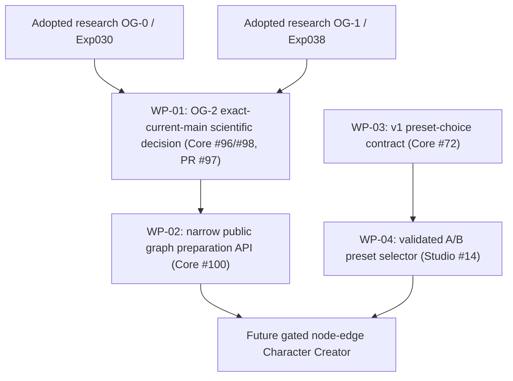

# Organ Graph Foundation — execution work orders / acceptance plan (2026-10-14 JST)

**Current execution update (2026-10-16; corrected after Codex P2):** **WP-02 = OG-3 fixed2 Core graph preparation+observation, ADOPTED LIMITED and merged** via [PR #104](https://github.com/ryonakayama234/morphoacoustics/pull/104); see [Gate C decision](./og3-gate-c-limited-adoption.md). **WP-03 = creator-selected exact body preset contract v1** remains a **separate Core contract workstream** (its draft status is not changed or adopted by OG-3). **WP-04 = Studio validated A/B body preset selector** likewise remains separate and **not delivered by OG-3**. These WP identifiers follow the explicit graph and section headings below; the old 2026-10-15 status line is retained only as historical prerelease planning, not as the current authoritative status.

**Status: WORK PLAN / 2026-10-15 UPDATE — WP-01 ADOPTED LIMITED RESEARCH AND MERGED; WP-03 DRAFT IMPLEMENTED, NOT ADOPTED; WP-02/04 UNIMPLEMENTED.**
Parent [Studio Character Creator #12](https://github.com/ryonakayama234/morphoacoustics-studio/issues/12), previous synchronized proposal [Draft PR #99](https://github.com/ryonakayama234/morphoacoustics/pull/99). This document records exact expected work, outputs and fail-closed gates so implementation may be delegated without authoring decisions about the science during coding.

## Milestone definition

Demonstrate that a body containing **two immutable named fixed 1D passive rigid acoustic organ modules** connected by **one typed ideal p/U port law** can be:
1. validated (including invalid-connection rejection);
2. bound reproducibly to a backend-specific prepared physical graph;
3. observed as a full complex transfer response against independent Wolfram oracle;
4. stored/reloaded under exact graph/module/backend identity;
5. later selected by creator-facing contract with separate character identity and immutable Take provenance.

This is a **physical body preparation and small-signal acoustic demonstration**, NOT a human-like voice or waveform demonstration. Stage A Studio preset comparison may proceed independently with already validated bodies; arbitrary node-edit UI is not in this milestone.

## Parallel dependency map

## WP-01 — OG-2 research experiment Gate: review/accept, not rewrite

**Owner:** Core. Existing [PR #97](https://github.com/ryonakayama234/morphoacoustics/pull/97), [audit #98](https://github.com/ryonakayama234/morphoacoustics/issues/98), [tracking #96](https://github.com/ryonakayama234/morphoacoustics/issues/96). **Input baseline:** PR #97 `68b24375d374902f4793d32e35214d07bc720f4d` versus adopted main `0def163fadcf8fc59aece773faecd7ca852e1ea7` when this plan was drafted. Pin freshly read SHAs at execution; these are historical identifiers.

**Concrete candidate change scope:** `experiments/039_og2_prepared_graph/`, `tests/test_experiment_039_og2.py`, `.github/workflows/experiment-039-og2.yml`; dedicated architecture/data/ledger updates in this plan PR lineage. No `src/morphoacoustics/`, public contracts or Studio modifications.

**Implementation actions:** integrate/rebase the experiment-only PR onto adopted main; inspect overlapping tests/scientific provenance; preserve `AMENDMENT_001` as post-implementation correction and existing frozen 7-frequency oracle; run exact-head Python 3.11–3.13 full pytest + experiment mypy + generic CI + runner twice; verify clean HEAD, source/oracle hashes, SHA-256 evidence, fresh-output rejection and wrong-expected-SHA rejection; independently recompute Wolfram complex matrices/isolated power and falsifying wrong connection/orientation controls; independently critique physics and code/API/evidence, disclosing shared AI context.

**Acceptance:** the frozen OG-2 gate in `PREREGISTRATION.md`: max dimensionless full complex transfer error `<=1e-10`; power/scattering absolute error `<=1e-12`; false particle-velocity coupling max normalized mismatch `>1e-3`; identity invariance vs B intervention, both positive/negative structural/capability diagnostics; no experimental code import from production. Results must be tied to **new integrated exact HEAD** and cannot rely only on old 38430414632 successes. Human voices/3D/FSI/WAV not claimed.

**Decision/output:** exact SHA-scoped [audit #98](https://github.com/ryonakayama234/morphoacoustics/issues/98) with `SUPPORT_LIMITED_PASSIVE_2PORT_PREPARATION` / `INCONCLUSIVE` / `REJECT`; research PR may be considered for merge only after the decision, and its merge is **not** public API approval. Post-merge main exact-SHA regression if merged.

### WP-01 execution receipt — 2026-10-15 JST

Integrated exact HEAD `5711a3a` passed [scientific CI #38667264999](https://github.com/ryonakayama234/morphoacoustics/actions/runs/38667264999) and [full regression #38667265000](https://github.com/ryonakayama234/morphoacoustics/actions/runs/38667265000), with [artifact hash and 11 controls](./organ-graph-experiment-ledger.md), [independent audit and explicit limited decision](https://github.com/ryonakayama234/morphoacoustics/issues/98#issuecomment-6182585021). [PR #97 merged](https://github.com/ryonakayama234/morphoacoustics/pull/97) as research only to `main@2f325956`; production graph ABI remains unapproved. Post-merge main CI is separately tracked in the ledger.

### WP-03 initial execution receipt — 2026-10-15 JST

[Draft PR #101](https://github.com/ryonakayama234/morphoacoustics/pull/101) adds v1 JSON schemas, fixtures, exact binding semantics, request digest and contract tests with unchanged v0; the reference resolver is **under `contracts/performance/v1/`, not published `src/`**, to keep the frozen limited-live source inventory byte-identical. Initial [green v1 CI #38668068786](https://github.com/ryonakayama234/morphoacoustics/actions/runs/38668068786) Python 3.11/3.12/3.13 and mypy followed remediation. A fresh integrated-head CI is required before acceptance.

## WP-02 — Core narrow public graph API, only if WP-01 supported

**Owner:** Core; [planning and design gate #100](https://github.com/ryonakayama234/morphoacoustics/issues/100). **Deliverable:** versioned, production-visible **exactly-two-module fixed passive serial** `validate_graph` / `prepare_graph` / acoustic observation façade, with the specific final function/class names selected in a reviewed RFC. Preserve current `CreatureSpec`/semantic cavities, `PreparedMorphology[T]`/preparation provenance, and `BodyPresetRegistry`; do not elevate the Experiment039 Python class directly without API/compatibility review.

**Required source isolation (reconciled with RFC §10; exact internal split remains a suggestion):**
- `src/morphoacoustics_graph/model.py` — immutable typed physical organ/port/edge blueprint
- `src/morphoacoustics_graph/preparation.py` — validation, typed outcomes, resolved digest and observation façade
- Existing `morphoacoustics.acoustics.uniform_tube.UniformTube` — reuse unchanged via explicit sibling import; entire `src/morphoacoustics/`, its initializers and X2a manifest/pins remain byte-identical
- `tests/test_prepared_graph_public.py` and `tests/scientific/test_graph_port_physics.py`
- `docs/architecture.md`, `docs/invariants.md`, formal data contract notes and `experiments/README.md`.

**API case:** named A/B organs and ideal p/U serial edge, explicit source/load metadata, immutable prepared identity, and one normalized full complex matrix per requested frequency. Follow RFC §9: `1<=N<=4096`, `0<=f<=4000`, preserve order/duplicates; 4097 finite in-band points are `UNSUPPORTED` with no observation. Malformed requests are `INVALID`; ±0 canonicalize to identical exact zero bytes. The seven-point grid is only the frozen oracle fixture. No fallback flattening or visual coordinates as physics.

**Quantitative regression:** inherit *only* existing Experiment039 fixed-fixture mathematical oracle and errors. For any novel fixture, fix hypotheses and thresholds BEFORE implementing the new experiment. Structural invariants: module reorder with same IDs → same canonical digest, B area/revision change → changed digest but invariant A, stable roundtrip serialization and exact no-`latest` semantics, nonfinite `rho*c/A` refused, valid three-port shape but unsupported serial backend refused. Distinguish validation INVALID, capability UNSUPPORTED, supported physical task INFEASIBLE, numerical unresolved and infrastructure FAILED.

**Decision:** independent public API compatibility/capability review and machine evidence. Expected visible success is **prepared body and response**, not playable WAV. No automatic general graph API endorsement from one fixed two-node success.

## WP-03 — creator-selected exact body preset contract v1

**Owner:** Core [CC-A1 #72](https://github.com/ryonakayama234/morphoacoustics/issues/72). May proceed while WP-01/02 continue. **Code candidates:** `contracts/performance/v1/`, `src/morphoacoustics/integration/body_presets.py` only if narrowly necessary, `docs/body-binding-v0.md` compatibility supplement, contract fixtures/tests. Keep `contracts/performance/v0/` and all old v0 Take interpretation unchanged.

**Request:** `embodiment: {preset_id, preset_revision}` and exact seed/script/direction; **result:** resolved `{preset_id,preset_revision,backend_id,preparation_digest}`. Never put physical selection into Character description/Direction notes, and never infer mutable `latest`. Same v1 input/backend/revision → same request and preparation digest; alternate exact preset/revision → distinguishable request digest; old saved Take retains previous resolution; mismatch/missing/unsupported/INVALID/INFEASIBLE/FAILED correctly distinct. Test versioned schema compatibility, semantic validation and saved snapshot roundtrip.

**Gate:** `CC-A1 #72` evidence-first acceptance and versioned release, independent of graph editor. Version-pinned Studio adapter uses Core's canonical upstream schema, not a parallel Studio fork.

## WP-04 — Studio's first creator-visible body A/B control

**Owner:** Studio [CC-A2 #14](https://github.com/ryonakayama234/morphoacoustics-studio/issues/14). Requires WP-03 contract, not WP-02 graph API. Current UI code `src/App.tsx`, `src/studio/model.ts`, `src/backend/`, `src/contract/` and Take storage provide integration points. Existing [X2a live Draft #15](https://github.com/ryonakayama234/morphoacoustics-studio/pull/15) supports **one frozen experimental body/utterance**, not a validated two-body live speech comparison.

**User workflow:** same Character, same supported Script/Gesture/Direction/seed; select two **independently validated exact** body preset revisions; execute two immutable Takes, display each selected/resolved body, backend and digest, capability/outcome and acoustic trace/response; play WAV **only when the chosen validated adapter genuinely produces one**. Unsupported body+task → explicit UNSUPPORTED and no synthetic waveform. Old Take unaffected by preset edit, browser reload, service restart or later catalog updates. UI calls backend contract, does not own solver state.

**Gate:** tests for canonical upstream contract, body-only request diff, snapshot history immutability, missing/incompatible preset refusal, adapter capability label accuracy, existing S2/X1/X2 regressions; UI integration smoke across supported runtime, with Windows/WSL2 manual smoke noted separately from Linux CI. Pass scenario must not rely on mock/fixture as a claimed newly generated voice.

## Common deliverables/record update gate — each work-package PR

Every implementation PR changes **three context views together**:
1. system architecture diagram and supported capability boundary;
2. physical/creative data schema or mapping + SI/sign units, version and digest semantics;
3. hypothesis, protocol/amendments, independent oracle/test, raw experiment ledger with exact code SHA/CI links and explicit status.

Use `PROPOSED`, `IN_PROGRESS`, `PROVISIONAL_NUMERICAL_PASS`, `ADOPTED_LIMITED`, `INCONCLUSIVE`, `REJECT` in tracker, with `NOT_ADOPTED` until a separate explicit decision. Do not confuse machine-green test suite with physical science, or research merge with public capability. Keep design docs and scientific artifact hashes immutable and searchable.

## Future after these four Work Packages — separate decisions

A) one dimensional-geometry editing intervention with deterministic body builder and verified observed acoustic changes; B) fixed passive 3-port public capability and junction-level oracle; C) actuated/deformable articulator coupled to geometry; D) active source↔airflow/acoustic feedback; E) time-dependent coupled FSI; F) creator-editable mixed-port graph. Each new family needs a physical law, capability boundary, negative controls, oracle and explicit acceptance. Do not directly map creator 'effort' or 'cute' to raw pressure/F0/gain without a body-specific control model.

## OG-3 Gate A initiated 2026-10-15 — docs only

Issue [#100](https://github.com/ryonakayama234/morphoacoustics/issues/100) has a proposed external Core API design package: [RFC](./og3-public-preparation-rfc.md), [protocol](./og3-gate-a-protocol.md), [Wolfram check](./og3-wolfram-gate-a.wl), and synchronized living architecture/data/ledger. This is a **design Draft**, not Gate B implementation, current-head scientific acceptance, published API or merge authorization. First nontrivial compatibility obstacle: X2a audits the entire package .py inventory, therefore a new graph module would break its frozen legacy-live preflight. An explicit source-hash inclusion/isolation re-audit and real X2a smoke at the exact future implementation HEAD are mandatory; never bypass the manifest. Gate B code starts only after critical RFC/protocol review and disposition, without changing CC-A1 Draft #101 or Studio #14.

### OG-3 Gate A post-author technical self-audit (2026-10-15)

Review comment [Gate A self-audit PR #102](https://github.com/ryonakayama234/morphoacoustics/pull/102#issuecomment-6188922718) recorded digest, termination and vector-shape candidates. **Its in-package pin-extension proposal is superseded** by RFC §10 and the handoff below. Current instructions are sibling-only source additions, frozen original tree/manifest, separate new-source hashes/import audit and complete legacy smoke. Candidate dispositions are not adoption; no X2a manifest change is allowed by this plan.

### Gate A Codex review disposition / Gate B branch plan (2026-10-15)

Two automatically raised issues on [#102](https://github.com/ryonakayama234/morphoacoustics/pull/102) were accepted: frequency window **0..4000 Hz** and signed-zero canonicalization. Amendment is synchronized across RFC/architecture/data/ledger/protocol. Gate A technical design review is recorded, but no independent human approval or API adoption is claimed. Implement Gate B in a **separate Draft PR stacked on the Gate A branch** (initial base branch `design/og3-gate-a-public-graph-20261015`); this isolates the code diff and avoids merging unapproved Gate A into main. The Gate B Draft remains not approved and never merges until both physics and code review, historical source inventory protection and exact-head evidence are satisfied.

### OG-3 Gate A handoff revised after real failed/green Gate B experimental runs (2026-10-15)

[PR #104](https://github.com/ryonakayama234/morphoacoustics/pull/104) first attempted to explicitly pin new Python files in X2a guard; Experiment028/029 original source fingerprints **FAILED**. It was corrected to Core-owned sibling `src/morphoacoustics_graph` that reuses unchanged UniformTube without changing `src/morphoacoustics` or original X2a manifest. Exact trial passes [all Python 3.11–3.13+typecheck](https://github.com/ryonakayama234/morphoacoustics/actions/runs/38731395318) and [specialized original V3 plus X2a genuine live and 7-point OG-3 oracle](https://github.com/ryonakayama234/morphoacoustics/actions/runs/38731394921), but remains Draft and NOT_ADOPTED. **Design acceptance is provisional technical disposition only**; independent review and explicit Gate C needed before any merge. Graph package is in same Core project; Studio remains unchanged.

### Geometry-domain correction and Gate B handoff (2026-10-15)

[RFC §11](./og3-public-preparation-rfc.md) restricts every 0..4000 Hz support claim to the two frozen **ordered** fixtures (first 0.08 m/3e-4 m², second 0.09 m/{3e-4,6e-4} m²; rho 1.21, c 343). All other valid geometry/medium is UNSUPPORTED before preparation; malformed input is INVALID. No arbitrary-geometry 4 kHz claim. Caller IDs/revision labels and collection reorder remain independent of physical path. Backend candidate v2 must refuse old candidate snapshots and forged prepared values rather than bypass capability. New code stays in the sibling package; old Core tree/oracles/pins stay unchanged. The [reconciliation work order](./og3-gate-b-reconciliation.md) records #104 blockers and acceptance before its next exact-head run. Design-only merge does not release or scientifically adopt Gate B.

## Historical Gate B trial receipt retained during design reconciliation

### OG-3 Gate B Draft proposal (2026-10-15)

Separately tracked **stacked Draft PR** `feat/og3-gate-b-minimal-public-fixed2` against `design/og3-gate-a-public-graph-20261015` pending Gate A design review. Code candidate includes fixed2 graph structure, Core validation/prepare, unloaded complex observation, immutable identity/snapshot tests, explicit 0..4000Hz refusal, and X2a explicit new-source pinning without rewriting old source. This is **work in progress**: generic CI green alone would not demonstrate genuine X2a two-take physics smoke or Gate C public signoff. Do not merge before audit.

#### Gate B correction after first failed CI (2026-10-15)

The initial full-package extension proposal is **superseded**: upstream Experiment028/029 source fingerprint rejects newly inserted `src/morphoacoustics/**.py` despite X2a-only explicit manifest pin. Original 23 source pins cannot safely be expanded to claim the V3 upstream freeze still matches. Revert X2a adapter change, place new Core-owned graph API in independently packaged sibling `src/morphoacoustics_graph/` and preserve all original source files/experiment fixtures. Mandatory exact-new-HEAD retest of all affected V3, X2a two real Takes, public 7-frequency matrix, and mypy remains. Detailed failed runs recorded in [experiment ledger](./organ-graph-experiment-ledger.md).

#### Gate B exact-head workflow and artefact policy

New `.github/workflows/og3-gate-b.yml` runs under PR HEAD, not a PR merge SHA. It forces V3b/Experiment028 and V3c/Experiment029 original gates despite their old path filters, real X2a two-take smoke and new OG-3 evidence `checks/check_og3_gate_b.py` twice; emits immutable raw artifacts and negative mismatch/replay tests. Do not interpret an unexecuted YAML definition as passing science or use existing historical artifacts as new evidence. This workflow is the new public capability's additional audit, not an amendment to old frozen experiments.

### Gate B reconciled implementation trial (2026-10-15; verification pending)

PR #104 incorporates merged Gate A main `6d38d8b`. Sibling backend v2 enforces RFC §11's two exact geometry/medium fixtures and reconstructs prepared binding before evaluation. Old v1 candidate snapshots are refused, never rebound. Observation validation preserves original scalar types, checks all malformed values before resource/frequency capability, returns UNSUPPORTED for valid 4097-point grids, preserves N matrices/order/duplicates and hashes exact positive-zero bytes. Supplementary per-point flux threshold <=1e-12, wrong defect 0.5 and separate reverse-order controls are explicit. Tests and evidence runner match the [reconciliation work order](./og3-gate-b-reconciliation.md); current exact-head CI/artifact receipt will be attached to [#104](https://github.com/ryonakayama234/morphoacoustics/pull/104). No legacy package, source pins or experiment/oracle changes; no release/adoption. Old trial receipts above are historical and do not attest this new implementation.

### Gate C P1 correction prerequisite (2026-10-16)

Before marking PR #104 review-ready or merging: fix Codex P1 recursive-DFS large graph `UNSUPPORTED` failure without weakening `INVALID` precedence; fix missed OG-3 exact-head CI when inherited acoustic physics/oracle/Wolfram evidence changes; test and re-audit against **new exact HEAD**, not historical `a97a9ac`. Distinct external Codex re-review plus deliberate two-pass AI audit and Wolfram check are required for limited adoption. No general graph claim or automatic merge.

### OG-4 proposed successor work order — after WP-02 fixed2 Core adoption (2026-10-16)

[OG-4 Gate A issue #106](https://github.com/ryonakayama234/morphoacoustics/issues/106) and [Gate A RF C](./og4-three-port-public-preparation-rfc.md): review a new versioned ideal **3-port** branch3 proposal **without** editing adopted OG-3 fixed2 or frozen science. New capability is three fixed organs A→J→(B,C), signed pressure/volume-flow constraints, OG-1 inherited exact fixture and four terminal boundary families, all six endpoint complex p/U; **no general branching solver or oral/nasal anatomy**. Gate A is docs+Wolfram only and needs distinct physics/code critical design review. Gate B is a **separate future Draft code PR**; Gate C an explicit exact-head limited decision then possible SHA-guarded merge. **Do not call OG-4 a completion of WP-03 creator preset contract or WP-04 Studio A/B selection**, which remain separate. Every phase updates architecture/data/ledger/plan together.

### OG-4 Gate A Amendment A1 — PR #107 review corrections (2026-10-16)

Implementers must follow [API Amendment A1](./og4-branch3-api-v1.md), including full validity before capability, a nonempty 1-D 1..256-point request, immutable reconstructed snapshot binding and golden byte/hash vectors. The [protocol](./og4-gate-a-protocol.md) separately requires fresh new-backend-vs-Python 288 and new-backend-vs-Wolfram 24 comparisons. No resource/schema/digest boundary is deferred to Gate B; Gate A ratification is still pending.

State remains **DESIGN PROPOSED / NOT ADOPTED / no branch3 runtime**. Existing physical sources, frozen experiments and adopted OG-3 behavior remain unchanged.

## OG-4 Gate B implementation work order initiated (2026-10-16)

Gate A design [PR #107](https://github.com/ryonakayama234/morphoacoustics/pull/107) merged at `572c115ea54084ea85acf13e2cf447e6a700d134`. This separate Gate B Draft branch started at that exact main commit. Scope: new isolated `morphoacoustics_graph.branch3` prepare/restore/response; 12x12 lossless full finite-tube solve; immutable snapshot + hash; strict fail-closed capability; new independently scored 288 inherited Python / 24 Wolfram records; canonical Python/JS goldens; dedicated CI and exact-head dual output/negative replay controls. The branch adds no general graph, anatomy, voice or waveform claims.

**Remaining acceptance tasks:** run exact-head GitHub general CI (Python 3.11/3.12/3.13 + mypy); dedicated Gate B runner including OG-1/OG-3 preserved tests, Experiment028/029 frozen decisions, and two real X2a Takes; inspect downloadable raw SHA evidence and repeat reproducibility; execute separately critical physics/numerics and code/API/CI reviews, address all findings and re-test on fresh HEAD. Only Gate C decision `GO_LIMITED_CORE_FIXED_3PORT` / `INCONCLUSIVE` / `REJECT` after review. No auto-merge.

### OG-4 Gate B machine-verification checkpoint (2026-10-16 JST)

- [x] Isolated production branch3 and strictly versioned snapshot/observation API in separate Draft [PR #108](https://github.com/ryonakayama234/morphoacoustics/pull/108).
- [x] Actual new Core outputs compared independently against 288 inherited Python states and 24 frozen Wolfram full-port cases, including endpoint powers; exact HEAD a5d0b4c.
- [x] Deliberately false signed-flow, particle-velocity and pressure junction laws rejected; 1205-organ valid unsupported vs malformed invalid tested.
- [x] Full general 3.11/3.12/3.13+mypy, OG-3 frozen, dedicated OG-4+X2a gate all green at that HEAD. Two actual 48 kHz 0.5-s WAV/pressure/trace Takes checked byte-identical.
- [x] Downloaded and re-opened GitHub artifact; checked both fresh case ledgers, SHA sidecars, each full-port case, WAV/pressure/trace manifests and baseline Experiment028/029 decisions.
- [ ] **External critical code-review**: Codex requested at a5d0b4c but code review blocked by account usage limit, not a substantive pass or failure. Separate physics/numerics and code/API/CI sign-off still needed; author/same-context AI does not count as external independent reviewer.
- [ ] Gate C scoped adoption/merge; new documentation receipt HEAD requires exact-head re-attestation if it is treated as the final candidate.

### OG-4 PR #108 critical review corrections — 2026-10-16 JST

Corrections from the two-scope review must pass on the new exact HEAD, including actual late-sample numerical refusal/atomicity, forged prepared JSON, deterministic multi-error precedence, malformed snapshot precedence, three-basis scattering coefficients versus frozen Wolfram, and evidence identity/tamper checks. Then inspect downloadable dual-run v2 artifacts, 288 Python / 24 Wolfram cases, general three-Python+mypy, OG-3 and X2a preservation. Record a separate explicit Gate C decision in the PR only after these pass; mark ready for review if no blocker remains. This work order does not execute a merge. Scope and AI-review independence are recorded in [Gate C review](./og4-gate-c-review.md).

## OG-5 Gate A work order submitted — 2026-10-16 JST, review pending

Track [#109](https://github.com/ryonakayama234/morphoacoustics/issues/109). Deliverables in same Draft PR: [physical+falsification protocol](./og5-gate-a-protocol.md), [versioned candidate API/data](./og5-tree5-api-v1.md), [source-only independent Wolfram calculation](./og5-wolfram-gate-a.wl) and [8-case full-endpoint output](./og5-wolfram-gate-a-result.json), [preliminary digest vectors](./og5-blueprint-goldens.json), architecture update (program), data candidate (this work package), execution plan and ledger.

Work division: Gate A1 physics + Wolfram two algorithms; Gate A2 exact data, version, refusal and ABI review; **hard Gate A acceptance before new solver**. Gate B1 isolated new `tree5` module with globally coupled dimensionless 20x20 complex solve, Gate B2 validate/prepare/snapshot/immutable results, Gate B3 144 candidate 5×2 branch-network tests, independent all-port Wolfram oracle, signed wrong-law kills, 3.11/3.12/3.13+mypy, OG3/OG4+genuine X2a regression, exact-head fresh dual SHA evidence. Gate C independent physics and code reviews, scoped decision only, then optional merge and postmerge verification. If reviewers find protocol/golden/version flaws amend Gate A visibly and **do not** silently fix during B. Current work is **docs-only, no scientific adoption or implementation**, and Studio CC-A1/CC-A2 runs separately.

## OG-5 Gate A Amendment A1 — 2026-10-16 JST, candidate review pending

Addresses [PR #110 R1–R4](https://github.com/ryonakayama234/morphoacoustics/pull/110#pullrequestreview-5546195786). The [normative complete handoff](./og5-gate-a-amendment-a1.md) and [complete fixtures](./og5-contract-goldens.json) define Snapshot and N×10 Observation fields/identity bytes, stable refusal codes and escaped-pointer precedence, revisions scoped per organ, and lawful vs malformed topology. The split-only connected v1 language admits trees; cycles are INVALID and a complete 7-organ/3-junction tree is the UNSUPPORTED control.

State/digest flow is Blueprint -> complete structural validation -> fixed capability -> recomputed immutable Snapshot -> rank-safe coupled solve -> atomic full Observation. Snapshot digests bind normalized anatomy/source/load; Observation digests bind exact ordered numeric outputs/diagnostics. Neither includes UI layout, timestamps or Git/CI metadata. Full SVD retains zeros; condition2<=1e4 and scaled equation residual<=1e-12 precede success. All 144 positive samples must succeed and pass independent full-state comparators; no refusal reduces the denominator. Child-slot permutation has a distinct bounded mapping identity but identical ideal junction physics; actual output identity swaps and signed/particle-velocity row mutants test numerical mistakes.

Standalone Python regeneration and an independent JavaScript encoder confirm full golden bytes/hashes; they do not implement Core validation. [A1 Wolfram receipt](./og5-wolfram-gate-a-a1-result.json) contains 144-case supplementary design maxima, eight mutant margins and numerical rank/condition/nonfinite refusals. Original 8-case exploration is preserved. No new production module, Studio support, new Core run, scientific adoption or merge is implied. Exact amended HEAD review must precede a separate Gate B Draft.

## OG-5 Gate A specification accepted — 2026-10-16 JST

Decision **ACCEPTED_FOR_GATE_B / SPECIFICATION_FROZEN**. [Acceptance and scope](./og5-gate-a-acceptance.md) supersedes the earlier pending status. Technical specification reviewed at `b7fb56c66236b0cbdb532fec8c75d46709c95bd0`; A1's schemas/bytes/refusal rules, fixed five-organ/two-junction fixture, 144/144 positive requirements and explicit numerical controls are frozen for a separate implementation trial. This accepts the design handoff only. Runtime tree5 support and scientific implementation adoption require Gate B execution and Gate C decision; #109 remains open. Original candidate receipts retain their historical status and hashes.

## OG-5 Gate B after accepted Gate A — 2026-10-16

- [x] Gate A [PR #110](https://github.com/ryonakayama234/morphoacoustics/pull/110) merged; normative A1 accepted and frozen.
- [x] B1 private scaled 20-state candidate and focused trial tests introduced in a separate Draft; record in [B1 trial](./og5-gate-b1-trial.md). No public ABI or merge.
- [ ] B1 exact-HEAD GitHub CI 3 Python+mypy, frozen eight all-port checks, real `UniformTube` linked execution, remediate failures.
- [ ] B2 strict Blueprint validation + exact snapshot/observation serialization, A1 27 error and 6 numerical seam assertions and canonical hash goldens.
- [ ] B3 144 fresh independent Wolfram all-port comparator cases + negative controls, regression/immutable raw evidence and two exact-HEAD runs.
- [ ] Gate C independent physics+API+reproducibility audit, explicit limited decision; never auto-merge before this decision.

Architecture, candidate data, execution and experiment ledger are updated in this same B1 Draft. Core Creator CC-A1/Studio CC-A2 remains a separate path.

**OG-5 B1 first CI correction:** At initial HEAD `82e1c69`, five B1 focused pytest tests passed on Python3.11 but mypy failed one incompatible `np.linalg.solve` return type; downstream OG3/OG4 suites also stopped at the same source type check. Typed no-op repair is proposed in subsequent HEAD; exact-head rerun required before a B1 machine-pass checkpoint. [Trial log summary](./og5-gate-b1-trial.md).

## Gate B2 contract checkpoint (2026-10-16; DRAFT)

OG-5 Gate B2: [x] code candidate for Blueprint→Prepared/Snapshot→Response and golden fixtures submitted to same Draft PR #112; [ ] exact HEAD CI and test failures addressed; [ ] B3 independent 144 full-port comparisons, 8 wrong laws, 6 true solver-boundary seams, two evidence archives and separate Gate C critical review. [B2 record](./og5-gate-b2-contract.md).

**OG-5 B2 initial red CI:** first run 619 green / 7 failed (Python3.13), 11 mypy errors. Six harness-envelope mistakes and one duplicate-organ precedence issue are patched for a fresh HEAD. No goalposts changed and no claim of B2 completion before all corrections pass. [Receipt](./og5-gate-b2-contract.md).

**B2 fixed A1 seams:** [x] Six solver-boundary numerical fault fixtures authored at actual 20×20 matrix/solve seam, including rank, condition, nonfinite, solver failure, algebraic residual and late-sample atomic failure. [ ] Exact-HEAD CI results for added controls. B3 requires 144 independent Wolfram full-state cases and all eight wrong-law controls; Gate C separate. [Trial](./og5-gate-b2-contract.md).
