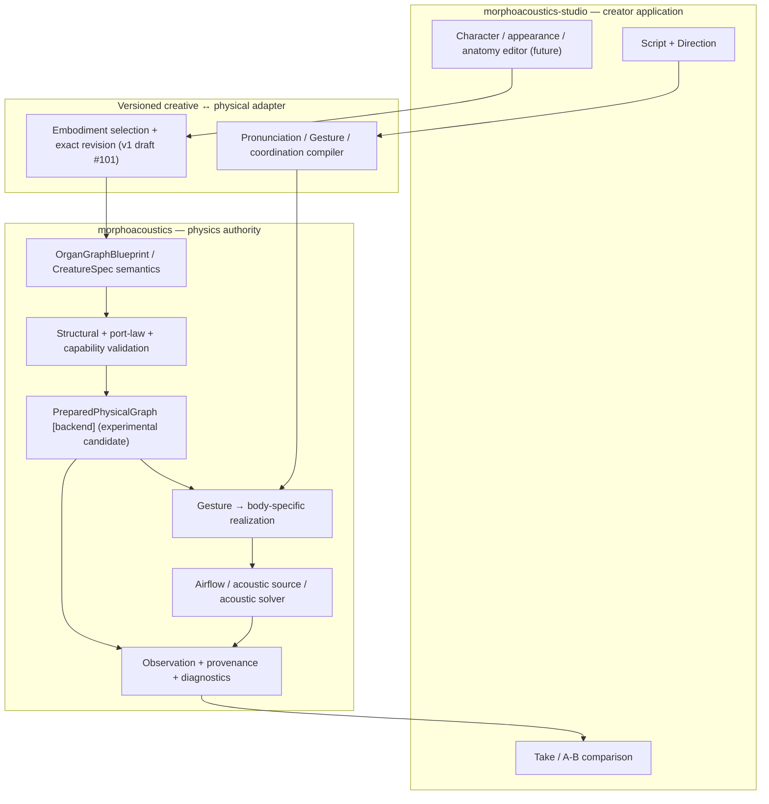
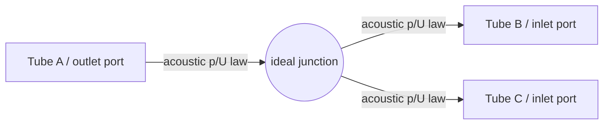

# Organ Graph Program — living architecture (proposal, 2026-10-14 JST)

**Status: LIVING ARCHITECTURE PROPOSAL. OG-2 RESEARCH ADOPTED LIMITED; public graph and creator UI NOT ADOPTED.** This document does not promote any experiment-local type or authorize public API/Studio changes. Related: [Core OG-2 #96](https://github.com/ryonakayama234/morphoacoustics/issues/96), [OG-2 audit #98](https://github.com/ryonakayama234/morphoacoustics/issues/98), [Studio Character Creator #12](https://github.com/ryonakayama234/morphoacoustics-studio/issues/12).

## Product boundary and causal diagram

The **Core decides physically valid dynamics**; the **Studio assembles and performs a body**. Creative identity, presentation mesh, physical body, performance intent, simulation state and observation are distinct.

**Current vs future:** Studio's current Performance Contract is v0 without creator-selected embodiment. `Body Binding v0` supports immutable prepared preset lookup, but creator selection requires a versioned contract revision (Core [CC-A1 #72](https://github.com/ryonakayama234/morphoacoustics/issues/72) → Studio [CC-A2 #14](https://github.com/ryonakayama234/morphoacoustics-studio/issues/14)). Current research OG-0/OG-1/OG-2 does *not* provide a public generic graph solver. A separate [v1 draft contract PR #101](https://github.com/ryonakayama234/morphoacoustics/pull/101) now prototypes exact body binding but does not make the Studio feature available.

## Node/edge diagram — one physical example

- **Node:** stable named organ/module, revision, geometry/material/actuator references and explicit **typed ports**. No requirement that all nodes are 3D.
- **Edge:** a connection between typed ports with orientation, unit semantics, boundary/coupling law ID, and version/provenance. A line in a visual editor does **not** guarantee a legal physical connection.
- **Physics:** for an ideal *zero-volume* junction of fixed rigid 1D small-signal acoustic ducts, perturbation pressure is continuous and signed **volume velocities** satisfy \(\sum U_\text{outward}=0\). Conjugate port power is \(pU\) (mean peak-phasor acoustic power: \(\tfrac12\operatorname{Re}(pU^*)\)). This is not a universal nonlinear-flow/FSI law.
- Later port families (not validated by OG-2) may include mechanical force/velocity, tissue contact, airflow/pressure, and actuation. Each family requires its *own* laws and cross-domain coupling; reject a connection that lacks a model.
- Keep **semantic topology**, **numerical prepared topology**, **physical state**, and **UI graph layout** separate. Never store computed pressure/flow as persistent anatomy.

## Delivery order — dependencies, not a single mega-feature

1. **WP-01 COMPLETE (2026-10-15 JST):** OG-0 [#93](https://github.com/ryonakayama234/morphoacoustics/issues/93), OG-1 [#94](https://github.com/ryonakayama234/morphoacoustics/issues/94) and OG-2 [#98 decision](https://github.com/ryonakayama234/morphoacoustics/issues/98#issuecomment-6182585021) each have distinct limited research decisions. [OG-2 PR #97](https://github.com/ryonakayama234/morphoacoustics/pull/97) was independently checked at integrated head `5711a3a` with [science CI](https://github.com/ryonakayama234/morphoacoustics/actions/runs/38667264999), [tests](https://github.com/ryonakayama234/morphoacoustics/actions/runs/38667265000), Wolfram and artifact hash, then **merged research-only** to main `2f325956a98b527f295821522ef844540e734cd8`. Post-merge push CI is tracked separately. Its public preparation API is **not** adopted.
2. **Next production-facing Gate:** if OG-2 research is accepted, propose a *minimal versioned graph preparation contract*, for fixed passive tubes and typed acoustic p/U connections only. Map to existing `CreatureSpec`, `PreparedMorphology[T]`, `BodyPresetRegistry` without breaking them. Separately review compatibility, deterministic canonical digest, failure types and no-hidden-fallback rules.
3. **First creator-visible Gate is independent:** Core [CC-A1 #72](https://github.com/ryonakayama234/morphoacoustics/issues/72) versioned exact body-preset request/result → Studio [CC-A2 #14](https://github.com/ryonakayama234/morphoacoustics-studio/issues/14) identical task across two validated body revisions and immutable Takes. Do not block Stage A on speculative general graphs.
4. **Following science slices:** validated passive branch→speech-relevant coupling, deformable articulator/material→geometry, source ↔ acoustic load, time-varying shared-state gestures, finally broader anatomy/Studio modular graph editor. Each new phenomenon requires its own falsification gate. Never label the existing fixed-1D research results as validated 3D physiology/FSI/phonation.

## Repository ownership

| Concern | Source of truth |
| --- | --- |
| Physical law / port interpretation / SI / capability / feasibility | Core |
| Graph preparation / backend numerical rest state / physical provenance | Core |
| Creative identity / script / direction / graph editing UX / undo | Studio |
| Versioned creative-to-physical exchange | Core contract, Studio version-pinned consumer |
| Scientific experiment and immutable evidence | Core experiment + scientific tests |
| Creator Take and comparison | Studio, carrying Core evidence references |

## Docs-as-tests workflow (required for each future capability change)

The **same PR** should update (1) architecture diagram + capability boundary, (2) candidate/adopted data model with backward compatibility and units, and (3) experiment ledger + raw reproducible evidence link. If a PR modifies a subsystem, these three views must be reviewed *together*; pure research PRs mark types as experiment-local.

- **Hypothesis first:** record H0/H1, supported fixture, frozen controls, predicted observables, explicit rejection and numerical floor **before implementation**. Amend errors transparently and never describe amended results as untouched preregistration.
- **Implement one falsifiable capability:** emit typed diagnostics `INVALID`, `UNSUPPORTED`, `INFEASIBLE` (only for supported task/body failure) and `NUMERICALLY_UNRESOLVED` when appropriate; keep execution `FAILED` separate.
- **Evaluate against distinct evidence paths:** independently derived Wolfram/analytic oracle, wrong-law mutation tests, local experiment tests, regression/typecheck, same exact-head multi-Python CI, artifact hashes and provenance. Disclose correlated AI reviews; they are not independent human signatures.
- **Decision:** `SUPPORTED_LIMITED` / `INCONCLUSIVE` / `REJECT` with precisely bounded scientific claim. Passing code/CI alone does not grant physical validity or public API adoption.
- **Archive:** link exact commit SHA, issue/PR, inputs, backend/version, preparation/graph digest, raw outputs, diagnostics, evaluation metrics, known limitations, amendment, decision, and any listening comparison. Existing historical Takes remain immutable.

See companion [data-model candidate](./organ-graph-data-candidate.md) and [experiment ledger](./organ-graph-experiment-ledger.md).

## Execution work orders

The concrete delegated implementation tasks, expected source/test paths, independent Wolfram criteria, acceptance gates and failure decisions are in [the four-work-package implementation plan](./organ-graph-execution-plan.md). Production graph API design is separately tracked as [Core OG-3 #100](https://github.com/ryonakayama234/morphoacoustics/issues/100) and may not start without OG-2 limited adoption. Creator-facing presets remain [Core CC-A1 #72](https://github.com/ryonakayama234/morphoacoustics/issues/72) → [Studio CC-A2 #14](https://github.com/ryonakayama234/morphoacoustics-studio/issues/14).
